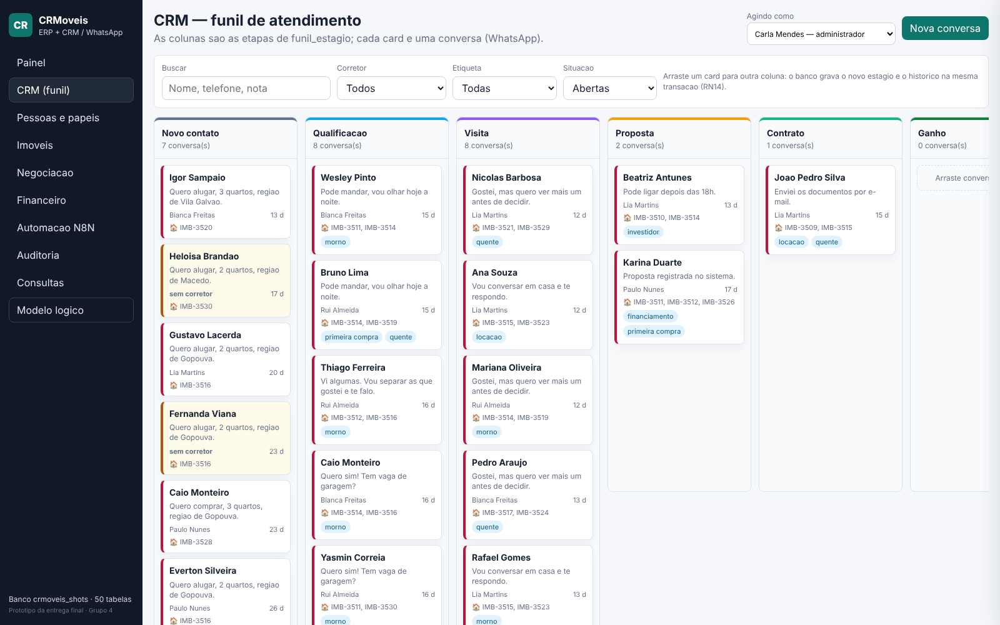
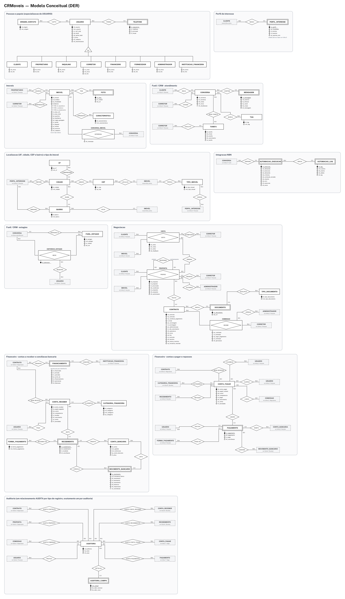
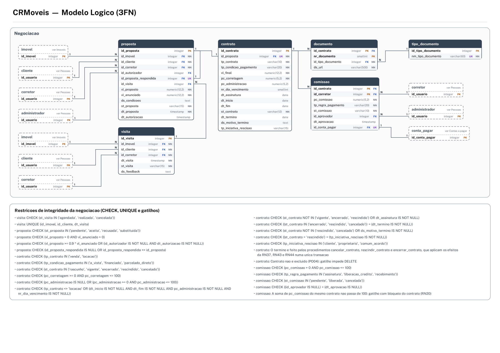

# CRMoveis — ERP para imobiliaria com CRM integrado ao WhatsApp

> Projeto Integrador — Modelagem de Dados · Prof. Clovis · Grupo 4 · **Entrega final**: modelo logico, normalizacao, banco de dados implementado e testado, massa de dados, consultas e prototipo.

**Comece por aqui:** este README explica o que foi construido e onde esta cada parte. Para ver tudo funcionando, rode `executar_tudo.bat` (cria o banco do zero e executa tudo) e depois `prototipo/INICIAR_PROTOTIPO.bat`.

## Sumario

1. [Identificacao do projeto](#1-identificacao-do-projeto)
2. [Integrantes](#2-integrantes)
3. [Empresa e problema](#3-empresa-e-problema)
4. [Solucao proposta](#4-solucao-proposta)
5. [Requisitos e regras de negocio](#5-requisitos-e-regras-de-negocio)
6. [DER atualizado](#6-der-atualizado)
7. [Modelo logico](#7-modelo-logico)
8. [Normalizacao](#8-normalizacao)
9. [Dicionario de dados](#9-dicionario-de-dados)
10. [Implementacao SQL](#10-implementacao-sql)
11. [Massa de dados](#11-massa-de-dados)
12. [Consultas gerenciais](#12-consultas-gerenciais)
13. [Consultas de auditoria](#13-consultas-de-auditoria)
14. [Potencial para BI e IA](#14-potencial-para-bi-e-ia)
15. [Historico e evolucao do projeto](#15-historico-e-evolucao-do-projeto)
16. [Conclusao](#16-conclusao)

[Estrutura do repositorio](#estrutura-do-repositorio) · [Como executar](#como-executar) · [Evidencias](#evidencias)

## 1. Identificacao do projeto

| Item | Descricao |
|---|---|
| Projeto | **CRMoveis** — sistema de gestao (ERP) para imobiliaria de venda e locacao, com CRM integrado ao WhatsApp e ao N8N |
| Disciplina | Projeto Integrador — Modelagem de Dados |
| Professor | Clovis |
| Equipe | Grupo 4 |
| Banco de dados | PostgreSQL 13 ou superior (testado no 16) |
| Ponto de partida | O app **SP Imoveis CRM** (Flask + SQLite), de um amigo da equipe e dono do app, que deu a ideia inicial do projeto e serviu de base para o prototipo |

## 2. Integrantes

| Integrante | RGM |
|---|---|
| Giovanni Correa Rodrigues (lider) | 46997741 |
| Julio Cesar Ferreira do Nascimento | 48915050 |
| Anderson da Silva | 49170694 |
| Fellipe da Eira Aguiar | 47521503 |
| Leonardo Vinicius de Farias | 46921613 |
| Guilherme Lucas Correa | 47520078 |
| Joao Vitor Candido Cassiano | 49218751 |
| Kayky Fernandes de Andrade | 47331801 |
| Gabriel Rocha da Silva | 47134313 |
| Davi Costa Ferraz | 47892153 |

Gustavo Amorim (RGM 47296445) participou da primeira entrega e saiu do grupo antes da entrega final.

## 3. Empresa e problema

Uma **imobiliaria de pequeno porte** de Sao Paulo, Guarulhos e Aruja, que intermedeia vendas e locacoes e administra alugueis (cobra o inquilino e repassa ao proprietario).

Hoje o primeiro contato acontece no WhatsApp pessoal de cada corretor; os imoveis ficam no Imobzi; visitas, propostas, comissoes e contas ficam em planilhas. O app SP Imoveis CRM ja organizava as conversas num funil, mas guardava tudo em cinco tabelas, com papel, corretor e imoveis de interesse em texto livre. Os principais problemas:

- historico perdido quando o corretor sai, e o mesmo cliente cadastrado varias vezes;
- a mesma pessoa tratada como duas (proprietario que tambem quer comprar) e numeros de telefone compartilhados;
- visitas e propostas sem ligacao com o cliente e o imovel, e nenhuma visao do funil;
- comissoes calculadas a mao, financiamento acompanhado por fora e repasse do aluguel controlado manualmente, inclusive quando o inquilino paga em partes;
- lancamentos nao conferidos com o extrato do banco, e nenhum registro de quem alterou contratos e valores.

A descricao completa da empresa, dos 15 problemas e dos 6 processos de negocio esta no [historico da primeira entrega](docs/historico/README-primeira-entrega-e-devolutiva.md#2-caracterizacao-da-empresa).

## 4. Solucao proposta

O **CRMoveis** junta num so banco de dados o que hoje esta espalhado:

| Modulo | O que resolve | Tabelas principais |
|---|---|---|
| Pessoas e papeis | Cadastro unico; a mesma pessoa pode ser cliente, proprietaria e inquilina ao mesmo tempo | usuario + 8 subtipos, telefone, origem_contato |
| CRM / funil | Conversas do WhatsApp em etapas, com historico, mensagens, tarefas e etiquetas | conversa, funil_estagio, historico_estagio, mensagem, tarefa, tag |
| Imoveis | Catalogo integrado ao Imobzi, com tipo, fotos, caracteristicas e endereco pelo CEP; busca e cadastro de imoveis; perfil do cliente com varios tipos | imovel, tipo_imovel, foto, caracteristica, cep, cidade, perfil_interesse, perfil_interesse_tipo |
| Negociacao | Visitas, propostas e contrapropostas, contratos, comissoes e financiamento | visita, proposta, contrato, comissao, financiamento, documento |
| Financeiro | Contas a receber e a pagar, baixas parciais, repasse automatico e conciliacao com o extrato | conta_receber, recebimento, conta_pagar, pagamento, categoria_financeira, forma_pagamento, movimento_bancario |
| Automacao e auditoria | Execucoes do N8N sem repeticao e trilha de quem alterou o que | automacao_execucao, automacao_log, auditoria, auditoria_campo |

As regras de negocio que envolvem mais de um registro (soma das comissoes, repasse a cada recebimento, quem pode pagar, conciliacao, auditoria) sao garantidas **pelo proprio banco**, com restricoes, gatilhos e procedimentos — nao dependem de quem programa a aplicacao.

**Prototipo.** Para analisar o modelo logico de perto, adaptamos o app SP Imoveis CRM ao nosso banco: o mesmo layout, o funil em colunas e a API do N8N, agora gravando nas 50 tabelas. Quando uma acao viola uma regra, o prototipo mostra a mensagem do banco. Veja [`prototipo/README.md`](prototipo/README.md).



## 5. Requisitos e regras de negocio

| Item | Quantidade | Onde esta |
|---|---|---|
| Requisitos funcionais | 37 | [`docs/requisitos/`](docs/requisitos/CRMoveis-requisitos-e-regras.md) |
| Requisitos nao funcionais | 13 | idem |
| Regras de negocio | 53 | idem |
| Politicas organizacionais | 7 | idem |
| Fluxogramas dos processos | 6 | [`docs/diagramas/fluxogramas/`](docs/diagramas/fluxogramas/) |

Cada regra aponta para o que a garante no modelo: uma cardinalidade, um atributo, uma restricao ou um gatilho ([secao 7 do modelo logico](docs/modelo-logico/README.md#7-restricoes-e-integridade-referencial-etapa-12)).

## 6. DER atualizado

Modelo conceitual em notacao de Chen: **46 entidades** (21 fortes, 12 fracas, 5 associativas e 8 subtipos da especializacao de USUARIO) e **70 relacionamentos**, em oito folhas A3 sem linhas cruzadas. E o DER revisado apos a devolutiva e de novo na revisao final, antes da apresentacao: tipo de imovel como entidade, perfil com varios tipos (DESEJA), telefone como entidade fraca da pessoa, origem do contato e forma de pagamento como entidades e, por ultimo, UF, bairro (com o perfil aceitando varios bairros: ABRANGE) e tipo de documento como entidades.



Folhas: [1](docs/diagramas/der/folha-1.png) · [2](docs/diagramas/der/folha-2.png) · [3](docs/diagramas/der/folha-3.png) · [4](docs/diagramas/der/folha-4.png) · [5](docs/diagramas/der/folha-5.png) · [6](docs/diagramas/der/folha-6.png) · [7](docs/diagramas/der/folha-7.png) · [8](docs/diagramas/der/folha-8.png). Legenda, cardinalidades e justificativas: [historico da primeira entrega, secoes 11 a 17](docs/historico/README-primeira-entrega-e-devolutiva.md#16-der).

## 7. Modelo logico

O DER foi convertido seguindo o manual: **ENTIDADE → TABELA → ATRIBUTOS → PK → FK → RESTRICOES**. Resultado: **50 tabelas**, 285 colunas, 87 chaves estrangeiras, 64 CHECKs e 49 gatilhos, todas na 3FN.

| Decisao | Como ficou | Por que |
|---|---|---|
| Chaves primarias | 21 substitutas (IDENTITY), 2 natural (CEP), 18 compostas, 9 herdadas | Cada tabela tem a justificativa “por que esta e uma boa chave”; os atributos naturais viram UNIQUE (chaves candidatas) |
| Relacionamentos 1:N e 1:1 | FK no lado N; NOT NULL quando a participacao minima e 1; UNIQUE no 1:1 | A cardinalidade do DER vira restricao no banco |
| Relacionamentos N:N | 9 tabelas: 5 associativas (com atributos proprios) e 4 de ligacao | Nenhum N:N fica direto no modelo fisico |
| Listas de dominio | Tabela quando a lista cresce ou e usada por mais de uma tabela (tipo de imovel, origem do contato, forma de pagamento, UF, bairro, tipo de documento); CHECK quando uma regra depende de cada valor (situacoes, papeis) | Analise dos temas do CRM na revisao final ([secao 8 do modelo logico](docs/modelo-logico/README.md#8-listas-de-dominio-check-ou-tabela-revisao-final)) |
| Especializacao de USUARIO | 8 tabelas-subtipo com PK = FK | A pessoa tem varios papeis, e cada FK exige o papel certo |
| Integridade referencial | 64 FKs com RESTRICT, 21 com CASCADE, 2 com SET NULL | Historico nunca perde a referencia; dependentes saem com o dono; participacao opcional fica nula |



Documento completo, etapa por etapa (revisao e tabela de alteracoes, conversao, PK, FK, N:N, entidades fracas, restricoes): **[`docs/modelo-logico/README.md`](docs/modelo-logico/README.md)**. Diagramas: [`logico-1` a `logico-5`](docs/modelo-logico/) e [`logico-A3.pdf`](docs/modelo-logico/logico-A3.pdf); para o dbdiagram.io: [`crmoveis.dbml`](docs/modelo-logico/crmoveis.dbml).

## 8. Normalizacao

O manual pede para mostrar o processo, e nao so dizer que o banco esta na 3FN — e para **nao inventar erros**. Todos os casos documentados aconteceram de verdade, no app original ou nas nossas entregas anteriores:

| Caso | Forma normal | O que era | Como ficou |
|---|---|---|---|
| 1.1 | 1FN | `property_codes`: varios codigos de imovel num campo (app original) | conversa_imovel, uma linha por imovel |
| 1.2 | 1FN | Papeis da pessoa num atributo multivalorado | 8 subtipos de usuario |
| 1.3 | 1FN | Campos alterados da auditoria num texto | auditoria_campo |
| 1.4 | 1FN | Endereco como atributo composto | colunas atomicas |
| 1.5 | 1FN | Perfil com um tipo de imovel so (varios tipos exigiriam uma lista no campo) | tipo_imovel + perfil_interesse_tipo |
| 2.1 | 2FN | Telefone com o numero na chave: o tipo dependeria so de parte dela | telefone como entidade fraca da pessoa (id_usuario, nr_sequencia) |
| 3.1 | 3FN | Nome e telefone do cliente dentro da conversa (app original) | usuario, conversa com FKs |
| 3.2 | 3FN | Cidade e UF dependentes do CEP | cidade, cep |
| 3.3 | 3FN | Conta a receber ligada ao financiamento do mesmo contrato (LIBERA) | LIBERA removido |
| 3.4 | 3FN | Atributos derivados (corretagem, comissao, situacao) | calculados em visoes |
| 3.5 | 3FN | Tipo do lancamento dependente da categoria financeira | so a categoria, com codigo fixo |

Cada caso esta no formato **ANTES → DEPENDENCIAS → PROBLEMA → DEPOIS**, com os dados da massa: **[`docs/normalizacao/normalizacao.md`](docs/normalizacao/normalizacao.md)**.

## 9. Dicionario de dados

O dicionario e **gerado do catalogo do banco instalado**: tipo, tamanho, nulos, padrao e restricoes vem do PostgreSQL, e as descricoes vem dos comentarios (`COMMENT ON`) criados pelo script. Assim ele nao fica diferente do que foi implementado. Tem as colunas sugeridas pelo manual (Tabela, Atributo, Descricao, Tipo, Tamanho, PK, FK, NULL, UNIQUE, DEFAULT, Regra) para as 285 colunas: **[`docs/dicionario-dados/dicionario-de-dados.md`](docs/dicionario-dados/dicionario-de-dados.md)**.

## 10. Implementacao SQL

Scripts separados por etapa, na ordem de execucao. O `executar_tudo` roda todos a partir de um banco vazio (Etapa 15).

| Arquivo | Conteudo |
|---|---|
| `sql/00_criar_banco.sql` | DROP e CREATE DATABASE |
| `sql/ddl/01_tabelas.sql` | 50 tabelas com PRIMARY KEY, NOT NULL, UNIQUE, DEFAULT e CHECK |
| `sql/ddl/02_chaves_estrangeiras.sql` | 87 FOREIGN KEY, cada uma com o relacionamento do DER e a politica ON DELETE |
| `sql/ddl/03_indices.sql` | Indices unicos parciais (RN03) e os indices das chaves estrangeiras |
| `sql/ddl/04_regras_gatilhos_procedimentos.sql` | Gatilhos e procedimentos das regras que envolvem mais de um registro |
| `sql/ddl/05_visoes.sql` | Visoes dos atributos derivados |
| `sql/ddl/06_comentarios.sql` | Descricao de cada tabela e coluna (o dicionario dentro do banco) |
| `sql/dados/07_dados_de_referencia.sql` | Listas de dominio (tipos de imovel, origens de contato, formas de pagamento), categorias financeiras e etapas do funil |
| `sql/dados/10_massa_de_dados.sql` | Massa de dados (INSERT INTO) |
| `sql/consultas/20_select_join_update_delete.sql` | SELECT, JOIN, UPDATE e DELETE, inclusive CASCADE, SET NULL e operacoes recusadas |
| `sql/consultas/21_consultas_gerenciais.sql` | 15 consultas gerenciais |
| `sql/auditoria/30_consultas_auditoria.sql` | 13 consultas de auditoria |
| `sql/testes/40_testes_regras.sql` | 61 cenarios de teste das regras, num banco separado |

**Testado do banco vazio ate os resultados:** todos os scripts executam sem erro e os 61 testes passam ([`evidencias/execucao/`](evidencias/execucao/)).

## 11. Massa de dados

Oito meses de operacao ficticia (marco a outubro de 2026): **2553 linhas** em 50 tabelas, nenhuma vazia — 55 pessoas, 30 imoveis, 45 conversas, 353 mensagens, 31 visitas, 16 propostas, 9 contratos, 45 contas a receber e 84 lancamentos de extrato.

Ela cobre de proposito as situacoes das regras: pessoa com varios papeis, telefone compartilhado, perfis com um, varios ou nenhum tipo de imovel, corretor que saiu, cliente anonimizado, contratos em todas as situacoes (rascunho, vigente, encerrado, rescindido com multa, cancelado por financiamento reprovado), aluguel pago em dia, atrasado e em partes, repasses, conciliacao com divergencias. Detalhes, volume por tabela e coerencia: [`sql/dados/README.md`](sql/dados/README.md).

**Uso de IA (Etapa 17):** a massa e os scripts foram gerados com ajuda do Claude (Anthropic), a partir dos nossos requisitos. Os pedidos feitos, a especificacao seguida, o que os testes encontraram e foi corrigido, e o checklist de validacao do grupo estao em [`docs/uso-de-ia/uso-de-ia.md`](docs/uso-de-ia/uso-de-ia.md).

## 12. Consultas gerenciais

Cada consulta comeca pela pergunta do gestor (**DADO → INFORMACAO → DECISAO**):

| # | Pergunta do negocio |
|---|---|
| G01 | Quantas conversas chegaram a cada etapa do funil e quanto se perde de uma etapa para a outra? |
| G02 | De onde vem os clientes que fecham negocio? |
| G03 | Quanto cada corretor atende, visita, propoe e fecha, e quanto ja tem de comissao liberada? |
| G04 | Quanto a imobiliaria faturou por mes, separando corretagem, taxa de administracao e multas? |
| G05 | Quais alugueis estao em atraso, de quem e ha quantos dias? |
| G06 | Quais repasses estao para vencer ou atrasados? |
| G07 | Quais imoveis despertam mais interesse, visitas e propostas? |
| G08 | Quais imoveis disponiveis nao recebem visita ha mais de 60 dias? |
| G09 | Onde ha mais clientes procurando do que imoveis disponiveis? |
| G10 | Quanto tempo leva, em media, do primeiro contato ate a assinatura? |
| G11 | Qual e o desconto medio pedido e quantas propostas precisaram de autorizacao? |
| G12 | Quanto de aluguel e de taxa de administracao esta previsto para os proximos tres meses? |
| G13 | Quanto tempo cada corretor leva para responder o primeiro contato no WhatsApp? |
| G14 | Quantas demandas a automacao recebeu, enviou e em quantas falhou? |
| G15 | Quais tipos de imovel os clientes procuram, comparados com os imoveis disponiveis de cada tipo? |

Resultados, decisoes e SQL: [`sql/consultas/README.md`](sql/consultas/README.md).

## 13. Consultas de auditoria

Procuram o que merece verificacao e que o banco nao consegue impedir na gravacao (depende do tempo, do extrato que chega depois ou de uma decisao humana):

| # | O que verifica |
|---|---|
| A01 | Movimentos do extrato bancario que nao tem baixa ligada (pendentes) ou cuja soma das baixas nao chega ao valor (parciais). |
| A02 | Recebimentos e pagamentos registrados ha mais de 3 dias, em periodo com extrato importado, que ainda nao foram conferidos com o extrato. |
| A03 | Repasses ao proprietario vencidos e nao pagos (o prazo e de 5 dias uteis, PO05). |
| A04 | Comissoes liberadas sem a conta a pagar ao corretor (RN25) e contas a pagar de comissao que nao estao ligadas a nenhuma comissao. |
| A05 | Propostas aceitas sem contrato ha mais de 7 dias e contratos ainda em rascunho mais de 3 dias depois do aceite da proposta. |
| A06 | Conversas abertas sem corretor ou sem nenhuma mensagem nos ultimos 7 dias. |
| A07 | Tarefas pendentes com prazo vencido, por corretor. |
| A08 | Imoveis disponiveis sem corretor responsavel, com menos de 3 fotos ou sem nenhuma caracteristica. |
| A09 | Numeros que estao no cadastro de mais de uma pessoa, com o titular de cada um (RN03). Celular ou fixo se deduz do numero. |
| A10 | Pessoas com papel encerrado (data de fim) que ainda aparecem como corretor de conversa aberta ou de imovel disponivel, ou como inquilino de locacao vigente. |
| A11 | Conversas cujo estagio atual e diferente do ultimo registro do historico (redundancia controlada, RN14). |
| A12 | Alteracoes e cancelamentos feitos em contratos e comissoes, com quem fez e o que mudou (RN40). |
| A13 | Contas canceladas que receberam baixa, contas com baixas acima do valor e contratos encerrados ou rescindidos com contas de periodo futuro em aberto. |

Resultados e o que fazer com cada um: [`sql/auditoria/README.md`](sql/auditoria/README.md).

## 14. Potencial para BI e IA

No caminho **PROBLEMA → DADOS → ANALISE → BENEFICIO**, com dados que ja existem no modelo:

| Ideia | Problema | Dados | Beneficio |
|---|---|---|---|
| Painel comercial (BI) | Nao se sabe em que etapa os clientes desistem | conversa, historico_estagio, origem, corretor | Atacar a etapa com mais perda e investir nos canais que fecham |
| Painel financeiro (BI) | Atrasos e divergencias descobertos tarde | contas, baixas, extrato | Cobranca antes do atraso e repasse sempre no prazo |
| Pontuacao de leads (IA) | Conversas atendidas por ordem de chegada | historico de conversas ganhas e perdidas | Corretor prioriza quem tem mais chance de fechar |
| Previsao de inadimplencia (IA) | Atraso so percebido depois do vencimento | historico de recebimentos por inquilino | Contato preventivo e previsao de caixa realista |

Indicadores, metricas e cuidados (LGPD, qualidade, vies): [`docs/bi-ia/bi-e-ia.md`](docs/bi-ia/bi-e-ia.md).

## 15. Historico e evolucao do projeto

| Etapa | O que foi feito |
|---|---|
| Origem | App SP Imoveis CRM: funil de conversas do WhatsApp, seletor de imoveis e integracao com o N8N, em 5 tabelas SQLite |
| Primeira entrega | Empresa, problemas, processos, requisitos, regras e o DER conceitual |
| Normalizacao (aula 8) | Modelo logico na 3FN: CEP e cidade, auditoria campo a campo, endereco atomico, LIBERA removido |
| Devolutiva | Sete correcoes: papeis como especializacao, telefone compartilhado, repasse por recebimento, tres formas de termino, conciliacao bancaria, auditoria por FK e soma das comissoes |
| Entrega final | Modelo logico documentado etapa por etapa, integridade referencial explicita, scripts separados e testados do zero, massa de dados, consultas e prototipo |
| Revisao final | Depois da conversa com o professor: tipo de imovel como tabela, perfil com varios tipos, telefone como entidade fraca da pessoa, origem do contato e forma de pagamento como tabelas, correcao de 3FN na categoria financeira, busca e cadastro de imoveis no prototipo e todo o projeto sem acentos. Por ultimo, a revisao de todos os atributos de texto pelos criterios da literatura: UF, bairro e tipo de documento viraram tabelas, o perfil passou a aceitar varios bairros e a aba Dados do modelo logico no prototipo ganhou a busca (na tabela imovel, por tipo, finalidade, cidade, bairro, quartos e valor) |

O que mudou em cada decisao de modelagem (como era, como ficou e por que): [tabela de alteracoes](docs/modelo-logico/README.md#11-principais-alteracoes-de-modelagem-etapa-2). O README completo da etapa anterior esta guardado em [`docs/historico/`](docs/historico/README-primeira-entrega-e-devolutiva.md).

## 16. Conclusao

A entrega final levou o CRMoveis do modelo conceitual a um banco de dados que funciona. O DER virou 50 tabelas na 3FN, cada chave e cada restricao tem a sua justificativa, e as regras que antes dependiam do cuidado de quem digita — a soma das comissoes, o repasse de cada pagamento do inquilino, quem pode pagar uma comissao, a conferencia com o extrato, o registro de quem alterou o que — agora sao garantidas pelo proprio PostgreSQL.

O banco foi testado do zero: os scripts criam tudo, a massa de dados entra respeitando todas as regras, as consultas respondem as perguntas do negocio e os testes confirmam que o banco aceita o que deve aceitar e recusa o que deve recusar. O prototipo, construido sobre o app que deu origem ao projeto, mostra o modelo logico em uso e permite ver de perto cada tabela, cada chave e cada regra.

**Fora do escopo:** copropriedade de imoveis, fiador e caucao, reajuste anual do aluguel, multa e juros por atraso, e o login de usuarios no prototipo.

## Como executar

1. Instale o **PostgreSQL** (13 ou superior). No Windows, rode **`executar_tudo.bat`** (pede a senha do usuario `postgres`). No Linux/macOS: `PGUSER=postgres PGPASSWORD=... ./executar_tudo.sh`.
2. Confira o resultado em `evidencias/execucao/` (o arquivo `06_testes_regras.txt` termina com todos os testes “OK”).
3. Para o prototipo: instale o **Python 3** e rode **`prototipo/INICIAR_PROTOTIPO.bat`**; ele abre http://127.0.0.1:5003.

Rodar `executar_tudo` de novo recria o banco do zero.

## Evidencias

| Pasta | Conteudo |
|---|---|
| `evidencias/execucao/` | Saida de cada script, do banco vazio aos testes |
| `evidencias/prototipo/` | Telas do prototipo, inclusive as recusas do banco, e o resultado dos testes da API (264 de 264 verificacoes OK) |
| [`docs/modelo-logico/README.md`](docs/modelo-logico/README.md) | Conferencia automatica DER ↔ modelo logico ↔ banco ↔ dicionario ↔ dados |

## Estrutura do repositorio

```
CRMoveis/
├── README.md                      # este arquivo
├── executar_tudo.bat / .ps1 / .sh  # banco vazio → scripts → dados → consultas → testes
├── docs/
│   ├── requisitos/                # requisitos, regras e politicas
│   ├── diagramas/der/             # DER em 8 folhas + visao geral
│   ├── diagramas/fluxogramas/     # 6 fluxogramas dos processos
│   ├── modelo-logico/             # documento do modelo logico, diagramas, DBML e Mermaid
│   ├── normalizacao/              # 1FN, 2FN e 3FN com casos reais
│   ├── dicionario-dados/          # dicionario gerado do banco
│   ├── bi-ia/                     # indicadores, BI e IA
│   ├── uso-de-ia/                 # prompts e validacao (Etapa 17)
│   └── historico/                 # README e PDF da etapa anterior
├── sql/
│   ├── 00_criar_banco.sql
│   ├── ddl/                       # 01 a 06: tabelas, FKs, indices, regras, visoes, comentarios
│   ├── dados/                     # 07 referencia, 10 massa, 11 contagem, gerador/
│   ├── consultas/                 # 20 SELECT/JOIN/UPDATE/DELETE, 21 gerenciais
│   ├── auditoria/                 # 30: as 13 consultas de auditoria
│   └── testes/                    # 40: os 61 testes das regras
├── prototipo/                     # app baseado no SP Imoveis CRM, sobre o nosso banco
├── evidencias/                    # saidas da execucao, telas e testes
└── apresentacao/                  # roteiro da apresentacao e da defesa
```
