# Projeto ERP — CRMoveis

> **Historico.** Este e o README da etapa anterior (primeira entrega, normalizacao da aula 8 e correcoes da devolutiva), guardado como estava, porque o manual pede que o repositorio mostre a evolucao do projeto. A versao atual do projeto esta no [README da raiz](../../README.md); o modelo logico da entrega final, em [`docs/modelo-logico/`](../modelo-logico/README.md).

> Sistema de gestao (ERP) para imobiliaria de venda e locacao de imoveis, com CRM integrado ao WhatsApp e ao N8N e modulos de negociacao e financeiro. Projeto Integrador de Modelagem de Dados: do problema real ao modelo conceitual, normalizado e revisado conforme a devolutiva do professor.

**Documento unico (PDF):** [`CRMoveis-documentacao-devolutiva.pdf`](CRMoveis-documentacao-devolutiva.pdf), com todo o conteudo deste README, o DER em A3, os fluxogramas, o modelo logico e os testes, na ordem do manual (secao 19.6).

## Sumario

- [1. Identificacao da equipe](#1-identificacao-da-equipe)
- [2. Caracterizacao da empresa](#2-caracterizacao-da-empresa)
- [3. Justificativa da escolha](#3-justificativa-da-escolha)
- [4. Problemas identificados](#4-problemas-identificados)
- [5. Processos de negocio](#5-processos-de-negocio)
- [6. Requisitos funcionais](#6-requisitos-funcionais)
- [7. Requisitos nao funcionais](#7-requisitos-nao-funcionais)
- [8. Regras de negocio](#8-regras-de-negocio)
- [9. Restricoes e politicas organizacionais](#9-restricoes-e-politicas-organizacionais)
- [10. Fluxogramas](#10-fluxogramas)
- [11. Entidades](#11-entidades)
- [12. Atributos](#12-atributos)
- [13. Relacionamentos](#13-relacionamentos)
- [14. Cardinalidades](#14-cardinalidades)
- [15. Dicionario de dados conceitual](#15-dicionario-de-dados-conceitual)
- [16. DER](#16-der)
- [17. Justificativas tecnicas](#17-justificativas-tecnicas)
- [18. Normalizacao (1FN, 2FN e 3FN)](#18-normalizacao-1fn-2fn-e-3fn)
- [19. Correcoes da devolutiva](#19-correcoes-da-devolutiva)
- [20. Conclusao](#20-conclusao)
- [Arquivos do repositorio](#arquivos-do-repositorio)

## 1. Identificacao da equipe

**Disciplina:** Projeto Integrador — Modelagem de Dados · **Professor:** Clovis

| Integrante | RGM |
|---|---|
| Gustavo Amorim | 47296445 |
| Giovanni Correa Rodrigues | 46997741 |
| Julio Cesar Ferreira do Nascimento | 48915050 |
| Anderson da Silva | 49170694 |
| Fellipe da Eira Aguiar | 47521503 |
| Leonardo Vinicius de Farias | 46921613 |
| Guilherme Lucas Correa | 47520078 |
| Joao Vitor Candido Cassiano | 49218751 |
| Kayky Fernandes de Andrade | 47331801 |
| Gabriel Rocha da Silva | 47134313 |
| Davi Costa Ferraz | 47892153 |

## 2. Caracterizacao da empresa

| Item | Descricao |
|---|---|
| **Nome** | Imobiliaria de pequeno porte, tratada no projeto como “a imobiliaria”; a solucao proposta pela equipe chama-se **CRMoveis** |
| **Segmento** | Imobiliaria de pequeno porte, com atuacao em venda e locacao de imoveis residenciais e comerciais |
| **O que oferece** | Intermediacao de venda, intermediacao de locacao e administracao de alugueis (cobranca do inquilino e repasse ao proprietario) |
| **Principais clientes** | Pessoas que querem comprar ou alugar um imovel, proprietarios que querem vender ou alugar, e inquilinos de imoveis administrados |
| **Principais setores** | Atendimento e vendas (corretores), captacao de imoveis, administracao de locacoes, financeiro e gestao |
| **Informacoes importantes** | Clientes e proprietarios, imoveis e suas caracteristicas, historico de atendimento, visitas, propostas, contratos, financiamentos, comissoes, contas a receber e contas a pagar |

**Como funciona hoje.** Hoje o primeiro contato do cliente acontece pelo WhatsApp de cada corretor. Os imoveis ficam cadastrados no IMOBIZI, mas visitas e propostas sao anotadas em planilhas ou no proprio celular. Quando uma venda ou locacao e fechada, a comissao e calculada a mao, o andamento do financiamento e acompanhado por fora e as contas a pagar e a receber ficam em uma planilha separada. Na locacao, o aluguel recebido e o repasse ao proprietario tambem sao controlados manualmente.

## 3. Justificativa da escolha

Escolhemos uma imobiliaria de venda e locacao porque o negocio reune processos bem definidos e interligados — atendimento de clientes, captacao de imoveis, visitas, propostas, contratos, financiamento e repasses mensais — que hoje ficam espalhados entre WhatsApp, planilhas e o sistema de anuncios. Isso gera clientes esquecidos, cadastros duplicados, comissoes calculadas a mao e pouca visao do que entra e sai do caixa, o que mostra uma necessidade real de integracao e torna o caso adequado a um sistema ERP. O caso tambem e adequado a modelagem de dados porque reune relacionamentos N:N com informacoes proprias (visita, proposta e comissao), entidades que dependem de outras (fotos, documentos, baixas financeiras) e um modulo financeiro com regras proprias.

| O manual pede que a empresa tenha… | No caso da imobiliaria |
|---|---|
| processos que possam ser analisados | Cinco processos principais, do primeiro contato ao repasse do aluguel (secao 5) |
| problemas de organizacao das informacoes | Treze problemas levantados, de cadastro duplicado a comissao calculada a mao (secao 4) |
| necessidade de integracao | Atendimento, imoveis, negociacao e financeiro dependem uns dos outros |
| possibilidade de aplicacao de um ERP | Um sistema unico cobre cadastro, funil, contratos e financeiro |

## 4. Problemas identificados

| Problema | Consequencia | Necessidade | Requisitos que respondem |
|---|---|---|---|
| Atendimento feito no WhatsApp pessoal de cada corretor | O historico se perde quando o corretor sai e o cliente pode ser atendido duas vezes | Centralizar conversas e mensagens por cliente | RF03, RF05, RF06, RF11, RF12 |
| O mesmo cliente cadastrado em planilha, no IMOBIZI e no celular | Duplicidade e dados desencontrados | Cadastro unico de pessoas | RF01, RF03, RF14 |
| Proprietario que tambem quer comprar e tratado como duas pessoas | Informacao duplicada e contatos errados | Uma pessoa com varios papeis, aceita em cada operacao so no papel que exerce | RF02 |
| Um mesmo numero de telefone usado por mais de uma pessoa (um casal, os socios de uma empresa) | O numero e cadastrado duas vezes ou fica ligado a pessoa errada | Numero cadastrado uma vez, compartilhado, com um titular | RF03 |
| Visitas e propostas anotadas em papel ou planilha | Nao se sabe quantas visitas viram proposta; retrabalho | Registrar visitas e propostas ligadas ao cliente e ao imovel | RF18, RF19, RF32 |
| Nao existe visao do funil de vendas | Clientes esquecidos e sem acompanhamento | Funil com estagios e historico de mudancas | RF07–RF10, RF30 |
| Comissoes calculadas manualmente | Erros de valor e conflitos entre corretores | Comissao com percentual e regra de pagamento | RF22, RF28 |
| Financiamento acompanhado fora do sistema | Comissao paga antes de o banco liberar o credito | Registrar o financiamento e a data de liberacao | RF23, RF24 |
| Contas a pagar e a receber em planilha separada | Dificil saber quanto entra, quanto sai e quem deve pagar | Contas a receber e a pagar com responsavel e baixas | RF24–RF26, RF29, RF31 |
| Recebimentos e pagamentos nao sao conferidos com o extrato do banco | Diferencas entre o que foi lancado e o que entrou ou saiu da conta passam despercebidas | Conferir cada baixa com o extrato bancario | RF36 |
| Repasse do aluguel controlado a mao | Atraso no repasse ao proprietario, principalmente quando o inquilino paga em partes | Gerar todo mes o aluguel e, a cada recebimento, mesmo parcial, o repasse do valor recebido | RF25, RF27 |
| Relatorios montados manualmente | Demora e informacao desatualizada | Relatorios de funil e financeiros a partir dos dados | RF30–RF32 |
| Imoveis, fotos e documentos ficam no IMOBIZI ou em pastas, sem ligacao com proprietario, corretor e interessados | Dificil sugerir imovel compativel e saber quem responde por ele | Cadastro de imoveis integrado ao IMOBIZI e ligado a proprietario, corretor e conversas | RF04, RF13–RF17, RF21 |
| Fim de contrato sem controle (cancelamento, saida antecipada do inquilino ou fim do prazo): cobrancas e comissoes continuam abertas | Valores cobrados ou pagos indevidamente | Tratar cancelamento, rescisao e encerramento, cada um com seus efeitos sobre o imovel, as comissoes e os lancamentos | RF20, RF33 |
| Nao se sabe quem alterou contratos e valores, nem como atender pedidos de exclusao de dados | Conflitos sem rastro e risco de descumprir a LGPD | Registro de auditoria e anonimizacao de dados pessoais | RF34, RF35 |

## 5. Processos de negocio

### P1 — Atendimento de um novo contato pelo WhatsApp

| | |
|---|---|
| **Quem participa** | Cliente, automacao N8N e corretor |
| **O que inicia** | O cliente manda mensagem no WhatsApp da imobiliaria |
| **O que acontece** | O sistema identifica o cliente pelo telefone (ou o cadastra), abre ou retoma a conversa, registra a mensagem, interpreta a demanda, sugere imoveis compativeis ou cria uma tarefa para o corretor e posiciona a conversa no funil |
| **Informacao gerada** | Usuario, telefone, conversa, mensagens, execucao da automacao, interesse em imoveis, historico do funil e tarefa |
| **Resultado** | O contato fica registrado, atendido e posicionado no funil |
| **Fluxograma** | [F1](#f1--atendimento-de-um-novo-contato-pelo-whatsapp) |

### P2 — Captacao de imovel

| | |
|---|---|
| **Quem participa** | Proprietario e corretor |
| **O que inicia** | O proprietario procura a imobiliaria para vender ou alugar |
| **O que acontece** | O proprietario e cadastrado (ou tem o papel acrescentado), o imovel e registrado com endereco e CEP (a cidade e a UF vem do CEP), caracteristicas e fotos, a documentacao e conferida e um corretor responsavel e definido |
| **Informacao gerada** | Usuario com papel proprietario, imovel, CEP e cidade (quando ainda nao cadastrados), caracteristicas, fotos e tarefa de pendencia |
| **Resultado** | O imovel e publicado como disponivel |
| **Fluxograma** | [F2](#f2--captacao-de-imovel) |

### P3 — Visita e proposta

| | |
|---|---|
| **Quem participa** | Cliente, corretor e proprietario |
| **O que inicia** | O cliente pede para visitar um imovel |
| **O que acontece** | O sistema verifica se o imovel esta disponivel, agenda a visita, registra a realizacao e o feedback, registra a proposta e as contrapropostas ate o aceite |
| **Informacao gerada** | Visita, feedback, proposta e contraproposta |
| **Resultado** | Proposta aceita, pronta para virar contrato |
| **Fluxograma** | [F3](#f3--visita-e-proposta) |

### P4 — Venda: contrato, financiamento e comissao

| | |
|---|---|
| **Quem participa** | Comprador, proprietario (vendedor), corretor, banco e financeiro |
| **O que inicia** | Uma proposta de venda e aceita |
| **O que acontece** | O contrato e gerado como rascunho e passa a valer na assinatura; se houver financiamento, ele e registrado e acompanhado ate a liberacao do credito; a corretagem vira conta a receber; quando a condicao da regra de pagamento e atendida e o administrador aprova, a comissao e paga ao corretor; se o contrato for cancelado, registram-se data e motivo e as pendencias financeiras sao canceladas |
| **Informacao gerada** | Contrato, documentos, financiamento, conta a receber, recebimento, comissao, conta a pagar, pagamento, registro de auditoria e, se houver, cancelamento do contrato |
| **Resultado** | Imovel vendido, corretagem recebida e comissao paga (ou contrato cancelado e pendencias encerradas) |
| **Fluxograma** | [F4](#f4--venda-contrato-financiamento-e-comissao) |

### P5 — Locacao: ciclo mensal do aluguel

| | |
|---|---|
| **Quem participa** | Inquilino, proprietario e financeiro |
| **O que inicia** | Todo mes, enquanto o contrato de locacao estiver vigente |
| **O que acontece** | O sistema gera a conta a receber do aluguel, acompanha o pagamento do inquilino e registra cada recebimento, total ou parcial; a cada recebimento, retem a taxa de administracao proporcional, gera o repasse do valor recebido ao proprietario e o paga em ate 5 dias uteis. No fim do prazo o contrato e encerrado; se uma das partes sair antes, ele e rescindido |
| **Informacao gerada** | Conta a receber do aluguel, recebimentos, uma conta a pagar de repasse por recebimento, pagamentos e, no termino, a data e a forma de termino do contrato |
| **Resultado** | O proprietario recebe o repasse do que foi pago e a imobiliaria fica com a taxa de administracao; no termino, o contrato fica encerrado ou rescindido |
| **Fluxograma** | [F5](#f5--locacao-ciclo-mensal-do-aluguel) |

### P6 — Conciliacao bancaria

| | |
|---|---|
| **Quem participa** | Financeiro |
| **O que inicia** | O financeiro importa o extrato de uma conta bancaria (todo dia ou no fechamento do periodo) |
| **O que acontece** | O sistema registra cada movimento do extrato uma unica vez, procura para cada um os recebimentos ou pagamentos da mesma conta, na mesma direcao e com o mesmo valor, e os liga ao movimento; o que nao bate fica pendente para o financeiro analisar |
| **Informacao gerada** | Movimentos do extrato, ligacao entre cada movimento e as baixas que ele comprova e data da conciliacao |
| **Resultado** | Recebimentos e pagamentos conferidos com o banco e divergencias apontadas |
| **Fluxograma** | [F6](#f6--conciliacao-bancaria) |

## 6. Requisitos funcionais

O que o sistema deve fazer. A coluna *Fluxo* indica em qual fluxograma o requisito aparece; o traco (—) marca requisito transversal ou de consulta, que nao e etapa de nenhum fluxo.

### Pessoas

| Codigo | Requisito | Fluxo | Entidades |
|---|---|---|---|
| RF01 | O sistema devera cadastrar usuarios com nome, documento (CPF/CNPJ), e-mail e origem do contato. | F1, F2 | USUARIO |
| RF02 | O sistema devera permitir que um mesmo usuario exerca mais de um papel (cliente, proprietario, inquilino, corretor, financeiro, fornecedor, administrador ou instituicao financeira) e so aceitar a pessoa, em cada operacao, no papel que ela exerce. | F1, F2 | USUARIO e os subtipos CLIENTE, PROPRIETARIO, INQUILINO, CORRETOR, FINANCEIRO, FORNECEDOR, ADMINISTRADOR e INSTITUICAO_FINANCEIRA |
| RF03 | O sistema devera registrar os telefones de cada usuario, permitir que um mesmo numero seja compartilhado por mais de um usuario e identificar quem escreveu pelo titular do numero de WhatsApp. | F1 | TELEFONE, USUARIO_TELEFONE |
| RF04 | O sistema devera registrar os perfis de interesse do cliente: finalidade, tipo de imovel, cidade, bairro, faixa de valor e quartos. | F1 | PERFIL_INTERESSE, CIDADE, CLIENTE |

### Atendimento e funil

| Codigo | Requisito | Fluxo | Entidades |
|---|---|---|---|
| RF05 | O sistema devera receber as mensagens do WhatsApp, por meio do N8N, e registra-las na conversa do cliente. | F1 | CONVERSA, MENSAGEM |
| RF06 | O sistema devera abrir uma nova conversa ou retomar a conversa existente do cliente. | F1 | CONVERSA |
| RF07 | O sistema devera posicionar cada conversa em um estagio do funil de vendas e permitir move-la entre estagios. | F1 | FUNIL_ESTAGIO |
| RF08 | O sistema devera registrar cada mudanca de estagio, com data, hora e usuario responsavel. | F1 | HISTORICO_ESTAGIO |
| RF09 | O sistema devera permitir classificar conversas com etiquetas (tags). | — | TAG |
| RF10 | O sistema devera criar tarefas para os corretores, com prazo e situacao, ligadas ou nao a uma conversa. | F1, F2, F4 | TAREFA |
| RF11 | O sistema devera interpretar a demanda do cliente e sugerir automaticamente imoveis compativeis com o perfil de interesse. | F1 | AUTOMACAO_EXECUCAO, CONVERSA_IMOVEL |
| RF12 | O sistema devera registrar cada execucao da automacao e os eventos tecnicos de cada execucao. | F1 | AUTOMACAO_EXECUCAO, AUTOMACAO_LOG |

### Imoveis

| Codigo | Requisito | Fluxo | Entidades |
|---|---|---|---|
| RF13 | O sistema devera cadastrar imoveis com endereco, caracteristicas, finalidade (venda, locacao ou ambas), valores de venda e/ou de aluguel e situacao. | F2 | IMOVEL, CARACTERISTICA, CEP, CIDADE |
| RF14 | O sistema devera importar e atualizar os imoveis a partir do IMOBIZI. | F2 | IMOVEL, CEP |
| RF15 | O sistema devera anexar fotos aos imoveis, na ordem de exibicao. | F2 | FOTO |
| RF16 | O sistema devera registrar o proprietario e o corretor responsavel de cada imovel. | F2 | IMOVEL, PROPRIETARIO, CORRETOR |
| RF17 | O sistema devera registrar os imoveis de interesse de cada conversa. | F1 | CONVERSA_IMOVEL |

### Negociacao

| Codigo | Requisito | Fluxo | Entidades |
|---|---|---|---|
| RF18 | O sistema devera agendar, registrar a realizacao e cancelar visitas, guardando o feedback do cliente. | F3 | VISITA |
| RF19 | O sistema devera registrar propostas e contrapropostas, ligadas ou nao a uma visita, guardando o valor anunciado do imovel no momento da proposta e ligando cada contraproposta a proposta que ela responde. | F3 | PROPOSTA |
| RF20 | O sistema devera gerar o contrato de venda ou de locacao a partir de uma proposta aceita, com percentual de corretagem ou taxa de administracao. | F3, F4 | CONTRATO |
| RF21 | O sistema devera anexar documentos ao contrato. | F4 | DOCUMENTO |
| RF22 | O sistema devera registrar a comissao de cada corretor no contrato, com percentual sobre a corretagem, regra de pagamento e aprovacao do administrador. | F4 | COMISSAO, CORRETOR, ADMINISTRADOR |
| RF33 | O sistema devera cancelar, rescindir e encerrar contratos, registrando a data, o motivo e, na rescisao, quem pediu, e aplicar os efeitos de cada caso sobre o imovel, as comissoes e os lancamentos. | F4, F5 | CONTRATO, IMOVEL, COMISSAO, CONTA_RECEBER, CONTA_PAGAR |

### Financeiro

| Codigo | Requisito | Fluxo | Entidades |
|---|---|---|---|
| RF23 | O sistema devera registrar o financiamento do contrato: instituicao financeira, valor financiado, entrada, parcelas, taxa, aprovacao e liberacao do credito. | F4 | FINANCIAMENTO, INSTITUICAO_FINANCEIRA |
| RF24 | O sistema devera gerar contas a receber (corretagem, intermediacao, taxa de administracao, aluguel e servicos), indicando quem paga. | F4, F5 | CONTA_RECEBER |
| RF25 | O sistema devera gerar contas a pagar (comissao, repasse ao proprietario, despesas e impostos), indicando quem paga e quem recebe. | F4, F5 | CONTA_PAGAR |
| RF26 | O sistema devera registrar recebimentos e pagamentos, inclusive parciais, indicando a conta bancaria movimentada e, nos pagamentos, o usuario que os efetivou. | F4, F5 | RECEBIMENTO, PAGAMENTO, CONTA_BANCARIA |
| RF27 | O sistema devera gerar todo mes, nos contratos de locacao, a conta a receber do aluguel e, a cada recebimento do aluguel, inclusive parcial, a conta a pagar do repasse do valor recebido ao proprietario, descontada a taxa de administracao, com vencimento em ate 5 dias uteis. | F5 | CONTA_RECEBER, RECEBIMENTO, CONTA_PAGAR |
| RF28 | O sistema devera liberar a comissao para pagamento somente quando a condicao da regra de pagamento for atendida. | F4 | COMISSAO, CONTA_PAGAR |
| RF29 | O sistema devera classificar cada conta a receber e a pagar em uma categoria financeira. | F4, F5 | CATEGORIA_FINANCEIRA |
| RF36 | O sistema devera importar o extrato de cada conta bancaria e conciliar cada movimento com os recebimentos e pagamentos registrados, apontando o que ficou pendente ou divergente. | F6 | MOVIMENTO_BANCARIO, RECEBIMENTO, PAGAMENTO, CONTA_BANCARIA |

### Consultas e relatorios

| Codigo | Requisito | Fluxo | Entidades |
|---|---|---|---|
| RF30 | O sistema devera emitir relatorio de conversao do funil por estagio e por periodo. | — | HISTORICO_ESTAGIO |
| RF31 | O sistema devera emitir relatorio financeiro com valores a receber, recebidos, a pagar e pagos por periodo. | — | CONTA_RECEBER, CONTA_PAGAR |
| RF32 | O sistema devera permitir consultar o historico de atendimentos, visitas, propostas e contratos de um cliente. | — | CONVERSA, VISITA, PROPOSTA, CONTRATO |

### Auditoria e privacidade

| Codigo | Requisito | Fluxo | Entidades |
|---|---|---|---|
| RF34 | O sistema devera registrar quem criou, alterou ou cancelou contratos, propostas, comissoes e lancamentos financeiros, e quando, ligando cada registro ao contrato, proposta, comissao, conta, recebimento ou pagamento afetado e guardando os campos alterados. | — | AUDITORIA, AUDITORIA_CAMPO |
| RF35 | O sistema devera anonimizar os dados pessoais de um usuario a pedido do titular quando houver obrigacao de guarda dos registros (contratos e lancamentos financeiros), e excluir o cadastro quando nao houver. | — | USUARIO, TELEFONE, MENSAGEM |

## 7. Requisitos nao funcionais

Como o sistema deve funcionar. Os valores de tempo e disponibilidade sao metas propostas pela equipe.

| Codigo | Categoria | Requisito |
|---|---|---|
| RNF01 | Controle de acesso | O sistema devera controlar o acesso por perfil (administrador, corretor e financeiro), liberando a cada perfil apenas as funcoes e os dados de que ele precisa. |
| RNF02 | Seguranca | O sistema devera armazenar as senhas somente na forma de hash, nunca em texto. |
| RNF03 | Privacidade (LGPD) | O sistema devera tratar os dados pessoais (CPF/CNPJ, telefone e e-mail) conforme a LGPD, permitindo ao titular consultar, corrigir e solicitar a exclusao ou anonimizacao de seus dados (RF35, PO07). |
| RNF04 | Auditoria | Os registros de auditoria (RF34) deverao ser somente de inclusao: nenhum perfil podera altera-los ou exclui-los. |
| RNF05 | Tempo de resposta | O sistema devera enviar a resposta automatica ao cliente no WhatsApp em ate 10 segundos apos o recebimento da mensagem, em condicoes normais de uso. |
| RNF06 | Desempenho | As consultas de cadastro, funil e contas deverao ser apresentadas em ate 3 segundos, para uso no atendimento. |
| RNF07 | Disponibilidade | O sistema devera funcionar 24 horas por dia, com meta de 99% de disponibilidade mensal, porque o atendimento pelo WhatsApp acontece tambem fora do horario comercial. |
| RNF08 | Confiabilidade | O sistema nao devera processar a mesma demanda da automacao mais de uma vez. |
| RNF09 | Copia de seguranca | O banco de dados devera ter copia de seguranca diaria, guardada por pelo menos 30 dias. |
| RNF10 | Usabilidade | O sistema devera ser web e responsivo, utilizavel no celular pelos corretores durante visitas. |
| RNF11 | Integracao | A integracao com o WhatsApp e com o IMOBIZI devera ocorrer por meio do N8N, sem redigitacao manual dos dados. |
| RNF12 | Precisao financeira | Os valores financeiros deverao ser armazenados com duas casas decimais, sem arredondamentos intermediarios nos calculos de comissao e repasse. |
| RNF13 | Integridade transacional | As regras que envolvem mais de um registro (papel exigido em cada operacao, soma das comissoes, repasse a cada recebimento, termino do contrato, conciliacao e referencia da auditoria) deverao ser garantidas pelo proprio banco de dados, com chaves, restricoes, gatilhos (triggers) e transacoes, e nao so pela tela. |

## 8. Regras de negocio

O que pode ou nao pode acontecer. A ultima coluna mostra onde a regra aparece no DER. Nas cardinalidades, o par (min,max) escrito junto de uma entidade indica quantas vezes uma ocorrencia dela participa do relacionamento, isto e, com quantas ocorrencias da outra entidade ela se relaciona (convencao detalhada na [secao 14](#14-cardinalidades)).

### Pessoas

| Codigo | Regra | Onde aparece no modelo |
|---|---|---|
| RN01 | Toda pessoa registrada no CRM e um usuario e deve exercer pelo menos um papel. | Especializacao total (t) de USUARIO |
| RN02 | A mesma pessoa pode exercer varios papeis ao mesmo tempo, por exemplo ser cliente e proprietaria. Cada papel guarda a data em que a pessoa passou a exerce-lo e, se deixar de exercer, a data de fim; o papel nunca e apagado, para nao perder os registros ligados a ele. | Especializacao compartilhada (c) de USUARIO em CLIENTE, PROPRIETARIO, INQUILINO, CORRETOR, FINANCEIRO, FORNECEDOR, ADMINISTRADOR e INSTITUICAO_FINANCEIRA · dt_inicio, dt_fim |
| RN03 | Um mesmo numero de telefone pode ser compartilhado por varios usuarios (por exemplo, um casal ou os socios de uma empresa), mas e cadastrado uma unica vez e tem exatamente um titular entre os usuarios ligados a ele. E pelo titular do numero de WhatsApp que a automacao identifica quem enviou a mensagem. | USUARIO (0,n) — POSSUI (USUARIO_TELEFONE) — (1,n) TELEFONE · nr_telefone unico · um titular por telefone |
| RN04 | O documento (CPF/CNPJ) nao pode se repetir e e obrigatorio para proprietarios, para instituicoes financeiras e para quem assina contrato. | USUARIO.nr_cpf_cnpj unico |
| RN05 | Um cliente pode ter nenhum ou varios perfis de interesse. | CLIENTE (0,n) — BUSCA — (1,1) PERFIL_INTERESSE |
| RN32 | Cada relacionamento que exige um papel liga-se ao subtipo correspondente, e nao a USUARIO: PROPRIETARIO em ANUNCIA; CORRETOR em RESPONSAVEL, ATENDE, EXECUTA, ACOMPANHA, NEGOCIA e RECEBE; CLIENTE em BUSCA, INICIA, VISITA e PROPOE; ADMINISTRADOR em AUTORIZA e APROVA; INSTITUICAO_FINANCEIRA em CONCEDE. Assim, a ligacao so e aceita se a pessoa exercer aquele papel. Nos relacionamentos que aceitam mais de um papel (PAGA, CUSTEIA e EFETIVA), o papel fica num atributo e a pessoa precisa exerce-lo. Novos registros so aceitam papeis sem data de fim. | Relacionamentos com os subtipos de USUARIO · tp_papel_pagador, tp_papel_custeio |
| RN33 | O cliente passa a ser tambem INQUILINO quando o contrato de locacao e assinado e recebe a data de fim desse papel quando o contrato e encerrado ou rescindido; o banco passa a ser INSTITUICAO_FINANCEIRA quando concede um financiamento. | INQUILINO.dt_inicio, dt_fim · INSTITUICAO_FINANCEIRA |
| RN42 | O perfil de interesse pode indicar no maximo uma cidade, escolhida do cadastro de cidades, para que a comparacao com a cidade do imovel seja exata. | CIDADE (0,n) — PREFERE — (0,1) PERFIL_INTERESSE |

### Imoveis

| Codigo | Regra | Onde aparece no modelo |
|---|---|---|
| RN06 | Todo imovel tem exatamente um proprietario, e um proprietario pode ter varios imoveis. Imoveis com mais de um proprietario (copropriedade) ficam fora do escopo desta entrega. | PROPRIETARIO (0,n) — ANUNCIA — (1,1) IMOVEL |
| RN07 | Um imovel pode ter nenhum ou um corretor responsavel, e um corretor pode ser responsavel por varios imoveis. | CORRETOR (0,n) — RESPONSAVEL — (0,1) IMOVEL |
| RN08 | Um imovel pode ter varias caracteristicas, e uma caracteristica pode estar em varios imoveis. | IMOVEL (0,n) — APRESENTA — (0,n) CARACTERISTICA |
| RN09 | Uma foto so existe vinculada a um imovel. | FOTO · entidade fraca |
| RN10 | Imovel vendido, alugado ou inativo nao pode receber novas visitas nem propostas. | IMOVEL.st_imovel |
| RN41 | Todo imovel esta em exatamente um CEP, e todo CEP pertence a exatamente uma cidade. A cidade e a UF do imovel nao sao digitadas no imovel: sao obtidas pelo CEP. | CEP (0,n) — LOCALIZA — (1,1) IMOVEL · CIDADE (0,n) — AGRUPA — (1,1) CEP |

### Atendimento e funil

| Codigo | Regra | Onde aparece no modelo |
|---|---|---|
| RN11 | Toda conversa pertence a exatamente um cliente, e um cliente pode ter varias conversas. | CLIENTE (0,n) — INICIA — (1,1) CONVERSA |
| RN12 | A conversa pode ficar sem corretor no inicio do atendimento, mas nunca tera mais de um corretor responsavel. | CORRETOR (0,n) — ATENDE — (0,1) CONVERSA |
| RN13 | Toda conversa esta em exatamente um estagio do funil por vez. | CONVERSA (1,1) — PERTENCE A — (0,n) FUNIL_ESTAGIO |
| RN14 | Toda mudanca de estagio, inclusive o estagio inicial na abertura da conversa, deve gerar um registro no historico, com data e hora; o estagio atual da conversa e sempre o do registro mais recente. | HISTORICO_ESTAGIO · PERTENCE A = ultimo registro |
| RN15 | Toda tarefa tem um corretor responsavel e pode ou nao estar ligada a uma conversa. | CORRETOR (0,n) — EXECUTA — (1,1) TAREFA · CONVERSA (0,n) — GERA TAREFA — (0,1) TAREFA |
| RN34 | Uma conversa fica aberta ate ser encerrada pelo corretor ou por inatividade (prazo definido pela imobiliaria). A mensagem de um cliente que tem conversa aberta retoma essa conversa; se nao houver conversa aberta, o sistema abre uma nova. | CONVERSA.st_conversa |

### Negociacao

| Codigo | Regra | Onde aparece no modelo |
|---|---|---|
| RN16 | Uma visita envolve exatamente um cliente, um imovel e um corretor; o mesmo cliente pode visitar o mesmo imovel mais de uma vez, em datas diferentes. | VISITA · associativa entre CLIENTE e IMOVEL, com CORRETOR (ACOMPANHA) · unico (imovel, cliente, data e hora) |
| RN17 | Uma proposta pode ou nao ter origem em uma visita; quando tem, o cliente e o imovel da proposta sao os mesmos da visita. | VISITA (0,n) — ORIGINA — (0,1) PROPOSTA |
| RN18 | Uma proposta aceita gera no maximo um contrato, e todo contrato nasce de exatamente uma proposta. | PROPOSTA (0,1) — FECHA — (1,1) CONTRATO |
| RN19 | Todo contrato e de venda ou de locacao, e o contrato de locacao deve ter data de inicio, data de termino, taxa de administracao e dia de vencimento do aluguel. | CONTRATO.tp_contrato, dt_inicio, dt_fim, pc_administracao, nr_dia_vencimento |
| RN20 | A comissao de um contrato pode ser dividida entre varios corretores, e a soma dos percentuais nao pode passar de 100% da corretagem do contrato. As comissoes canceladas nao entram na soma. A soma e conferida pelo banco a cada gravacao, com o contrato bloqueado, e a gravacao que passar de 100% e recusada. | CONTRATO (0,n) — RECEBE (COMISSAO) — (0,n) CORRETOR · gatilho de soma (17.30, secao 19) |
| RN21 | O valor da comissao e o percentual do corretor aplicado sobre a corretagem do contrato (valor final × percentual de corretagem), e nao sobre o valor do imovel. | COMISSAO.vl_comissao · derivado de CONTRATO.vl_corretagem |
| RN35 | Uma contraproposta e uma nova proposta ligada a proposta que ela responde. Cada proposta recebe no maximo uma contraproposta, e a proposta respondida passa a situacao “substituida”. | PROPOSTA (0,1) — RESPONDE — (0,1) PROPOSTA · recursivo |
| RN36 | O contrato nasce como rascunho e so e considerado assinado quando a data de assinatura e registrada. Somente contratos assinados geram comissoes, contas a receber e contas a pagar. | CONTRATO.st_contrato, dt_assinatura |
| RN37 | Cancelar e desfazer o contrato antes de ele produzir efeitos (por exemplo, um rascunho de que se desistiu ou uma venda cujo financiamento foi negado). Registram-se a data e o motivo; as contas a receber e a pagar sem nenhuma baixa e as comissoes ainda nao pagas sao canceladas; os valores ja recebidos ou pagos sao mantidos, e qualquer devolucao e feita por um novo lancamento; o imovel volta a situacao “disponivel”. | CONTRATO.st_contrato = cancelado, dt_termino, ds_motivo_termino · CONTA_*.fl_cancelada · COMISSAO.st_comissao |
| RN43 | Rescindir e terminar antes do prazo um contrato vigente, por pedido de uma das partes ou de comum acordo (por exemplo, o inquilino que sai antes do fim da locacao). Registram-se a data, o motivo e quem pediu; o sistema deixa de gerar alugueis a partir da data da rescisao e cancela as contas de periodos futuros; as contas ja vencidas continuam devidas; os repasses de valores ja recebidos continuam devidos; se o contrato preve multa rescisoria, ela e lancada como conta a receber; as comissoes ja liberadas sao mantidas e as pendentes sao canceladas; o imovel volta a “disponivel” e o papel de inquilino recebe a data de fim. | CONTRATO.st_contrato = rescindido, dt_termino, ds_motivo_termino, tp_iniciativa_rescisao |
| RN44 | Encerrar e o termino normal do contrato: na locacao, ao chegar a data de termino sem renovacao; na venda, quando todas as contas do contrato estao quitadas. Nenhum lancamento e cancelado; na locacao, o imovel volta a “disponivel” e o papel de inquilino recebe a data de fim; na venda, o imovel fica “vendido”. | CONTRATO.st_contrato = encerrado, dt_termino |

### Financeiro

| Codigo | Regra | Onde aparece no modelo |
|---|---|---|
| RN22 | Um contrato pode ter no maximo um financiamento. O financiamento so existe quando a forma de pagamento do contrato e “financiado”, e todo contrato “financiado” tem financiamento. | CONTRATO (0,1) — FINANCIA — (1,1) FINANCIAMENTO · CONTRATO.tp_forma_pagamento |
| RN23 | Na venda financiada, a corretagem so e considerada recebida depois que o banco libera o credito: nenhum recebimento da corretagem pode ter data anterior a liberacao do financiamento do mesmo contrato. | FINANCIAMENTO.dt_liberacao · RECEBIMENTO.dt_recebimento · CONTRATO (0,1) — FINANCIA — (1,1) FINANCIAMENTO |
| RN24 | A comissao so e liberada para pagamento quando a condicao da regra de pagamento e atendida: na assinatura, na liberacao do credito ou no recebimento. | COMISSAO.tp_regra_pagamento |
| RN25 | Cada comissao liberada gera no maximo uma conta a pagar ao corretor. | COMISSAO (0,1) — LANCA — (0,1) CONTA_PAGAR |
| RN26 | Toda conta a receber e toda conta a pagar deve ter uma categoria financeira do tipo compativel (receita para a conta a receber, despesa para a conta a pagar). | CATEGORIA_FINANCEIRA (0,n) — CLASSIFICA e CATEGORIZA — (1,1) CONTA_RECEBER e CONTA_PAGAR |
| RN27 | Toda conta a receber tem um pagador, que e um usuario: cliente, inquilino, proprietario ou banco. Quando o pagador e o banco, a conta deve pertencer a um contrato financiado, e o banco deve ser a instituicao financeira que concedeu esse financiamento; o financiamento e encontrado pelo proprio contrato. O pagador precisa exercer o papel indicado na conta (RN32). | USUARIO (0,n) — PAGA — (1,1) CONTA_RECEBER · CONTA_RECEBER.tp_papel_pagador · INSTITUICAO_FINANCEIRA (0,n) — CONCEDE — (1,1) FINANCIAMENTO |
| RN28 | Toda conta a pagar e paga pela imobiliaria ao favorecido; o atributo de custeio indica quem arca com o valor final: a imobiliaria, o proprietario (descontado do repasse) ou o inquilino (cobrado no aluguel). Quando nao for a imobiliaria, a pessoa que arca com o custo deve ser informada e precisa exercer o papel indicado (RN32). | CONTA_PAGAR.tp_papel_custeio · USUARIO (0,n) — CUSTEIA — (0,1) CONTA_PAGAR |
| RN29 | Uma conta pode ser quitada em varios recebimentos ou pagamentos parciais, sem que a soma passe do valor da conta, e cada baixa deve indicar a conta bancaria movimentada. | CONTA (0,n) — QUITA e LIQUIDA — (1,1) baixa · CONTA_BANCARIA (0,n) — CREDITA e DEBITA — (1,1) baixa |
| RN30 | Na locacao, cada recebimento do aluguel, inclusive parcial, gera uma conta a pagar de repasse ao proprietario com o valor recebido menos a taxa de administracao proporcional. Enquanto nada e recebido, nao ha repasse; o saldo continua na conta a receber do inquilino, e cada novo recebimento gera um novo repasse. O prazo de pagamento de cada repasse e o da PO05, contado do recebimento que o originou. | RECEBIMENTO (0,1) — REPASSA — (0,1) CONTA_PAGAR · CONTRATO.pc_administracao |
| RN38 | A situacao de uma conta (prevista, parcial, quitada ou atrasada) e calculada a partir do valor, das baixas e do vencimento; somente o cancelamento e registrado. | CONTA_RECEBER.st_conta e CONTA_PAGAR.st_conta · derivados · fl_cancelada |
| RN45 | Cada recebimento e cada pagamento e conferido com um movimento do extrato da mesma conta bancaria e na mesma direcao (credito para recebimento, debito para pagamento). Um movimento pode comprovar varias baixas, e a soma das baixas ligadas a ele nao pode passar do valor do movimento. Movimento sem baixa, ou com baixas que somam menos que o seu valor, fica pendente para analise do financeiro. | MOVIMENTO_BANCARIO (0,n) — CONCILIA — (0,1) RECEBIMENTO · MOVIMENTO_BANCARIO (0,n) — CONFERE — (0,1) PAGAMENTO · st_conciliacao |
| RN46 | O mesmo movimento do extrato nao pode ser importado duas vezes: o codigo da transacao informado pelo banco nao se repete na mesma conta. | CONTA_BANCARIA (0,n) — LISTA — (1,1) MOVIMENTO_BANCARIO · unico (conta, cd_transacao_banco) |
| RN39 | Todo pagamento registra o usuario que o efetivou, que precisa exercer o papel de administrador ou de financeiro; o pagamento de comissoes so pode ser efetivado pelo administrador (PO01). | USUARIO (0,n) — EFETIVA — (1,1) PAGAMENTO · ADMINISTRADOR ou FINANCEIRO |

### Automacao e auditoria

| Codigo | Regra | Onde aparece no modelo |
|---|---|---|
| RN31 | A mesma demanda de uma conversa nao pode ser processada duas vezes pela automacao, e a mesma mensagem do WhatsApp nao pode ser registrada duas vezes na conversa. | AUTOMACAO_EXECUCAO · unico (conversa, cd_demanda) · MENSAGEM.cd_externo |
| RN40 | Toda criacao, alteracao ou cancelamento de contrato, proposta, comissao e lancamento financeiro (conta, recebimento e pagamento) gera um registro de auditoria com o usuario e a data e hora da acao, ligado ao registro afetado por exatamente um dos relacionamentos AUDITA; cada campo alterado e registrado a parte, com o valor anterior e o novo. O registro de auditoria nunca e alterado, e os registros auditados nunca sao excluidos, so cancelados, para que a referencia nao se perca. | USUARIO (0,n) — PRATICA — (1,1) AUDITORIA · AUDITA (sete relacionamentos, exatamente um por registro) · AUDITORIA (0,n) — DETALHA — (1,1) AUDITORIA_CAMPO |

## 9. Restricoes e politicas organizacionais

Decisoes da imobiliaria que o sistema precisa respeitar. Os limites (10% e 5 dias uteis) sao propostas da equipe.

| Codigo | Tipo | Descricao | Area |
|---|---|---|---|
| PO01 | Politica | Somente o administrador pode aprovar e pagar comissoes (relacionamentos APROVA e EFETIVA). | Financeiro |
| PO02 | Politica | O corretor so pode alterar as conversas, visitas e propostas sob sua responsabilidade. | Atendimento e negociacao |
| PO03 | Restricao | Proposta com desconto acima de 10% do valor anunciado no momento da proposta (vl_anunciado) exige autorizacao do administrador (relacionamento AUTORIZA). | Negociacao |
| PO04 | Restricao | Contrato assinado nao pode ser excluido; ele so termina por cancelamento, rescisao ou encerramento, com a data registrada (RN37, RN43, RN44). | Negociacao |
| PO05 | Restricao | O repasse ao proprietario deve ser pago em ate 5 dias uteis apos o recebimento do aluguel. | Financeiro |
| PO06 | Politica | Dados financeiros e documentos pessoais so podem ser consultados pelos perfis administrador e financeiro; o corretor consulta apenas as proprias comissoes. | Acesso a informacao |
| PO07 | Politica | A pedido do titular, os dados pessoais de quem tem contrato, lancamento financeiro ou outra obrigacao legal de guarda sao anonimizados e o registro e mantido; os demais cadastros podem ser excluidos. | Privacidade (LGPD) |

## 10. Fluxogramas

Cada fluxograma tem inicio, fim, atividades e decisoes. No documento unico, cada fluxograma ocupa uma pagina A4.

| Fluxo | Processo | Requisitos atendidos | Regras respeitadas |
|---|---|---|---|
| F1 | Atendimento de um novo contato pelo WhatsApp | RF01–RF08, RF10–RF12, RF17 | RN01–RN03, RN05, RN11–RN14, RN31, RN34, RN42 |
| F2 | Captacao de imovel | RF01, RF02, RF10, RF13–RF16 | RN01, RN02, RN06–RN09, RN32, RN41 |
| F3 | Visita e proposta | RF18–RF20 | RN10, RN16–RN18, RN35 |
| F4 | Venda: contrato, financiamento e comissao | RF10, RF20–RF26, RF28, RF29, RF33 | RN19–RN29, RN32, RN33, RN36–RN39 |
| F5 | Locacao: ciclo mensal do aluguel | RF24–RF27, RF29, RF33 | RN26–RN30, RN33, RN38, RN39, RN43, RN44 |
| F6 | Conciliacao bancaria | RF26, RF36 | RN29, RN45, RN46 |

Os requisitos RF09, RF30–RF32, RF34 e RF35 sao transversais ou de consulta e, por isso, nao sao etapa de nenhum fluxo. A auditoria (RF34, RN40) acompanha as etapas que criam ou alteram contratos, propostas, comissoes e lancamentos (F3 a F6).

### F1 — Atendimento de um novo contato pelo WhatsApp

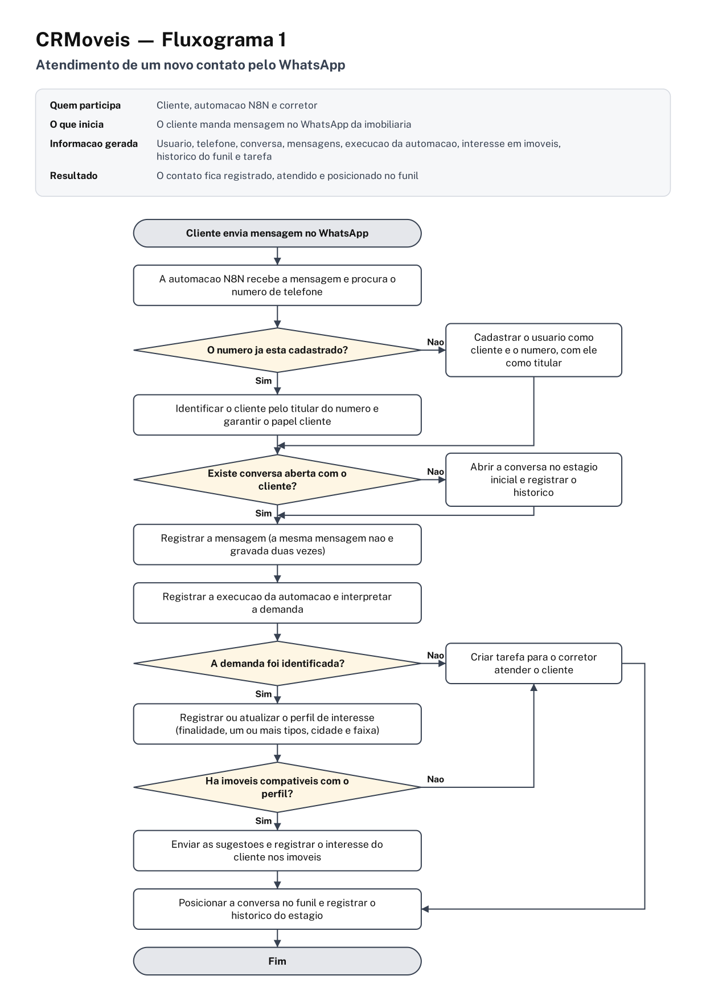

### F2 — Captacao de imovel

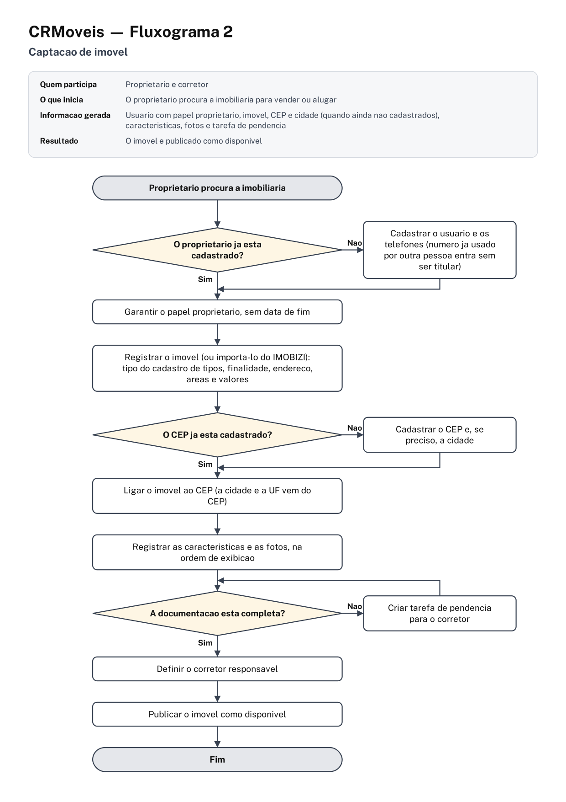

### F3 — Visita e proposta

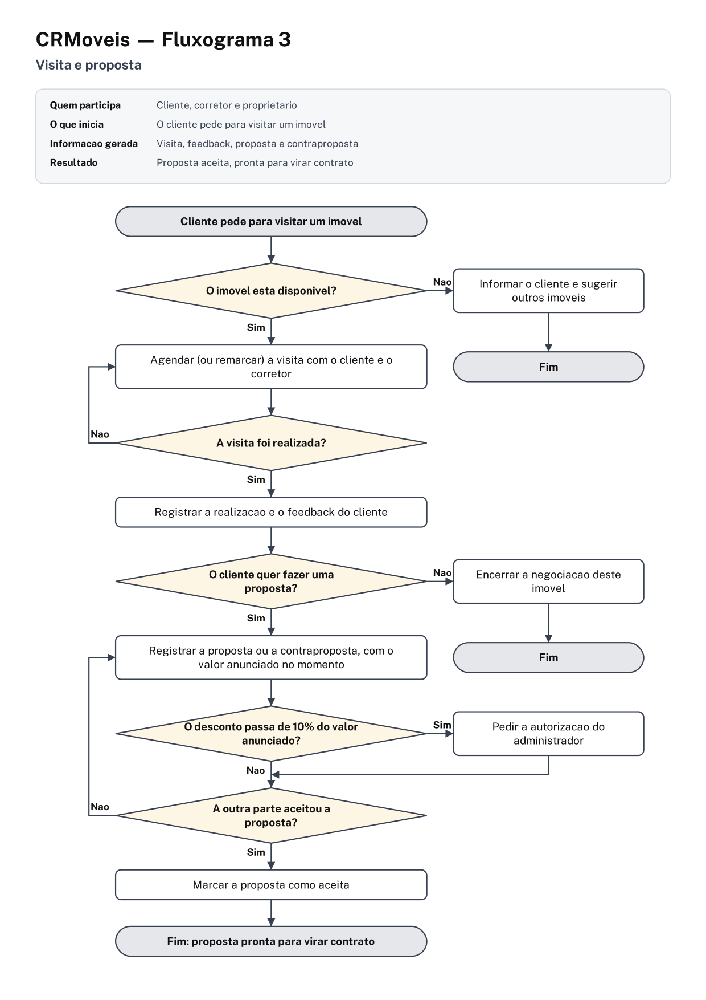

### F4 — Venda: contrato, financiamento e comissao

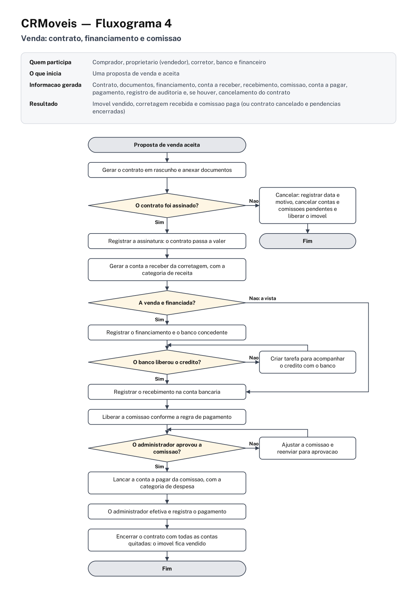

### F5 — Locacao: ciclo mensal do aluguel

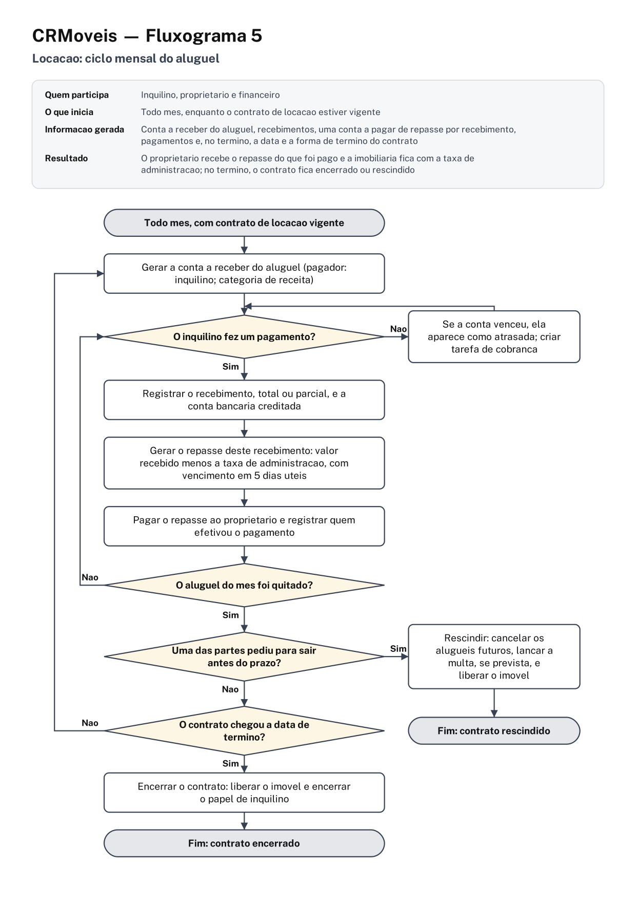

### F6 — Conciliacao bancaria

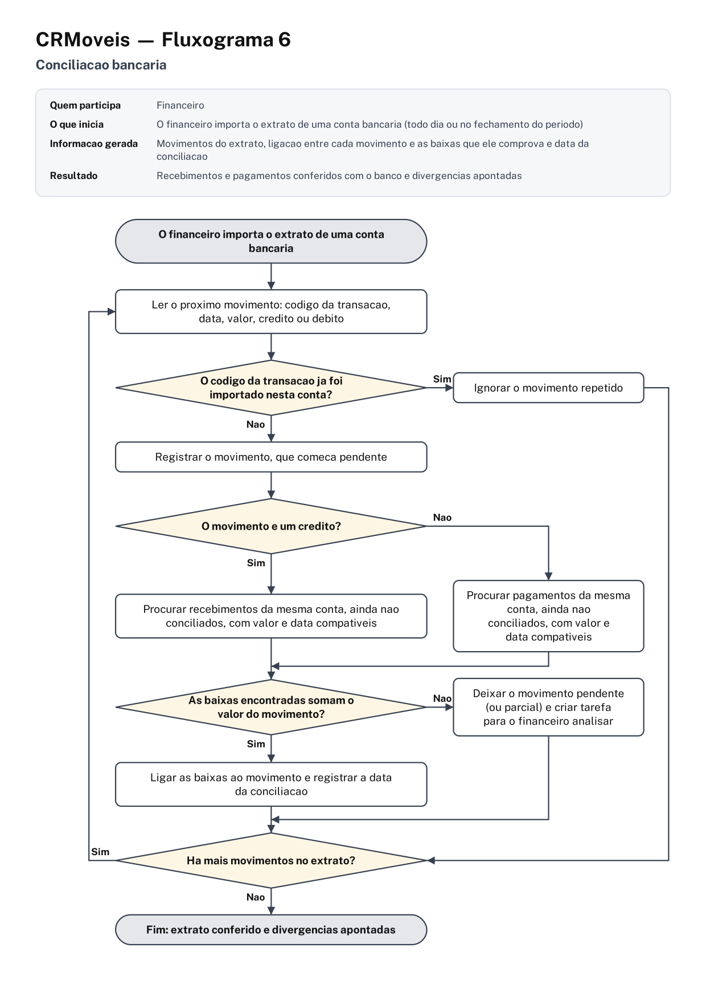

## 11. Entidades

O modelo tem **41 entidades**: 16 fortes, 11 fracas, 6 associativas e 8 subtipos de USUARIO. Cada uma existe porque um requisito ou regra precisa dela. CIDADE, CEP e AUDITORIA_CAMPO nasceram da normalizacao ([secao 18](#18-normalizacao-1fn-2fn-e-3fn)); os subtipos, USUARIO_TELEFONE e MOVIMENTO_BANCARIO nasceram das correcoes da devolutiva ([secao 19](#19-correcoes-da-devolutiva)).

| Entidade | Tipo | Por que existe | Requisito · regra | Folha do DER |
|---|---|---|---|---|
| **USUARIO** | forte | Toda pessoa ou instituicao que circula no CRM. Uma entidade so evita cadastro duplicado; os papeis que a pessoa exerce sao os subtipos abaixo. | RF01, RF02 · RN01, RN02, RN04 | 2 |
| **CLIENTE** | subtipo | Quem procura imovel: inicia conversas, tem perfis de interesse, visita e faz propostas. | RF02, RF04 · RN05, RN11, RN16, RN32 | 2 |
| **PROPRIETARIO** | subtipo | Quem anuncia imoveis para venda ou locacao e recebe os repasses. | RF02, RF16 · RN06, RN32 | 2 |
| **INQUILINO** | subtipo | O cliente com contrato de locacao; paga o aluguel. Entra no papel na assinatura e sai no termino do contrato. | RF02 · RN27, RN33 | 2 |
| **CORRETOR** | subtipo | Quem atende, acompanha visitas, negocia e recebe comissao. Guarda o CRECI, que so existe para corretores. | RF02, RF22 · RN07, RN12, RN15, RN20, RN32 | 2 |
| **FINANCEIRO** | subtipo | Quem opera o financeiro e pode efetivar pagamentos (exceto comissoes). | RF02 · RN39 | 2 |
| **FORNECEDOR** | subtipo | Quem presta servicos e recebe pagamentos de despesas. | RF02, RF25 | 2 |
| **ADMINISTRADOR** | subtipo | Quem autoriza descontos, aprova e paga comissoes. | RF02 · RN39 · PO01, PO03 | 2 |
| **INSTITUICAO_FINANCEIRA** | subtipo | O banco que concede o financiamento e paga a corretagem na venda financiada. | RF02, RF23 · RN27, RN33 | 2 |
| **TELEFONE** | forte | Cada numero de telefone, cadastrado uma unica vez, mesmo quando e usado por mais de uma pessoa. | RF03 · RN03 | 2 |
| **USUARIO_TELEFONE** | associativa | O vinculo entre uma pessoa e um numero (POSSUI), com o telefone principal da pessoa e o titular do numero, que e quem a automacao identifica pelo WhatsApp. | RF03 · RN03 | 2 |
| **PERFIL_INTERESSE** | fraca | Guarda o que o cliente procura, para a automacao sugerir imoveis. So existe ligado a um cliente. | RF04, RF11 · RN05, RN42 | 2 |
| **IMOVEL** | forte | O produto da imobiliaria, com endereco, caracteristicas, valor e situacao. | RF13, RF14 · RN06, RN10, RN41 | 3 |
| **FOTO** | fraca | Galeria do imovel; a foto nao tem sentido fora dele. | RF15 · RN09 | 3 |
| **CARACTERISTICA** | forte | Catalogo de itens (piscina, elevador, aceita pet) que permite filtrar imoveis sem depender de texto livre. | RF13 · RN08 | 3 |
| **CONVERSA_IMOVEL** | associativa | Registra quais imoveis interessam em cada conversa e desde quando. | RF17 | 3 |
| **CIDADE** | forte | Cadastro unico de cidades, com a UF. E usada pelo CEP do imovel e pelo perfil de interesse, o que evita a mesma cidade escrita de formas diferentes. | RF04, RF11, RF13 · RN41, RN42 | 3 |
| **CEP** | forte | Guarda a cidade de cada CEP. O CEP determina a cidade e a UF, entao esses dados ficam aqui, e nao repetidos em cada imovel (3FN). | RF13, RF14 · RN41 | 3 |
| **CONVERSA** | forte | O atendimento de um cliente, que concentra as mensagens e a posicao no funil. | RF05, RF06 · RN11, RN12, RN34 | 4 |
| **MENSAGEM** | fraca | Cada mensagem trocada ou nota interna; so existe dentro de uma conversa. Guarda o codigo externo da mensagem do WhatsApp, que impede o registro em duplicidade. | RF05 · RN31 | 4 |
| **FUNIL_ESTAGIO** | forte | As etapas do funil de vendas (novo contato, visita, proposta, fechado). | RF07 · RN13 | 4 |
| **HISTORICO_ESTAGIO** | associativa | Cada passagem de uma conversa por um estagio, com data e hora; base do relatorio de conversao. | RF08, RF30 · RN14 | 4 |
| **TAREFA** | forte | Pendencias do corretor, com prazo, ligadas ou nao a uma conversa. | RF10 · RN15 | 4 |
| **TAG** | forte | Etiquetas livres para classificar conversas. | RF09 | 4 |
| **VISITA** | associativa | O fato de um cliente visitar um imovel com um corretor, com data, situacao e feedback. | RF18 · RN16 | 5 |
| **PROPOSTA** | associativa | A oferta de um cliente por um imovel, com valor, valor anunciado, condicoes, situacao e a autorizacao quando ha desconto alto. | RF19 · RN17, RN35 · PO03 | 5 |
| **CONTRATO** | forte | O negocio fechado, de venda ou de locacao, com os percentuais que definem a corretagem e o repasse e a forma como terminou. Dispara toda a parte financeira. | RF20, RF33 · RN18, RN19, RN30, RN36, RN37, RN43, RN44 · PO04 | 5 |
| **DOCUMENTO** | fraca | Arquivos do contrato (escritura, vistoria, documentos pessoais). | RF21 | 5 |
| **COMISSAO** | associativa | A parte de cada corretor em um contrato, com percentual, regra de pagamento e data de aprovacao. | RF22, RF28 · RN20, RN21, RN24 · PO01 | 5 |
| **FINANCIAMENTO** | fraca | Os dados do credito bancario de um contrato, principalmente a data de liberacao, que define quando a corretagem cai. | RF23 · RN22, RN23 | 6 |
| **CONTA_RECEBER** | forte | Tudo o que a imobiliaria tem a receber, com quem paga e o vencimento. | RF24 · RN26, RN27 | 6 |
| **RECEBIMENTO** | fraca | Cada baixa de uma conta a receber; permite recebimento parcial e e conferida com o extrato. | RF26, RF36 · RN29, RN45 | 6 |
| **CATEGORIA_FINANCEIRA** | forte | Classifica receitas e despesas para os relatorios financeiros. | RF29, RF31 · RN26 | 6 |
| **CONTA_BANCARIA** | forte | Onde o dinheiro entra e sai: contas e caixa da imobiliaria. | RF26 · RN29 | 6 |
| **MOVIMENTO_BANCARIO** | fraca | Cada lancamento do extrato de uma conta bancaria. Permite conferir os recebimentos e pagamentos registrados com o que o banco movimentou. | RF36 · RN45, RN46 | 6 |
| **CONTA_PAGAR** | forte | Tudo o que a imobiliaria tem a pagar: comissoes, repasses, despesas e impostos, com quem recebe e quem arca com o custo. | RF25, RF27 · RN25, RN28, RN30 | 7 |
| **PAGAMENTO** | fraca | Cada baixa de uma conta a pagar; permite pagamento parcial e e conferida com o extrato. | RF26, RF36 · RN29, RN39, RN45 | 7 |
| **AUTOMACAO_EXECUCAO** | fraca | Cada vez que o N8N processa uma demanda de uma conversa; garante que a mesma demanda nao seja processada duas vezes. | RF11 · RN31 | 8 |
| **AUTOMACAO_LOG** | fraca | Eventos tecnicos de cada execucao, para rastrear falhas da integracao. | RF12 | 8 |
| **AUDITORIA** | forte | Registro de quem criou, alterou ou cancelou contratos, propostas, comissoes e lancamentos financeiros, e quando, ligado ao registro afetado. | RF34 · RN40 · RNF04 | 8 |
| **AUDITORIA_CAMPO** | fraca | Cada campo alterado em uma acao auditada, com o valor anterior e o novo (1FN). | RF34 · RN40 | 8 |

**Tipos:** *forte* tem identificacao propria; *fraca* depende da identificacao de outra entidade e usa um identificador parcial; *associativa* nasce de um relacionamento N:N e guarda informacoes da propria relacao; *subtipo* e uma especializacao de USUARIO, herda o identificador id_usuario e representa um papel que a pessoa exerce.

## 12. Atributos

A lista completa, com classe, obrigatoriedade, descricao e regra de cada atributo, esta no [dicionario de dados](#15-dicionario-de-dados-conceitual). Aqui ficam as classificacoes.

| Classificacao | Atributos |
|---|---|
| **Identificador** | USUARIO.id_usuario, TELEFONE.id_telefone, IMOVEL.id_imovel, CARACTERISTICA.id_caracteristica, CONVERSA.id_conversa, FUNIL_ESTAGIO.id_estagio, TAREFA.id_tarefa, TAG.id_tag, VISITA.id_visita, PROPOSTA.id_proposta, CONTRATO.id_contrato, CATEGORIA_FINANCEIRA.id_categoria, CONTA_BANCARIA.id_conta, CONTA_RECEBER.id_conta_receber, CONTA_PAGAR.id_conta_pagar, AUDITORIA.id_auditoria, CIDADE.id_cidade, CEP.nr_cep |
| **Identificador parcial (entidade fraca)** | PERFIL_INTERESSE.nr_perfil, FOTO.nr_foto, MENSAGEM.nr_mensagem, HISTORICO_ESTAGIO.dt_alteracao, DOCUMENTO.nr_documento, RECEBIMENTO.nr_recebimento, PAGAMENTO.nr_pagamento, MOVIMENTO_BANCARIO.nr_movimento, AUTOMACAO_EXECUCAO.nr_execucao, AUTOMACAO_LOG.nr_log, AUDITORIA_CAMPO.nm_campo. FINANCIAMENTO e identificado apenas pelo contrato (relacao 1:1); os subtipos de USUARIO herdam id_usuario |
| **Composto** | IMOVEL.endereco (nm_logradouro, nr_endereco, ds_complemento, nm_bairro). O CEP, a cidade e a UF sairam do atributo composto e passaram a vir das entidades CEP e CIDADE (3FN, secao 18) |
| **Multivalorado** | Nenhum. O antigo USUARIO.tp_papel virou a especializacao de USUARIO (abaixo e 17.1), para que cada papel possa ter relacionamentos proprios com integridade |
| **Derivado** | COMISSAO.vl_comissao (pc_comissao × CONTRATO.vl_corretagem); CONTRATO.vl_corretagem (vl_final × pc_corretagem); CONTA_RECEBER.st_conta e CONTA_PAGAR.st_conta (calculados a partir das baixas e do vencimento); CONVERSA.dt_atualizacao (data da ultima mensagem); MOVIMENTO_BANCARIO.st_conciliacao (compara o valor do movimento com a soma das baixas ligadas) |
| **Simples** | Todos os demais. A obrigatoriedade de cada atributo (sim, nao ou condicional) esta na coluna *Obrig.* do dicionario |

### Atributos de relacionamento

Informacoes que descrevem a relacao, e nao uma das entidades (Etapa 15 do manual).

| Relacionamento | Atributos | Por que pertencem a relacao |
|---|---|---|
| POSSUI (USUARIO_TELEFONE) | fl_principal, fl_titular | Ser o telefone principal da pessoa e ser o titular do numero descrevem o vinculo entre aquela pessoa e aquele numero |
| CONVERSA_IMOVEL | dt_interesse | A data de interesse descreve o vinculo entre aquela conversa e aquele imovel |
| HISTORICO_ESTAGIO | dt_alteracao | A data e hora descrevem a passagem da conversa por um estagio |
| VISITA | id_visita, dt_visita, st_visita, ds_feedback | Data, situacao e feedback descrevem o encontro entre cliente e imovel |
| PROPOSTA | id_proposta, vl_proposto, vl_anunciado, ds_condicoes, st_proposta, dt_proposta, dt_autorizacao | Valor, condicoes e situacao descrevem a oferta daquele cliente por aquele imovel |
| COMISSAO | pc_comissao, vl_comissao, tp_regra_pagamento, st_comissao, dt_aprovacao | Percentual e regra de pagamento descrevem a participacao do corretor naquele contrato |
| AUTORIZA (ADMINISTRADOR–PROPOSTA) | dt_autorizacao | Descreve a autorizacao do administrador. Como o relacionamento e 1:N, o atributo fica representado junto da PROPOSTA |
| APROVA (ADMINISTRADOR–COMISSAO) | dt_aprovacao | Descreve a aprovacao do administrador. Como o relacionamento e 1:N, o atributo fica representado junto da COMISSAO |
| CONCILIA (MOVIMENTO_BANCARIO–RECEBIMENTO) e CONFERE (MOVIMENTO_BANCARIO–PAGAMENTO) | dt_conciliacao | Descreve a conferencia com o extrato. Como os relacionamentos sao 1:N, o atributo fica junto do RECEBIMENTO e do PAGAMENTO |

### Especializacao

USUARIO e especializado em CLIENTE, PROPRIETARIO, INQUILINO, CORRETOR, FINANCEIRO, FORNECEDOR, ADMINISTRADOR e INSTITUICAO_FINANCEIRA. A especializacao e **total** (t: todo usuario exerce pelo menos um papel, RN01) e **compartilhada** (c: a mesma pessoa pode estar em varios subtipos ao mesmo tempo, RN02). Cada subtipo herda o identificador id_usuario e guarda a data em que a pessoa passou a exercer o papel e, se deixou de exercer, a data de fim; CORRETOR guarda tambem o CRECI. No DER, a especializacao aparece como um triangulo marcado com t,c (folha 2).

## 13. Relacionamentos

Sao **60 relacionamentos**, contando os que foram representados por entidade associativa. A normalizacao acrescentou AGRUPA, LOCALIZA, PREFERE e DETALHA e removeu LIBERA (secao 18). As correcoes da devolutiva ligaram os relacionamentos que exigem um papel aos subtipos de USUARIO, transformaram POSSUI em N:N e acrescentaram LISTA, CONCILIA, CONFERE, REPASSA e os sete relacionamentos AUDITA (secao 19). A especializacao de USUARIO nao e um relacionamento: ela diz que cada subtipo *e um* usuario.

| Relacionamento | Entre | Significado | Requisito · regra |
|---|---|---|---|
| **POSSUI (associativa USUARIO_TELEFONE)** | USUARIO — TELEFONE | O usuario possui telefones; um numero pode ser compartilhado | RN03 |
| **BUSCA** | CLIENTE — PERFIL_INTERESSE | O cliente busca imoveis com determinado perfil | RN05 |
| **PREFERE** | CIDADE — PERFIL_INTERESSE | O perfil indica a cidade desejada | RN42 |
| **ANUNCIA** | PROPRIETARIO — IMOVEL | O proprietario anuncia o imovel | RN06 |
| **RESPONSAVEL** | CORRETOR — IMOVEL | O corretor e responsavel pelo imovel | RN07 |
| **TEM** | IMOVEL — FOTO | O imovel tem fotos | RN09 |
| **APRESENTA** | IMOVEL — CARACTERISTICA | O imovel possui caracteristicas | RN08 |
| **INTERESSA (associativa CONVERSA_IMOVEL)** | IMOVEL — CONVERSA | A conversa se interessa por imoveis | RF17 |
| **LOCALIZA** | CEP — IMOVEL | O CEP localiza o imovel | RN41 |
| **AGRUPA** | CIDADE — CEP | A cidade agrupa os seus CEPs | RN41 |
| **INICIA** | CLIENTE — CONVERSA | O cliente inicia a conversa | RN11 |
| **ATENDE** | CORRETOR — CONVERSA | O corretor atende a conversa | RN12 |
| **CONTEM** | CONVERSA — MENSAGEM | A conversa contem mensagens | RF05 |
| **MARCA** | CONVERSA — TAG | A conversa e marcada com tags | RF09 |
| **GERA TAREFA** | CONVERSA — TAREFA | A conversa gera tarefas | RN15 |
| **EXECUTA** | CORRETOR — TAREFA | O corretor executa a tarefa | RN15 |
| **PERTENCE A** | CONVERSA — FUNIL_ESTAGIO | A conversa esta em um estagio do funil | RN13 |
| **REGISTRA** | HISTORICO_ESTAGIO — USUARIO (responsavel) | O usuario registra a mudanca de estagio | RF08 |
| **MOVE (associativa HISTORICO_ESTAGIO)** | CONVERSA — FUNIL_ESTAGIO | A conversa passa pelos estagios do funil | RN14 |
| **ACOMPANHA** | VISITA — CORRETOR | O corretor acompanha a visita | RN16 |
| **ORIGINA** | VISITA — PROPOSTA | A visita da origem a proposta | RN17 |
| **RESPONDE** | PROPOSTA — PROPOSTA (recursivo) | A contraproposta responde a proposta anterior | RN35 |
| **NEGOCIA** | PROPOSTA — CORRETOR | O corretor negocia a proposta | RF19 |
| **FECHA** | PROPOSTA — CONTRATO | A proposta aceita fecha o contrato | RN18 |
| **ANEXA** | CONTRATO — DOCUMENTO | O contrato tem documentos anexados | RF21 |
| **AUTORIZA** | PROPOSTA — ADMINISTRADOR | O administrador autoriza a proposta com desconto acima do limite | PO03 |
| **APROVA** | COMISSAO — ADMINISTRADOR | O administrador aprova a comissao antes do pagamento | PO01 |
| **VISITA (associativa VISITA)** | CLIENTE — IMOVEL | O cliente visita o imovel | RN16 |
| **PROPOE (associativa PROPOSTA)** | CLIENTE — IMOVEL | O cliente faz proposta pelo imovel | RF19 |
| **RECEBE (associativa COMISSAO)** | CONTRATO — CORRETOR | O corretor recebe comissao do contrato | RN20 |
| **FINANCIA** | CONTRATO — FINANCIAMENTO | O contrato e financiado | RN22 |
| **CONCEDE** | INSTITUICAO_FINANCEIRA — FINANCIAMENTO | O banco concede o financiamento | RN27, RN33 |
| **GERA RECEITA** | CONTRATO — CONTA_RECEBER | O contrato gera contas a receber | RF24 |
| **CLASSIFICA** | CATEGORIA_FINANCEIRA — CONTA_RECEBER | A categoria classifica a conta a receber | RN26 |
| **PAGA** | USUARIO (pagador) — CONTA_RECEBER | A pessoa paga a conta a receber, no papel indicado na conta | RN27 |
| **QUITA** | CONTA_RECEBER — RECEBIMENTO | A conta a receber e baixada por recebimentos | RN29 |
| **CREDITA** | CONTA_BANCARIA — RECEBIMENTO | O recebimento entra em uma conta bancaria | RN29 |
| **LISTA** | CONTA_BANCARIA — MOVIMENTO_BANCARIO | O extrato da conta bancaria lista os movimentos | RN46 |
| **CONCILIA** | MOVIMENTO_BANCARIO — RECEBIMENTO | O movimento do extrato comprova o recebimento | RN45 |
| **GERA DESPESA** | CONTRATO — CONTA_PAGAR | O contrato origina contas a pagar | RF25 |
| **CATEGORIZA** | CATEGORIA_FINANCEIRA — CONTA_PAGAR | A categoria classifica a conta a pagar | RN26 |
| **FAVORECE** | USUARIO (favorecido) — CONTA_PAGAR | A conta a pagar favorece uma pessoa | RF25 |
| **CUSTEIA** | USUARIO (quem arca com o custo) — CONTA_PAGAR | A pessoa arca com o custo da conta a pagar, no papel indicado na conta | RN28 |
| **LANCA** | COMISSAO — CONTA_PAGAR | A comissao liberada lanca a conta a pagar ao corretor | RN25 |
| **REPASSA** | RECEBIMENTO — CONTA_PAGAR | O recebimento do aluguel gera o repasse ao proprietario | RN30 |
| **LIQUIDA** | CONTA_PAGAR — PAGAMENTO | A conta a pagar e baixada por pagamentos | RN29 |
| **DEBITA** | CONTA_BANCARIA — PAGAMENTO | O pagamento sai de uma conta bancaria | RN29 |
| **CONFERE** | MOVIMENTO_BANCARIO — PAGAMENTO | O movimento do extrato comprova o pagamento | RN45 |
| **EFETIVA** | USUARIO (administrador ou financeiro) — PAGAMENTO | O usuario efetiva o pagamento | RN39, PO01 |
| **DISPARA** | CONVERSA — AUTOMACAO_EXECUCAO | A conversa dispara execucoes da automacao | RN31 |
| **GRAVA** | AUTOMACAO_EXECUCAO — AUTOMACAO_LOG | A execucao registra eventos (logs) | RF12 |
| **PRATICA** | USUARIO — AUDITORIA | O usuario pratica a acao registrada na auditoria | RN40 |
| **DETALHA** | AUDITORIA — AUDITORIA_CAMPO | O registro de auditoria detalha cada campo alterado | RN40 |
| **AUDITA CONTRATO** | CONTRATO — AUDITORIA | A auditoria registra uma acao sobre o contrato | RN40 |
| **AUDITA PROPOSTA** | PROPOSTA — AUDITORIA | A auditoria registra uma acao sobre a proposta | RN40 |
| **AUDITA COMISSAO** | COMISSAO — AUDITORIA | A auditoria registra uma acao sobre a comissao | RN40 |
| **AUDITA CONTA_RECEBER** | CONTA_RECEBER — AUDITORIA | A auditoria registra uma acao sobre a conta a receber | RN40 |
| **AUDITA RECEBIMENTO** | RECEBIMENTO — AUDITORIA | A auditoria registra uma acao sobre o recebimento | RN40 |
| **AUDITA CONTA_PAGAR** | CONTA_PAGAR — AUDITORIA | A auditoria registra uma acao sobre a conta a pagar | RN40 |
| **AUDITA PAGAMENTO** | PAGAMENTO — AUDITORIA | A auditoria registra uma acao sobre o pagamento | RN40 |

## 14. Cardinalidades

Cada cardinalidade foi definida pelo metodo **va e volte** do manual: partindo de uma ocorrencia de cada lado e perguntando quantas ocorrencias do outro lado ela pode ter.

**Leitura no DER (convencao do manual):** o par (min,max) escrito junto de uma entidade indica quantas vezes cada ocorrencia *dessa* entidade participa do relacionamento, isto e, com quantas ocorrencias da outra entidade ela se relaciona. Exemplo: em `CLIENTE (0,n) — INICIA — (1,1) CONVERSA`, um cliente inicia nenhuma ou varias conversas (0,n), e cada conversa e iniciada por exatamente um cliente (1,1). A coluna *Ida* corresponde ao par da primeira entidade, e a coluna *Volta*, ao par da segunda.

| Relacionamento | Ida | Volta | Como fica no DER | Regra |
|---|---|---|---|---|
| POSSUI | 1 USUARIO → nenhum ou varios TELEFONE | 1 TELEFONE → um ou varios USUARIO | USUARIO (0,n) — POSSUI — (1,n) TELEFONE · N:N | RN03 |
| BUSCA | 1 CLIENTE → nenhum ou varios PERFIL_INTERESSE | 1 PERFIL_INTERESSE → exatamente um CLIENTE | CLIENTE (0,n) — BUSCA — (1,1) PERFIL_INTERESSE | RN05 |
| PREFERE | 1 CIDADE → nenhum ou varios PERFIL_INTERESSE | 1 PERFIL_INTERESSE → nenhum ou um CIDADE | CIDADE (0,n) — PREFERE — (0,1) PERFIL_INTERESSE | RN42 |
| ANUNCIA | 1 PROPRIETARIO → nenhum ou varios IMOVEL | 1 IMOVEL → exatamente um PROPRIETARIO | PROPRIETARIO (0,n) — ANUNCIA — (1,1) IMOVEL | RN06 |
| RESPONSAVEL | 1 CORRETOR → nenhum ou varios IMOVEL | 1 IMOVEL → nenhum ou um CORRETOR | CORRETOR (0,n) — RESPONSAVEL — (0,1) IMOVEL | RN07 |
| TEM | 1 IMOVEL → nenhum ou varios FOTO | 1 FOTO → exatamente um IMOVEL | IMOVEL (0,n) — TEM — (1,1) FOTO | RN09 |
| APRESENTA | 1 IMOVEL → nenhum ou varios CARACTERISTICA | 1 CARACTERISTICA → nenhum ou varios IMOVEL | IMOVEL (0,n) — APRESENTA — (0,n) CARACTERISTICA | RN08 |
| INTERESSA | 1 IMOVEL → nenhum ou varios CONVERSA | 1 CONVERSA → nenhum ou varios IMOVEL | IMOVEL (0,n) — INTERESSA — (0,n) CONVERSA · N:N | RF17 |
| LOCALIZA | 1 CEP → nenhum ou varios IMOVEL | 1 IMOVEL → exatamente um CEP | CEP (0,n) — LOCALIZA — (1,1) IMOVEL | RN41 |
| AGRUPA | 1 CIDADE → nenhum ou varios CEP | 1 CEP → exatamente um CIDADE | CIDADE (0,n) — AGRUPA — (1,1) CEP | RN41 |
| INICIA | 1 CLIENTE → nenhum ou varios CONVERSA | 1 CONVERSA → exatamente um CLIENTE | CLIENTE (0,n) — INICIA — (1,1) CONVERSA | RN11 |
| ATENDE | 1 CORRETOR → nenhum ou varios CONVERSA | 1 CONVERSA → nenhum ou um CORRETOR | CORRETOR (0,n) — ATENDE — (0,1) CONVERSA | RN12 |
| CONTEM | 1 CONVERSA → nenhum ou varios MENSAGEM | 1 MENSAGEM → exatamente um CONVERSA | CONVERSA (0,n) — CONTEM — (1,1) MENSAGEM | RF05 |
| MARCA | 1 CONVERSA → nenhum ou varios TAG | 1 TAG → nenhum ou varios CONVERSA | CONVERSA (0,n) — MARCA — (0,n) TAG | RF09 |
| GERA TAREFA | 1 CONVERSA → nenhum ou varios TAREFA | 1 TAREFA → nenhum ou um CONVERSA | CONVERSA (0,n) — GERA TAREFA — (0,1) TAREFA | RN15 |
| EXECUTA | 1 CORRETOR → nenhum ou varios TAREFA | 1 TAREFA → exatamente um CORRETOR | CORRETOR (0,n) — EXECUTA — (1,1) TAREFA | RN15 |
| PERTENCE A | 1 CONVERSA → exatamente um FUNIL_ESTAGIO | 1 FUNIL_ESTAGIO → nenhum ou varios CONVERSA | CONVERSA (1,1) — PERTENCE A — (0,n) FUNIL_ESTAGIO | RN13 |
| REGISTRA | 1 HISTORICO_ESTAGIO → nenhum ou um USUARIO (responsavel) | 1 USUARIO (responsavel) → nenhum ou varios HISTORICO_ESTAGIO | HISTORICO_ESTAGIO (0,1) — REGISTRA — (0,n) USUARIO (responsavel) | RF08 |
| MOVE | 1 CONVERSA → nenhum ou varios FUNIL_ESTAGIO | 1 FUNIL_ESTAGIO → nenhum ou varios CONVERSA | CONVERSA (0,n) — MOVE — (0,n) FUNIL_ESTAGIO · N:N | RN14 |
| ACOMPANHA | 1 VISITA → exatamente um CORRETOR | 1 CORRETOR → nenhum ou varios VISITA | VISITA (1,1) — ACOMPANHA — (0,n) CORRETOR | RN16 |
| ORIGINA | 1 VISITA → nenhum ou varios PROPOSTA | 1 PROPOSTA → nenhum ou um VISITA | VISITA (0,n) — ORIGINA — (0,1) PROPOSTA | RN17 |
| RESPONDE | 1 PROPOSTA (anterior) → nenhum ou um PROPOSTA (contraproposta) | 1 PROPOSTA (contraproposta) → nenhum ou um PROPOSTA (anterior) | PROPOSTA (anterior) (0,1) — RESPONDE — (0,1) PROPOSTA (contraproposta) · recursivo | RN35 |
| NEGOCIA | 1 PROPOSTA → exatamente um CORRETOR | 1 CORRETOR → nenhum ou varios PROPOSTA | PROPOSTA (1,1) — NEGOCIA — (0,n) CORRETOR | RF19 |
| FECHA | 1 PROPOSTA → nenhum ou um CONTRATO | 1 CONTRATO → exatamente um PROPOSTA | PROPOSTA (0,1) — FECHA — (1,1) CONTRATO | RN18 |
| ANEXA | 1 CONTRATO → nenhum ou varios DOCUMENTO | 1 DOCUMENTO → exatamente um CONTRATO | CONTRATO (0,n) — ANEXA — (1,1) DOCUMENTO | RF21 |
| AUTORIZA | 1 PROPOSTA → nenhum ou um ADMINISTRADOR | 1 ADMINISTRADOR → nenhum ou varios PROPOSTA | PROPOSTA (0,1) — AUTORIZA — (0,n) ADMINISTRADOR | PO03 |
| APROVA | 1 COMISSAO → nenhum ou um ADMINISTRADOR | 1 ADMINISTRADOR → nenhum ou varios COMISSAO | COMISSAO (0,1) — APROVA — (0,n) ADMINISTRADOR | PO01 |
| VISITA | 1 CLIENTE → nenhum ou varios IMOVEL | 1 IMOVEL → nenhum ou varios CLIENTE | CLIENTE (0,n) — VISITA — (0,n) IMOVEL · N:N | RN16 |
| PROPOE | 1 CLIENTE → nenhum ou varios IMOVEL | 1 IMOVEL → nenhum ou varios CLIENTE | CLIENTE (0,n) — PROPOE — (0,n) IMOVEL · N:N | RF19 |
| RECEBE | 1 CONTRATO → nenhum ou varios CORRETOR | 1 CORRETOR → nenhum ou varios CONTRATO | CONTRATO (0,n) — RECEBE — (0,n) CORRETOR · N:N | RN20 |
| FINANCIA | 1 CONTRATO → nenhum ou um FINANCIAMENTO | 1 FINANCIAMENTO → exatamente um CONTRATO | CONTRATO (0,1) — FINANCIA — (1,1) FINANCIAMENTO | RN22 |
| CONCEDE | 1 INSTITUICAO_FINANCEIRA → nenhum ou varios FINANCIAMENTO | 1 FINANCIAMENTO → exatamente um INSTITUICAO_FINANCEIRA | INSTITUICAO_FINANCEIRA (0,n) — CONCEDE — (1,1) FINANCIAMENTO | RN27, RN33 |
| GERA RECEITA | 1 CONTRATO → nenhum ou varios CONTA_RECEBER | 1 CONTA_RECEBER → nenhum ou um CONTRATO | CONTRATO (0,n) — GERA RECEITA — (0,1) CONTA_RECEBER | RF24 |
| CLASSIFICA | 1 CATEGORIA_FINANCEIRA → nenhum ou varios CONTA_RECEBER | 1 CONTA_RECEBER → exatamente um CATEGORIA_FINANCEIRA | CATEGORIA_FINANCEIRA (0,n) — CLASSIFICA — (1,1) CONTA_RECEBER | RN26 |
| PAGA | 1 USUARIO (pagador) → nenhum ou varios CONTA_RECEBER | 1 CONTA_RECEBER → exatamente um USUARIO (pagador) | USUARIO (pagador) (0,n) — PAGA — (1,1) CONTA_RECEBER | RN27 |
| QUITA | 1 CONTA_RECEBER → nenhum ou varios RECEBIMENTO | 1 RECEBIMENTO → exatamente um CONTA_RECEBER | CONTA_RECEBER (0,n) — QUITA — (1,1) RECEBIMENTO | RN29 |
| CREDITA | 1 CONTA_BANCARIA → nenhum ou varios RECEBIMENTO | 1 RECEBIMENTO → exatamente um CONTA_BANCARIA | CONTA_BANCARIA (0,n) — CREDITA — (1,1) RECEBIMENTO | RN29 |
| LISTA | 1 CONTA_BANCARIA → nenhum ou varios MOVIMENTO_BANCARIO | 1 MOVIMENTO_BANCARIO → exatamente um CONTA_BANCARIA | CONTA_BANCARIA (0,n) — LISTA — (1,1) MOVIMENTO_BANCARIO | RN46 |
| CONCILIA | 1 MOVIMENTO_BANCARIO → nenhum ou varios RECEBIMENTO | 1 RECEBIMENTO → nenhum ou um MOVIMENTO_BANCARIO | MOVIMENTO_BANCARIO (0,n) — CONCILIA — (0,1) RECEBIMENTO | RN45 |
| GERA DESPESA | 1 CONTRATO → nenhum ou varios CONTA_PAGAR | 1 CONTA_PAGAR → nenhum ou um CONTRATO | CONTRATO (0,n) — GERA DESPESA — (0,1) CONTA_PAGAR | RF25 |
| CATEGORIZA | 1 CATEGORIA_FINANCEIRA → nenhum ou varios CONTA_PAGAR | 1 CONTA_PAGAR → exatamente um CATEGORIA_FINANCEIRA | CATEGORIA_FINANCEIRA (0,n) — CATEGORIZA — (1,1) CONTA_PAGAR | RN26 |
| FAVORECE | 1 USUARIO (favorecido) → nenhum ou varios CONTA_PAGAR | 1 CONTA_PAGAR → nenhum ou um USUARIO (favorecido) | USUARIO (favorecido) (0,n) — FAVORECE — (0,1) CONTA_PAGAR | RF25 |
| CUSTEIA | 1 USUARIO (quem arca com o custo) → nenhum ou varios CONTA_PAGAR | 1 CONTA_PAGAR → nenhum ou um USUARIO (quem arca com o custo) | USUARIO (quem arca com o custo) (0,n) — CUSTEIA — (0,1) CONTA_PAGAR | RN28 |
| LANCA | 1 COMISSAO → nenhum ou um CONTA_PAGAR | 1 CONTA_PAGAR → nenhum ou um COMISSAO | COMISSAO (0,1) — LANCA — (0,1) CONTA_PAGAR | RN25 |
| REPASSA | 1 RECEBIMENTO → nenhum ou um CONTA_PAGAR | 1 CONTA_PAGAR → nenhum ou um RECEBIMENTO | RECEBIMENTO (0,1) — REPASSA — (0,1) CONTA_PAGAR | RN30 |
| LIQUIDA | 1 CONTA_PAGAR → nenhum ou varios PAGAMENTO | 1 PAGAMENTO → exatamente um CONTA_PAGAR | CONTA_PAGAR (0,n) — LIQUIDA — (1,1) PAGAMENTO | RN29 |
| DEBITA | 1 CONTA_BANCARIA → nenhum ou varios PAGAMENTO | 1 PAGAMENTO → exatamente um CONTA_BANCARIA | CONTA_BANCARIA (0,n) — DEBITA — (1,1) PAGAMENTO | RN29 |
| CONFERE | 1 MOVIMENTO_BANCARIO → nenhum ou varios PAGAMENTO | 1 PAGAMENTO → nenhum ou um MOVIMENTO_BANCARIO | MOVIMENTO_BANCARIO (0,n) — CONFERE — (0,1) PAGAMENTO | RN45 |
| EFETIVA | 1 USUARIO (administrador ou financeiro) → nenhum ou varios PAGAMENTO | 1 PAGAMENTO → exatamente um USUARIO (administrador ou financeiro) | USUARIO (administrador ou financeiro) (0,n) — EFETIVA — (1,1) PAGAMENTO | RN39, PO01 |
| DISPARA | 1 CONVERSA → nenhum ou varios AUTOMACAO_EXECUCAO | 1 AUTOMACAO_EXECUCAO → exatamente um CONVERSA | CONVERSA (0,n) — DISPARA — (1,1) AUTOMACAO_EXECUCAO | RN31 |
| GRAVA | 1 AUTOMACAO_EXECUCAO → nenhum ou varios AUTOMACAO_LOG | 1 AUTOMACAO_LOG → exatamente um AUTOMACAO_EXECUCAO | AUTOMACAO_EXECUCAO (0,n) — GRAVA — (1,1) AUTOMACAO_LOG | RF12 |
| PRATICA | 1 USUARIO → nenhum ou varios AUDITORIA | 1 AUDITORIA → exatamente um USUARIO | USUARIO (0,n) — PRATICA — (1,1) AUDITORIA | RN40 |
| DETALHA | 1 AUDITORIA → nenhum ou varios AUDITORIA_CAMPO | 1 AUDITORIA_CAMPO → exatamente um AUDITORIA | AUDITORIA (0,n) — DETALHA — (1,1) AUDITORIA_CAMPO | RN40 |
| AUDITA CONTRATO | 1 CONTRATO → nenhum ou varios AUDITORIA | 1 AUDITORIA → nenhum ou um CONTRATO | CONTRATO (0,n) — AUDITA CONTRATO — (0,1) AUDITORIA | RN40 |
| AUDITA PROPOSTA | 1 PROPOSTA → nenhum ou varios AUDITORIA | 1 AUDITORIA → nenhum ou um PROPOSTA | PROPOSTA (0,n) — AUDITA PROPOSTA — (0,1) AUDITORIA | RN40 |
| AUDITA COMISSAO | 1 COMISSAO → nenhum ou varios AUDITORIA | 1 AUDITORIA → nenhum ou um COMISSAO | COMISSAO (0,n) — AUDITA COMISSAO — (0,1) AUDITORIA | RN40 |
| AUDITA CONTA_RECEBER | 1 CONTA_RECEBER → nenhum ou varios AUDITORIA | 1 AUDITORIA → nenhum ou um CONTA_RECEBER | CONTA_RECEBER (0,n) — AUDITA CONTA_RECEBER — (0,1) AUDITORIA | RN40 |
| AUDITA RECEBIMENTO | 1 RECEBIMENTO → nenhum ou varios AUDITORIA | 1 AUDITORIA → nenhum ou um RECEBIMENTO | RECEBIMENTO (0,n) — AUDITA RECEBIMENTO — (0,1) AUDITORIA | RN40 |
| AUDITA CONTA_PAGAR | 1 CONTA_PAGAR → nenhum ou varios AUDITORIA | 1 AUDITORIA → nenhum ou um CONTA_PAGAR | CONTA_PAGAR (0,n) — AUDITA CONTA_PAGAR — (0,1) AUDITORIA | RN40 |
| AUDITA PAGAMENTO | 1 PAGAMENTO → nenhum ou varios AUDITORIA | 1 AUDITORIA → nenhum ou um PAGAMENTO | PAGAMENTO (0,n) — AUDITA PAGAMENTO — (0,1) AUDITORIA | RN40 |

**Relacionamentos N:N verificados (Etapa 14):** imovel × caracteristica e conversa × tag ficaram como losango, porque nao tem informacao propria; usuario × telefone, conversa × imovel, conversa × estagio, cliente × imovel (visita e proposta) e contrato × corretor viraram entidades associativas, porque tem. **Relacionamento recursivo:** RESPONDE liga uma proposta a outra proposta (a contraproposta) e e opcional e unico nos dois lados (0,1). **Arco exclusivo:** cada AUDITORIA usa exatamente um dos sete relacionamentos AUDITA (RN40).

## 15. Dicionario de dados conceitual

Preliminar, no formato do manual: identificar, descrever e organizar. Tipos de dados e implementacao fisica ficam para o modelo logico.

**Padrao de nomes.** Entidades e relacionamentos sao escritos em maiusculas, sem acento. Os atributos usam prefixo pelo tipo de informacao:

| Prefixo | Uso | Exemplo |
|---|---|---|
| `id_` | Identificador unico da entidade | id_usuario |
| `nr_` | Numero (sequencial, parcial ou de documento) | nr_perfil, nr_cpf_cnpj |
| `cd_` | Codigo vindo de sistema externo | cd_imobizi |
| `nm_` | Nome | nm_usuario |
| `ds_` | Descricao ou texto livre | ds_email |
| `tp_` | Tipo ou categoria com lista de valores | tp_telefone |
| `st_` | Situacao (estado) | st_visita |
| `fl_` | Indicador sim/nao | fl_ativo |
| `dt_` | Data ou data e hora | dt_cadastro |
| `vl_` | Valor numerico (monetario ou medida) | vl_venda |
| `pc_` | Percentual | pc_comissao |
| `qt_` | Quantidade | qt_quartos |
| `sg_` | Sigla | sg_uf |

**Colunas.** *Classe* segue a secao 12 (Identificador, Ident. parcial, Simples, Composto, Multivalorado ou Derivado). *Obrig.* indica se o dado e obrigatorio (Sim), opcional (Nao) ou obrigatorio apenas em certas situacoes descritas na regra (Cond.).

### USUARIO · forte

*USUARIO e qualquer pessoa ou instituicao cadastrada no CRM, tenha ou nao acesso ao sistema. Os papeis que a pessoa exerce sao os subtipos da especializacao (17.1).*

| Atributo | Classe | Obrig. | Descricao | Regra / observacao |
|---|---|---|---|---|
| id_usuario | Identificador | Sim | Identificador do usuario | Identificacao unica; herdado pelos subtipos |
| nm_usuario | Simples | Sim | Nome completo ou razao social | — |
| nr_cpf_cnpj | Simples | Cond. | CPF ou CNPJ | Nao pode se repetir; obrigatorio para proprietario, instituicao financeira e quem assina contrato (RN04); apagado na anonimizacao (PO07) |
| ds_email | Simples | Cond. | E-mail de contato e de acesso | Nao pode se repetir; obrigatorio para quem acessa o sistema |
| ds_senha_hash | Simples | Cond. | Senha de acesso, guardada como hash | So para quem acessa o sistema; nunca em texto (RNF02) |
| tp_origem | Simples | Nao | Canal pelo qual a pessoa chegou | Site, indicacao, portal, Instagram, WhatsApp ou interno |
| fl_ativo | Simples | Sim | Indica se o cadastro esta ativo | Cadastro inativo nao acessa o sistema |
| dt_cadastro | Simples | Sim | Data do cadastro | Preenchida automaticamente |
| dt_anonimizacao | Simples | Nao | Data em que os dados pessoais foram anonimizados | Preenchida quando o titular pede a exclusao e ha obrigacao de guarda (PO07) |

### CLIENTE · subtipo

*Subtipo de USUARIO: herda id_usuario. Representa quem exerce o papel de cliente.*

| Atributo | Classe | Obrig. | Descricao | Regra / observacao |
|---|---|---|---|---|
| dt_inicio | Simples | Sim | Data em que a pessoa passou a ser cliente | — |
| dt_fim | Simples | Nao | Data em que deixou de ser cliente | Preenchida quando a pessoa deixa o papel; o registro nao e apagado (RN02) |

### PROPRIETARIO · subtipo

*Subtipo de USUARIO: herda id_usuario. Representa quem exerce o papel de proprietario.*

| Atributo | Classe | Obrig. | Descricao | Regra / observacao |
|---|---|---|---|---|
| dt_inicio | Simples | Sim | Data em que a pessoa passou a ser proprietario | — |
| dt_fim | Simples | Nao | Data em que deixou de ser proprietario | Preenchida quando a pessoa deixa o papel; o registro nao e apagado (RN02) |

### INQUILINO · subtipo

*Subtipo de USUARIO: herda id_usuario. Representa quem exerce o papel de inquilino.*

| Atributo | Classe | Obrig. | Descricao | Regra / observacao |
|---|---|---|---|---|
| dt_inicio | Simples | Sim | Data em que a pessoa passou a ser inquilino | Data da assinatura do contrato de locacao (RN33) |
| dt_fim | Simples | Nao | Data em que deixou de ser inquilino | Preenchida no encerramento ou na rescisao da locacao (RN33, RN43, RN44); o registro nao e apagado (RN02) |

### CORRETOR · subtipo

*Subtipo de USUARIO: herda id_usuario. Representa quem exerce o papel de corretor.*

| Atributo | Classe | Obrig. | Descricao | Regra / observacao |
|---|---|---|---|---|
| nr_creci | Simples | Sim | Registro do corretor no CRECI | Nao pode se repetir; so existe para corretores |
| dt_inicio | Simples | Sim | Data em que a pessoa passou a ser corretor | — |
| dt_fim | Simples | Nao | Data em que deixou de ser corretor | Preenchida quando a pessoa deixa o papel; o registro nao e apagado (RN02) |

### FINANCEIRO · subtipo

*Subtipo de USUARIO: herda id_usuario. Representa quem exerce o papel de financeiro.*

| Atributo | Classe | Obrig. | Descricao | Regra / observacao |
|---|---|---|---|---|
| dt_inicio | Simples | Sim | Data em que a pessoa passou a ser financeiro | — |
| dt_fim | Simples | Nao | Data em que deixou de ser financeiro | Preenchida quando a pessoa deixa o papel; o registro nao e apagado (RN02) |

### FORNECEDOR · subtipo

*Subtipo de USUARIO: herda id_usuario. Representa quem exerce o papel de fornecedor.*

| Atributo | Classe | Obrig. | Descricao | Regra / observacao |
|---|---|---|---|---|
| dt_inicio | Simples | Sim | Data em que a pessoa passou a ser fornecedor | — |
| dt_fim | Simples | Nao | Data em que deixou de ser fornecedor | Preenchida quando a pessoa deixa o papel; o registro nao e apagado (RN02) |

### ADMINISTRADOR · subtipo

*Subtipo de USUARIO: herda id_usuario. Representa quem exerce o papel de administrador.*

| Atributo | Classe | Obrig. | Descricao | Regra / observacao |
|---|---|---|---|---|
| dt_inicio | Simples | Sim | Data em que a pessoa passou a ser administrador | — |
| dt_fim | Simples | Nao | Data em que deixou de ser administrador | Preenchida quando a pessoa deixa o papel; o registro nao e apagado (RN02) |

### INSTITUICAO_FINANCEIRA · subtipo

*Subtipo de USUARIO: herda id_usuario. Representa quem exerce o papel de instituicao financeira.*

| Atributo | Classe | Obrig. | Descricao | Regra / observacao |
|---|---|---|---|---|
| dt_inicio | Simples | Sim | Data em que a pessoa passou a ser instituicao financeira | Data do primeiro financiamento concedido (RN33) |
| dt_fim | Simples | Nao | Data em que deixou de ser instituicao financeira | Preenchida quando a pessoa deixa o papel; o registro nao e apagado (RN02) |

### TELEFONE · forte

*Cada numero e cadastrado uma unica vez; quem usa o numero esta em USUARIO_TELEFONE (POSSUI).*

| Atributo | Classe | Obrig. | Descricao | Regra / observacao |
|---|---|---|---|---|
| id_telefone | Identificador | Sim | Identificador do telefone | Identificacao unica |
| nr_telefone | Simples | Sim | Numero com DDD | Nao pode se repetir: o numero e cadastrado uma unica vez, mesmo quando e compartilhado (RN03) |
| tp_telefone | Simples | Sim | Tipo da linha | Celular, WhatsApp ou fixo |

### USUARIO_TELEFONE · associativa

*Vinculo entre uma pessoa e um numero (relacionamento POSSUI). Um numero compartilhado tem um vinculo para cada pessoa.*

| Atributo | Classe | Obrig. | Descricao | Regra / observacao |
|---|---|---|---|---|
| fl_principal | Simples | Sim | Indica o telefone preferencial da pessoa | No maximo um principal por pessoa |
| fl_titular | Simples | Sim | Indica o titular do numero | Exatamente um titular por telefone; e pelo titular que a automacao identifica quem escreveu no WhatsApp (RN03) |

### PERFIL_INTERESSE · fraca

*A cidade desejada e a CIDADE ligada pelo relacionamento PREFERE (RN42), e nao um texto digitado no perfil.*

| Atributo | Classe | Obrig. | Descricao | Regra / observacao |
|---|---|---|---|---|
| nr_perfil | Ident. parcial | Sim | Numero do perfil dentro do cliente | Identificador parcial |
| tp_finalidade | Simples | Sim | Venda ou locacao | Mesmo vocabulario de IMOVEL |
| tp_imovel | Simples | Nao | Tipo de imovel procurado | Ex.: apartamento, casa, comercial |
| nm_bairro | Simples | Nao | Bairro desejado | Pode ficar em branco |
| vl_minimo | Simples | Nao | Valor minimo aceito | Nao pode ser maior que o valor maximo |
| vl_maximo | Simples | Nao | Valor maximo aceito | Maior ou igual ao minimo |
| qt_quartos_min | Simples | Nao | Quantidade minima de quartos | — |

### IMOVEL · forte

| Atributo | Classe | Obrig. | Descricao | Regra / observacao |
|---|---|---|---|---|
| id_imovel | Identificador | Sim | Identificador do imovel | Identificacao unica |
| cd_imobizi | Simples | Cond. | Codigo do imovel no IMOBIZI | Nao pode se repetir; obrigatorio nos imoveis importados (RF14) |
| tp_imovel | Simples | Sim | Tipo do imovel | Apartamento, casa, terreno, comercial ou rural |
| tp_finalidade | Simples | Sim | Venda, locacao ou ambas | Define quais valores sao obrigatorios (17.24) |
| endereco | Composto | Sim | Endereco do imovel | Composto por nm_logradouro, nr_endereco, ds_complemento e nm_bairro; o CEP vem do relacionamento LOCALIZA, e a cidade e a UF, do CEP (RN41) |
| vl_area_util | Simples | Nao | Area util em m2 | — |
| vl_area_total | Simples | Nao | Area total em m2 | Maior ou igual a area util |
| qt_quartos | Simples | Nao | Quantidade de quartos | — |
| qt_banheiros | Simples | Nao | Quantidade de banheiros | — |
| qt_vagas_garagem | Simples | Nao | Quantidade de vagas de garagem | — |
| vl_venda | Simples | Cond. | Preco de venda | Obrigatorio quando a finalidade e venda ou ambas |
| vl_aluguel | Simples | Cond. | Aluguel mensal pedido | Obrigatorio quando a finalidade e locacao ou ambas |
| st_imovel | Simples | Sim | Situacao do imovel | Disponivel, reservado, vendido, alugado ou inativo; vendido, alugado ou inativo nao recebe visita nem proposta (RN10) |
| ds_anuncio | Simples | Nao | Texto do anuncio | — |
| dt_cadastro | Simples | Sim | Data do cadastro | Preenchida automaticamente |

### FOTO · fraca

| Atributo | Classe | Obrig. | Descricao | Regra / observacao |
|---|---|---|---|---|
| nr_foto | Ident. parcial | Sim | Numero da foto dentro do imovel | Identificador parcial; nao muda quando a galeria e reordenada |
| nr_ordem | Simples | Sim | Posicao da foto na galeria | Pode ser alterada |
| ds_url | Simples | Sim | Endereco do arquivo da foto | — |

### CARACTERISTICA · forte

| Atributo | Classe | Obrig. | Descricao | Regra / observacao |
|---|---|---|---|---|
| id_caracteristica | Identificador | Sim | Identificador da caracteristica | Identificacao unica |
| nm_caracteristica | Simples | Sim | Nome (piscina, elevador, aceita pet…) | Nao pode se repetir |

### CONVERSA_IMOVEL · associativa

| Atributo | Classe | Obrig. | Descricao | Regra / observacao |
|---|---|---|---|---|
| dt_interesse | Simples | Sim | Quando o imovel passou a interessar na conversa | Atributo do relacionamento |

### CONVERSA · forte

| Atributo | Classe | Obrig. | Descricao | Regra / observacao |
|---|---|---|---|---|
| id_conversa | Identificador | Sim | Identificador da conversa | Identificacao unica |
| st_conversa | Simples | Sim | Situacao da conversa | Aberta ou encerrada (RN34) |
| ds_notas | Simples | Nao | Anotacoes do corretor sobre o atendimento | — |
| dt_inicio | Simples | Sim | Data de abertura da conversa | Preenchida automaticamente |
| dt_atualizacao | Derivado | Sim | Data da ultima movimentacao | Derivada da data da ultima mensagem |

### MENSAGEM · fraca

| Atributo | Classe | Obrig. | Descricao | Regra / observacao |
|---|---|---|---|---|
| nr_mensagem | Ident. parcial | Sim | Numero da mensagem dentro da conversa | Identificador parcial |
| cd_externo | Simples | Cond. | Codigo da mensagem no WhatsApp | Nao se repete na mesma conversa, o que impede registrar a mesma mensagem duas vezes (RN31); vazio nas notas internas |
| tp_direcao | Simples | Cond. | Entrada (cliente) ou saida (imobiliaria) | Em branco quando for nota interna |
| tp_canal | Simples | Sim | Meio da mensagem | WhatsApp, e-mail ou nota interna |
| ds_corpo | Simples | Sim | Conteudo da mensagem | — |
| dt_mensagem | Simples | Sim | Data e hora da mensagem | — |

### FUNIL_ESTAGIO · forte

| Atributo | Classe | Obrig. | Descricao | Regra / observacao |
|---|---|---|---|---|
| id_estagio | Identificador | Sim | Identificador do estagio | Identificacao unica |
| nm_estagio | Simples | Sim | Nome do estagio | Nao pode se repetir |
| nr_ordem | Simples | Sim | Posicao do estagio no funil | — |
| ds_cor | Simples | Nao | Cor usada no quadro do funil | — |

### HISTORICO_ESTAGIO · associativa

| Atributo | Classe | Obrig. | Descricao | Regra / observacao |
|---|---|---|---|---|
| dt_alteracao | Ident. parcial | Sim | Data e hora da mudanca de estagio | Identificador parcial; toda mudanca gera um registro e o mais recente e o estagio atual (RN14) |

### TAREFA · forte

| Atributo | Classe | Obrig. | Descricao | Regra / observacao |
|---|---|---|---|---|
| id_tarefa | Identificador | Sim | Identificador da tarefa | Identificacao unica |
| ds_titulo | Simples | Sim | Resumo da tarefa | — |
| ds_tarefa | Simples | Nao | Detalhes | — |
| dt_vencimento | Simples | Sim | Prazo da tarefa | A situacao “atrasada” e calculada a partir do prazo e nao e armazenada |
| st_tarefa | Simples | Sim | Situacao | Pendente, concluida ou cancelada |

### TAG · forte

| Atributo | Classe | Obrig. | Descricao | Regra / observacao |
|---|---|---|---|---|
| id_tag | Identificador | Sim | Identificador da tag | Identificacao unica |
| nm_tag | Simples | Sim | Texto da etiqueta | Nao pode se repetir |

### VISITA · associativa

| Atributo | Classe | Obrig. | Descricao | Regra / observacao |
|---|---|---|---|---|
| id_visita | Identificador | Sim | Identificador da visita | Identificacao unica |
| dt_visita | Simples | Sim | Data e hora da visita | O mesmo cliente nao visita o mesmo imovel duas vezes no mesmo horario (RN16) |
| st_visita | Simples | Sim | Situacao | Agendada, realizada ou cancelada |
| ds_feedback | Simples | Cond. | Impressao do cliente apos a visita | Preenchido quando a visita e realizada |

### PROPOSTA · associativa

| Atributo | Classe | Obrig. | Descricao | Regra / observacao |
|---|---|---|---|---|
| id_proposta | Identificador | Sim | Identificador da proposta | Identificacao unica |
| vl_proposto | Simples | Sim | Valor oferecido | Desconto acima de 10% sobre o valor anunciado exige aprovacao (PO03) |
| vl_anunciado | Simples | Sim | Valor anunciado do imovel no momento da proposta | Base para calcular o desconto (PO03, 17.19) |
| ds_condicoes | Simples | Nao | Forma de pagamento, prazos e financiamento | — |
| st_proposta | Simples | Sim | Situacao | Pendente, aceita, recusada ou substituida (respondida por contraproposta, RN35) |
| dt_proposta | Simples | Sim | Data da proposta | — |
| dt_autorizacao | Simples | Cond. | Data da autorizacao do administrador | Obrigatoria quando o desconto passa de 10% (PO03); atributo do relacionamento AUTORIZA |

### CONTRATO · forte

| Atributo | Classe | Obrig. | Descricao | Regra / observacao |
|---|---|---|---|---|
| id_contrato | Identificador | Sim | Identificador do contrato | Identificacao unica |
| tp_contrato | Simples | Sim | Venda ou locacao | RN19 |
| tp_forma_pagamento | Simples | Sim | Como o comprador paga | A vista, financiado ou parcelado direto; “financiado” se, e somente se, houver financiamento (RN22) |
| vl_final | Simples | Sim | Valor fechado; na locacao, o aluguel mensal | — |
| pc_corretagem | Simples | Sim | Percentual de corretagem sobre o valor final | Na locacao, incide sobre o aluguel mensal (taxa de intermediacao); base da conta a receber da corretagem (RF24) |
| vl_corretagem | Derivado | Sim | Valor da corretagem | vl_final × pc_corretagem; base da comissao dos corretores (RN21) |
| pc_administracao | Simples | Cond. | Percentual retido do aluguel pela imobiliaria | Obrigatorio na locacao; define o repasse ao proprietario (RN30) |
| nr_dia_vencimento | Simples | Cond. | Dia do mes em que vence o aluguel | Obrigatorio na locacao (RF27) |
| dt_assinatura | Simples | Cond. | Data da assinatura | Vazia enquanto o contrato e rascunho (RN36) |
| dt_inicio | Simples | Cond. | Inicio da vigencia | Obrigatoria na locacao (RN19) |
| dt_fim | Simples | Cond. | Data prevista para o termino | Obrigatoria na locacao (RN19); a data em que o contrato realmente terminou e dt_termino |
| st_contrato | Simples | Sim | Situacao | Rascunho, vigente, encerrado, rescindido ou cancelado; contrato assinado nao e excluido (PO04) |
| dt_termino | Simples | Cond. | Data em que o contrato terminou | Obrigatoria quando encerrado, rescindido ou cancelado (RN37, RN43, RN44) |
| ds_motivo_termino | Simples | Cond. | Motivo do termino | Obrigatorio na rescisao e no cancelamento (RN37, RN43) |
| tp_iniciativa_rescisao | Simples | Cond. | Quem pediu a rescisao | Cliente, proprietario ou comum acordo; obrigatorio na rescisao (RN43) |

### DOCUMENTO · fraca

| Atributo | Classe | Obrig. | Descricao | Regra / observacao |
|---|---|---|---|---|
| nr_documento | Ident. parcial | Sim | Numero do documento dentro do contrato | Identificador parcial |
| nm_documento | Simples | Sim | Nome do documento | — |
| ds_url | Simples | Sim | Endereco do arquivo | — |

### COMISSAO · associativa

| Atributo | Classe | Obrig. | Descricao | Regra / observacao |
|---|---|---|---|---|
| pc_comissao | Simples | Sim | Percentual do corretor sobre a corretagem do contrato | A soma no contrato nao passa de 100% (RN20) |
| vl_comissao | Derivado | Sim | Valor da comissao | pc_comissao × vl_corretagem do contrato (RN21) |
| tp_regra_pagamento | Simples | Sim | Quando a comissao pode ser paga | Na assinatura, na liberacao do credito ou no recebimento (RN24) |
| st_comissao | Simples | Sim | Situacao | Pendente, liberada ou cancelada; “paga” nao e armazenada, pois deriva da conta a pagar ligada por LANCA (17.20) |
| dt_aprovacao | Simples | Cond. | Data da aprovacao do administrador | Obrigatoria antes do pagamento (PO01); atributo do relacionamento APROVA |

### FINANCIAMENTO · fraca

*Identificacao: identificado pelo contrato (entidade fraca, relacao 1:1). A instituicao financeira e o usuario ligado pelo relacionamento CONCEDE.*

| Atributo | Classe | Obrig. | Descricao | Regra / observacao |
|---|---|---|---|---|
| vl_financiado | Simples | Sim | Valor financiado | — |
| vl_entrada | Simples | Nao | Valor de entrada | — |
| nr_parcelas | Simples | Nao | Quantidade de parcelas | — |
| pc_juros_aa | Simples | Nao | Taxa de juros ao ano | — |
| st_financiamento | Simples | Sim | Situacao | Em analise, aprovado, reprovado, liberado ou cancelado |
| dt_aprovacao | Simples | Nao | Data da aprovacao do credito | — |
| dt_liberacao | Simples | Cond. | Data em que o banco libera o credito | Condiciona o recebimento da corretagem (RN23) |

### CONTA_RECEBER · forte

| Atributo | Classe | Obrig. | Descricao | Regra / observacao |
|---|---|---|---|---|
| id_conta_receber | Identificador | Sim | Identificador da conta a receber | Identificacao unica |
| tp_papel_pagador | Simples | Sim | Papel exercido por quem paga | Cliente, inquilino, proprietario ou instituicao financeira; o pagador precisa exercer esse papel (RN27, RN32) |
| tp_origem_receita | Simples | Sim | Natureza da receita | Corretagem, intermediacao, administracao, aluguel, servico ou multa rescisoria (RN43) |
| ds_conta | Simples | Nao | Descricao | — |
| dt_competencia | Simples | Cond. | Mes de referencia | Obrigatorio na locacao |
| vl_receber | Simples | Sim | Valor a receber | — |
| dt_vencimento | Simples | Sim | Data de vencimento | — |
| st_conta | Derivado | Sim | Situacao | Prevista, parcial, recebida ou atrasada, calculada a partir do valor, das baixas e do vencimento (RN38) |
| fl_cancelada | Simples | Sim | Indica conta cancelada | Unico estado armazenado (RN37, RN38) |

### RECEBIMENTO · fraca

| Atributo | Classe | Obrig. | Descricao | Regra / observacao |
|---|---|---|---|---|
| nr_recebimento | Ident. parcial | Sim | Numero do recebimento dentro da conta | Identificador parcial |
| dt_recebimento | Simples | Sim | Data do recebimento | — |
| vl_recebido | Simples | Sim | Valor recebido | A soma nao passa do valor da conta (RN29) |
| tp_forma_pagamento | Simples | Sim | Forma de pagamento | Pix, TED, boleto, dinheiro ou cartao |
| dt_conciliacao | Simples | Cond. | Data em que a baixa foi conferida com o extrato | Preenchida quando a baixa e ligada a um movimento do extrato (RN45) |

### CATEGORIA_FINANCEIRA · forte

| Atributo | Classe | Obrig. | Descricao | Regra / observacao |
|---|---|---|---|---|
| id_categoria | Identificador | Sim | Identificador da categoria | Identificacao unica |
| nm_categoria | Simples | Sim | Nome da categoria | Nao pode se repetir |
| tp_categoria | Simples | Sim | Receita ou despesa | Deve ser compativel com a conta classificada (RN26) |

### CONTA_BANCARIA · forte

| Atributo | Classe | Obrig. | Descricao | Regra / observacao |
|---|---|---|---|---|
| id_conta | Identificador | Sim | Identificador da conta | Identificacao unica |
| nm_apelido | Simples | Sim | Nome de referencia da conta | Nao pode se repetir |
| nm_instituicao | Simples | Nao | Banco | — |
| tp_conta_bancaria | Simples | Sim | Tipo | Corrente, poupanca ou caixa |
| fl_ativa | Simples | Sim | Indica se a conta esta em uso | — |

### MOVIMENTO_BANCARIO · fraca

*Cada lancamento do extrato de uma conta bancaria, importado para a conciliacao (LISTA, RN45, RN46).*

| Atributo | Classe | Obrig. | Descricao | Regra / observacao |
|---|---|---|---|---|
| nr_movimento | Ident. parcial | Sim | Numero do movimento dentro da conta | Identificador parcial |
| cd_transacao_banco | Simples | Sim | Codigo da transacao informado pelo banco | Nao se repete na mesma conta: o mesmo extrato nao e importado duas vezes (RN46) |
| dt_movimento | Simples | Sim | Data do lancamento no banco | — |
| vl_movimento | Simples | Sim | Valor do lancamento | Maior que zero |
| tp_movimento | Simples | Sim | Credito ou debito | Credito comprova recebimentos; debito comprova pagamentos (RN45) |
| ds_historico | Simples | Nao | Historico do lancamento no extrato | — |
| dt_importacao | Simples | Sim | Data e hora da importacao | Preenchida automaticamente |
| st_conciliacao | Derivado | Sim | Situacao da conciliacao | Pendente, parcial ou conciliado, comparando o valor com a soma das baixas ligadas (RN45) |

### CONTA_PAGAR · forte

*O repasse de aluguel nasce de um recebimento (REPASSA): um repasse por recebimento, inclusive parcial (RN30).*

| Atributo | Classe | Obrig. | Descricao | Regra / observacao |
|---|---|---|---|---|
| id_conta_pagar | Identificador | Sim | Identificador da conta a pagar | Identificacao unica |
| tp_papel_custeio | Simples | Sim | Papel de quem arca com o custo final | Imobiliaria, proprietario ou inquilino; quem arca precisa exercer esse papel (RN28, RN32) |
| tp_despesa | Simples | Sim | Natureza da despesa | Comissao, repasse ao proprietario, despesa ou imposto |
| ds_conta | Simples | Nao | Descricao | — |
| dt_competencia | Simples | Cond. | Mes de referencia | Obrigatorio no repasse de aluguel |
| vl_pagar | Simples | Sim | Valor a pagar | — |
| dt_vencimento | Simples | Sim | Data de vencimento | No repasse, ate 5 dias uteis apos o recebimento que o originou (PO05, RN30) |
| st_conta | Derivado | Sim | Situacao | Prevista, parcial, paga ou atrasada, calculada a partir do valor, das baixas e do vencimento (RN38) |
| fl_cancelada | Simples | Sim | Indica conta cancelada | Unico estado armazenado (RN37, RN38) |

### PAGAMENTO · fraca

| Atributo | Classe | Obrig. | Descricao | Regra / observacao |
|---|---|---|---|---|
| nr_pagamento | Ident. parcial | Sim | Numero do pagamento dentro da conta | Identificador parcial |
| dt_pagamento | Simples | Sim | Data do pagamento | — |
| vl_pago | Simples | Sim | Valor pago | A soma nao passa do valor da conta (RN29) |
| tp_forma_pagamento | Simples | Sim | Forma de pagamento | Pix, TED, boleto, dinheiro ou cartao |
| dt_conciliacao | Simples | Cond. | Data em que a baixa foi conferida com o extrato | Preenchida quando a baixa e ligada a um movimento do extrato (RN45) |

### AUTOMACAO_EXECUCAO · fraca

| Atributo | Classe | Obrig. | Descricao | Regra / observacao |
|---|---|---|---|---|
| nr_execucao | Ident. parcial | Sim | Numero da execucao dentro da conversa | Identificador parcial |
| cd_demanda | Simples | Sim | Resumo que identifica a demanda | Nao se repete na mesma conversa (RN31) |
| st_execucao | Simples | Sim | Situacao da execucao | — |
| ds_demanda | Simples | Nao | O que o cliente pediu, extraido da mensagem | — |
| ds_criterios | Simples | Nao | Criterios usados para escolher os imoveis | — |
| ds_conteudo_enviado | Simples | Nao | Conteudo enviado ao cliente | — |
| ds_resumo | Simples | Nao | Resumo da execucao | — |
| ds_erro | Simples | Cond. | Erro ocorrido | Preenchido apenas quando ha erro |
| dt_execucao | Simples | Sim | Data e hora da execucao | — |
| dt_envio | Simples | Cond. | Data e hora do envio ao cliente | Preenchida quando ha envio |

### AUTOMACAO_LOG · fraca

| Atributo | Classe | Obrig. | Descricao | Regra / observacao |
|---|---|---|---|---|
| nr_log | Ident. parcial | Sim | Numero do evento dentro da execucao | Identificador parcial |
| nm_evento | Simples | Sim | Nome do evento | — |
| ds_evento | Simples | Nao | Descricao do evento | — |
| ds_dados | Simples | Nao | Dados tecnicos do evento | — |
| dt_log | Simples | Sim | Data e hora do evento | — |

### AUDITORIA · forte

*O registro afetado e indicado por exatamente um dos relacionamentos AUDITA (contrato, proposta, comissao, conta a receber, recebimento, conta a pagar ou pagamento), e nao por um codigo em texto (RN40, 17.22). Os campos alterados ficam em AUDITORIA_CAMPO (DETALHA).*

| Atributo | Classe | Obrig. | Descricao | Regra / observacao |
|---|---|---|---|---|
| id_auditoria | Identificador | Sim | Identificador do registro de auditoria | Identificacao unica |
| tp_acao | Simples | Sim | Acao praticada | Criacao, alteracao ou cancelamento (RN40) |
| dt_acao | Simples | Sim | Data e hora da acao | Preenchida automaticamente; o registro nunca e alterado (RNF04) |

### AUDITORIA_CAMPO · fraca

| Atributo | Classe | Obrig. | Descricao | Regra / observacao |
|---|---|---|---|---|
| nm_campo | Ident. parcial | Sim | Nome do campo alterado | Identificador parcial dentro do registro de auditoria |
| ds_valor_anterior | Simples | Cond. | Valor do campo antes da acao | Vazio na criacao |
| ds_valor_novo | Simples | Cond. | Valor do campo depois da acao | Vazio quando o valor e apagado |

### CIDADE · forte

| Atributo | Classe | Obrig. | Descricao | Regra / observacao |
|---|---|---|---|---|
| id_cidade | Identificador | Sim | Identificador da cidade | Identificacao unica |
| nm_cidade | Simples | Sim | Nome da cidade | Junto com a UF, nao pode se repetir |
| sg_uf | Simples | Sim | Sigla do estado | Duas letras (ex.: SP) |

### CEP · forte

| Atributo | Classe | Obrig. | Descricao | Regra / observacao |
|---|---|---|---|---|
| nr_cep | Identificador | Sim | CEP com 8 digitos | Identificacao unica; determina a cidade (RN41) |
| tp_cep | Simples | Sim | Abrangencia do CEP | Geral (a cidade inteira) ou de logradouro; como um CEP geral nao indica rua nem bairro, esses dados continuam no imovel |

## 16. DER

Modelo conceitual em notacao de Chen. O DER foi desenhado em oito folhas, uma por dominio, para que nenhuma linha cruze outra e a letra seja legivel. Quando uma entidade detalhada em outra folha participa de um relacionamento, ela aparece como **atalho** (caixa tracejada com a folha indicada).

No documento unico, cada folha ocupa uma pagina A3, pronta para impressao.

### Visao geral

Todas as folhas juntas, para ver a integracao entre os dominios. Para leitura, use as folhas abaixo ou o PDF.

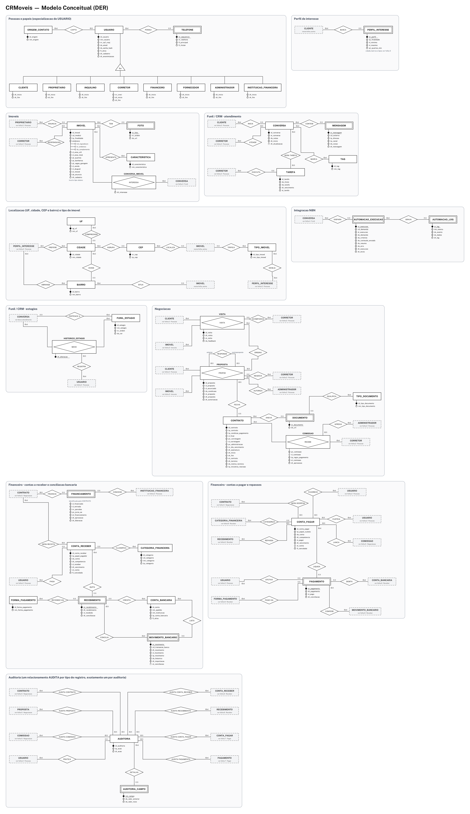

| Simbolo | Significado |
|---|---|
| Retangulo | Entidade forte (ou subtipo) |
| Retangulo duplo | Entidade fraca |
| Retangulo com losango | Entidade associativa |
| Losango | Relacionamento |
| Triangulo com t,c | Especializacao total (t) e compartilhada (c): USUARIO e seus subtipos |
| Circulo preenchido | Identificador (sublinhado) ou identificador parcial (sublinhado tracejado) |
| Circulo vazio | Atributo simples |
| Circulo tracejado | Atributo derivado |
| Caixa cinza tracejada | Atalho para entidade de outra folha |

**Convencao de cardinalidade:** o par (min,max) junto de uma entidade indica quantas vezes cada ocorrencia dela participa do relacionamento (secao 14). A legenda da Folha 1 traz a mesma convencao.

### Folha 1 — Identificacao, legenda e indice das entidades

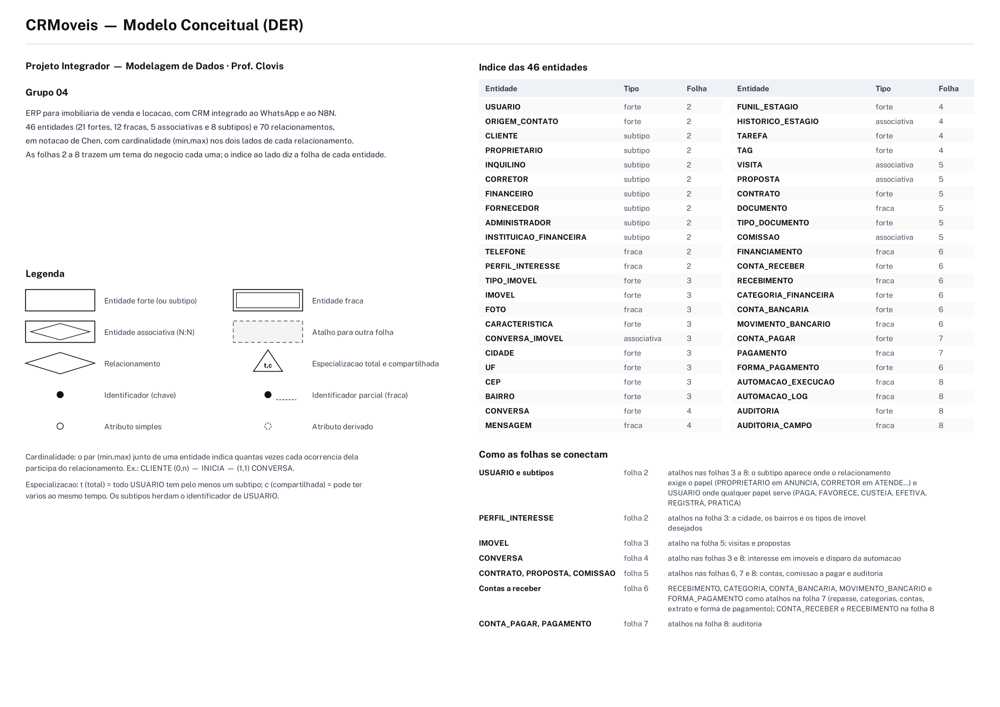

### Folha 2 — Pessoas e papeis

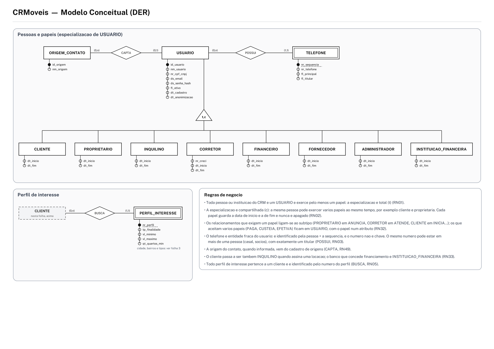

### Folha 3 — Imoveis e localizacao

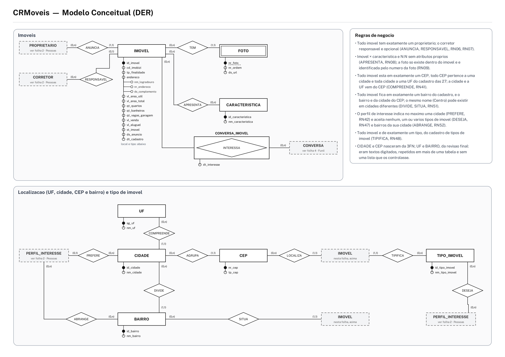

### Folha 4 — Funil / CRM

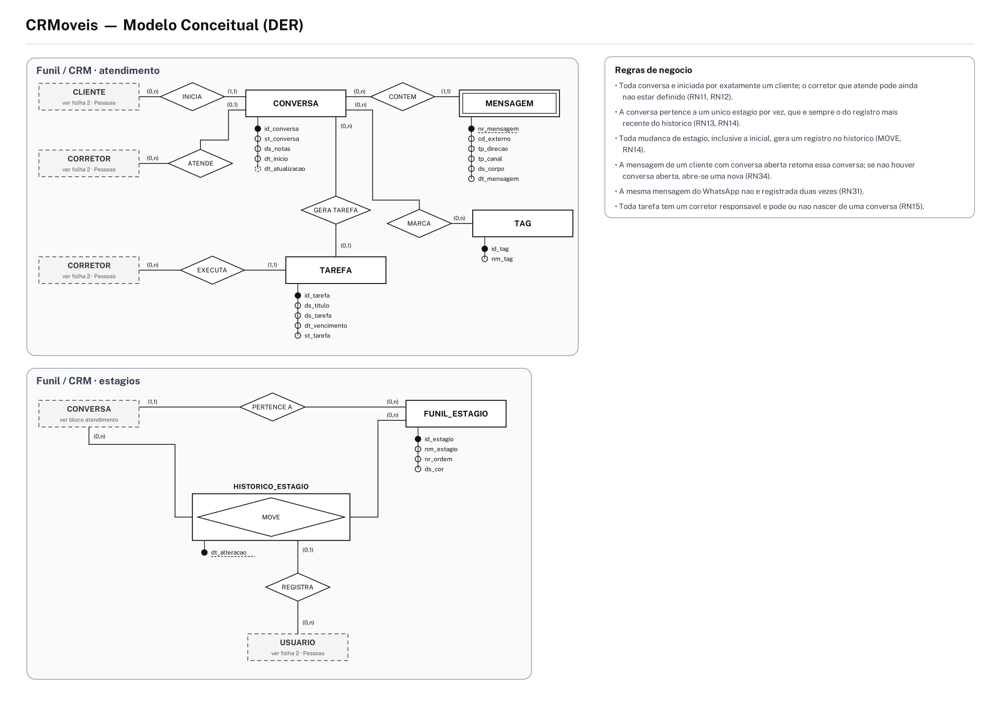

### Folha 5 — Negociacao

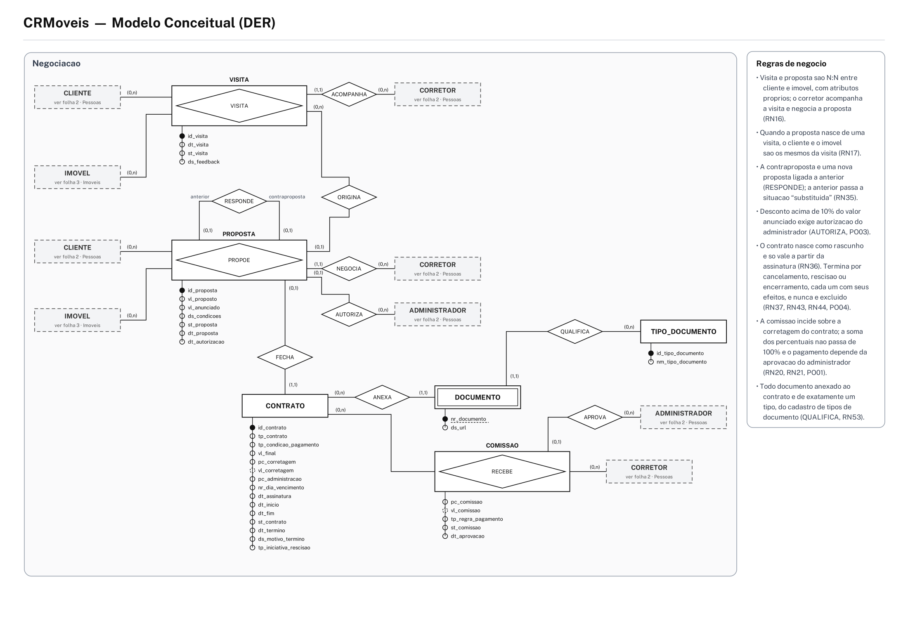

### Folha 6 — Financeiro · contas a receber e conciliacao

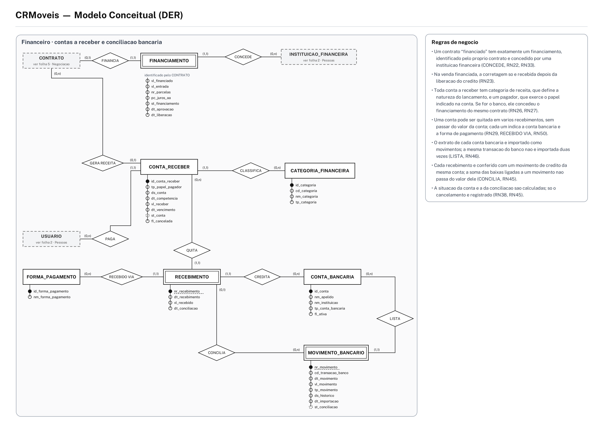

### Folha 7 — Financeiro · contas a pagar e repasses

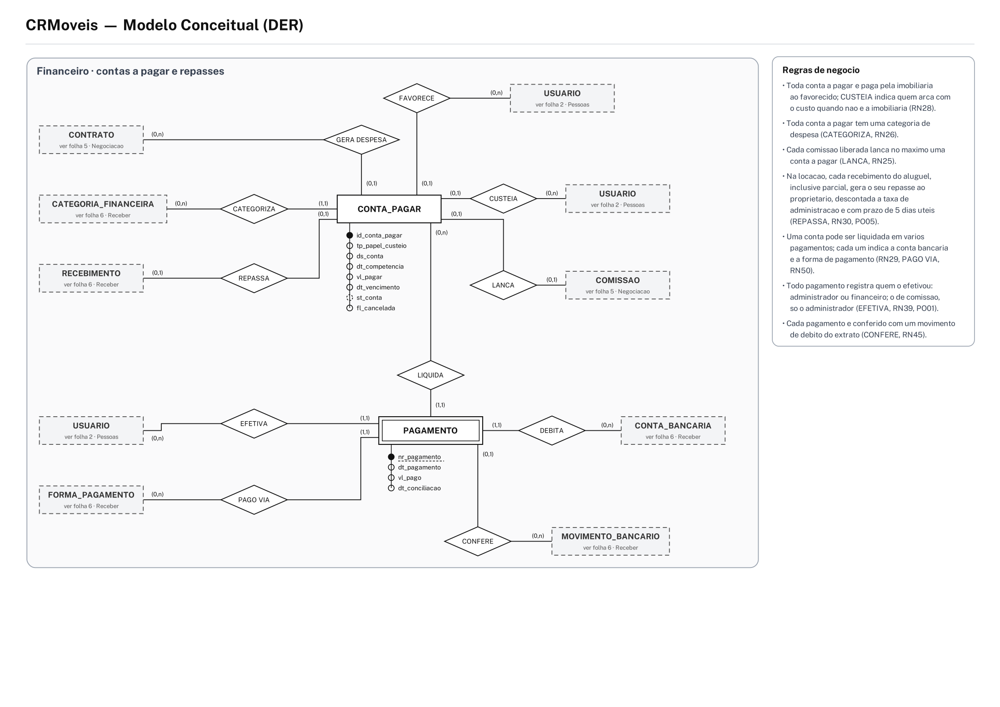

### Folha 8 — Integracao N8N e auditoria

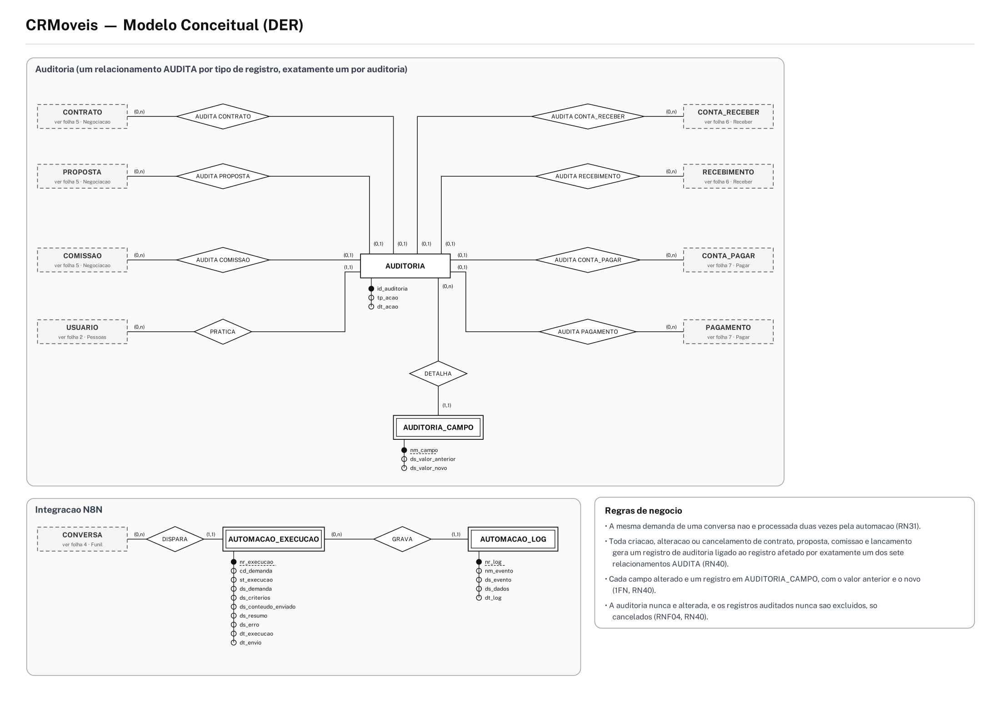

## 17. Justificativas tecnicas

As principais decisoes de modelagem, no formato pedido pelo manual.

### 17.1 USUARIO especializado em papeis

| | |
|---|---|
| **O que decidimos** | Toda pessoa ou instituicao e um USUARIO, e os papeis sao subtipos de uma especializacao total e compartilhada: CLIENTE, PROPRIETARIO, INQUILINO, CORRETOR, FINANCEIRO, FORNECEDOR, ADMINISTRADOR e INSTITUICAO_FINANCEIRA. Cada relacionamento que exige um papel liga-se ao subtipo, e nao a USUARIO. |
| **Por que decidimos assim** | A mesma pessoa pode ter varios papeis (o proprietario que tambem quer comprar), e o cadastro nao pode se repetir. Na versao anterior o papel era um atributo multivalorado, e nada no modelo impedia, por exemplo, ligar como corretor de uma conversa alguem que nao e corretor: a regra RN32 ficava so no texto. Com a especializacao, ANUNCIA so aceita um PROPRIETARIO, ATENDE so aceita um CORRETOR, e assim por diante; no banco, a chave estrangeira aponta para a tabela do subtipo e recusa quem nao tem o papel. A especializacao e compartilhada porque os papeis se sobrepoem, e cada subtipo guarda as datas de inicio e de fim, porque os papeis mudam com o tempo e o historico nao pode ser apagado. O CRECI saiu de USUARIO e foi para CORRETOR, onde passa a ser obrigatorio. Nos tres relacionamentos que aceitam mais de um papel (PAGA, CUSTEIA e EFETIVA), o papel fica num atributo e o banco confere se a pessoa o exerce. |
| **Qual regra sustenta** | RN01, RN02, RN32, RN33 · RF02 · devolutiva, ponto 1 |

### 17.2 Telefone compartilhado com um titular

| | |
|---|---|
| **O que decidimos** | TELEFONE guarda cada numero uma unica vez, e o vinculo com as pessoas e a entidade associativa USUARIO_TELEFONE (POSSUI), N:N. Cada vinculo diz se aquele e o telefone principal da pessoa e se a pessoa e o titular do numero; cada telefone tem exatamente um titular. |
| **Por que decidimos assim** | A versao anterior dizia, ao mesmo tempo, que todo telefone pertence a um unico usuario e que alguns numeros podem ser compartilhados, o que e contraditorio. Agora o compartilhamento esta na propria cardinalidade (um telefone com um ou varios usuarios), e a identificacao pelo WhatsApp continua sem ambiguidade, porque a automacao procura o titular do numero. Ter identificador proprio continua correto: o numero nao depende de nenhuma pessoa para existir. |
| **Qual regra sustenta** | RN03 · RF03 · devolutiva, ponto 2 |

### 17.3 Endereco como atributo composto

| | |
|---|---|
| **O que decidimos** | O endereco do imovel foi decomposto em logradouro, numero, complemento e bairro. O CEP, a cidade e a UF sairam do atributo composto e passaram a vir das entidades CEP e CIDADE (17.25). |
| **Por que decidimos assim** | A busca por imovel e feita por cidade e bairro, e o perfil de interesse compara esses campos separadamente. |
| **Qual regra sustenta** | RF04, RF11, RF13 |

### 17.4 Imovel × caracteristica como N:N sem atributos

| | |
|---|---|
| **O que decidimos** | Ficou como losango (0,n)–(0,n), sem entidade associativa. |
| **Por que decidimos assim** | Um imovel tem varias caracteristicas e uma caracteristica vale para varios imoveis; a relacao nao guarda nenhuma informacao propria. |
| **Qual regra sustenta** | RN08 · Etapas 14 e 15 do manual |

### 17.5 VISITA e PROPOSTA como associativas com identificador proprio

| | |
|---|---|
| **O que decidimos** | Sao N:N entre cliente e imovel, com atributos (data, situacao, valor) e identificador proprio. |
| **Por que decidimos assim** | O mesmo cliente pode visitar o mesmo imovel mais de uma vez e fazer varias propostas, entao o par cliente–imovel nao basta para identificar. |
| **Qual regra sustenta** | RN16, RN17 |

### 17.6 PROPOSTA (0,1) — FECHA — (1,1) CONTRATO

| | |
|---|---|
| **O que decidimos** | Uma proposta participa de no maximo um contrato (0,1), e todo contrato nasce de exatamente uma proposta (1,1). |
| **Por que decidimos assim** | Nem toda proposta e aceita (0), e a aceita nao pode gerar dois contratos (1); nao existe contrato sem proposta. |
| **Qual regra sustenta** | RN18 |

### 17.7 COMISSAO como associativa entre contrato e corretor, calculada sobre a corretagem

| | |
|---|---|
| **O que decidimos** | A comissao e N:N entre contrato e corretor, com percentual, regra de pagamento e valor derivado. O valor e o percentual do corretor aplicado sobre a corretagem do contrato (vl_corretagem), e nao sobre o preco do imovel. |
| **Por que decidimos assim** | Um contrato pode dividir a comissao entre varios corretores, e um corretor recebe comissao de varios contratos. O percentual descreve a participacao, nao o contrato nem o corretor. A base e a corretagem porque e o que a imobiliaria efetivamente recebe: aplicar a comissao sobre o preco do imovel permitiria pagar aos corretores mais do que a imobiliaria recebeu. |
| **Qual regra sustenta** | RN20, RN21 · Etapa 15 do manual |

### 17.8 FINANCIAMENTO como entidade fraca do contrato, concedido por um banco

| | |
|---|---|
| **O que decidimos** | O financiamento e 1:1 opcional com o contrato, e identificado pelo proprio contrato e e concedido por um usuario com o papel de instituicao financeira (CONCEDE). A conta a receber da corretagem se liga apenas ao contrato (GERA RECEITA); o financiamento e encontrado por esse mesmo contrato. |
| **Por que decidimos assim** | Na venda financiada, a corretagem so entra quando o banco libera o credito; o sistema precisa saber qual banco concedeu o credito e quando o liberou. Guardar so o nome do banco como texto impediria ligar o banco como pagador da conta a receber. Uma versao anterior ligava a conta a receber tambem ao financiamento (LIBERA), mas, como o financiamento e identificado pelo contrato, a conta apontava duas vezes para o mesmo contrato: um campo carona, que a 3FN nao permite. LIBERA foi removido sem perda de informacao (secao 18). |
| **Qual regra sustenta** | RN22, RN23, RN27, RN33 |

### 17.9 Contas a receber e a pagar separadas, com baixas

| | |
|---|---|
| **O que decidimos** | Receitas e despesas sao entidades diferentes, e cada uma tem baixas (RECEBIMENTO e PAGAMENTO) como entidades fracas. |
| **Por que decidimos assim** | Reconhecemos que as duas se parecem (valor, vencimento, categoria, baixas). Comparamos com um lancamento unico com tipo receita/despesa. Mantivemos separadas porque os relacionamentos e as regras diferem: so a conta a receber sempre tem um pagador (PAGA), que pode ser o banco do financiamento; so a conta a pagar nasce de uma comissao (LANCA), tem favorecido (FAVORECE) e indica quem arca com o custo (CUSTEIA). Um lancamento unico teria relacionamentos opcionais que so valem para um dos tipos. As baixas podem ser parciais e em contas bancarias diferentes. O modelo logico podera reavaliar a unificacao como supertipo. |
| **Qual regra sustenta** | RN26, RN29 · RF26 |

### 17.10 “Quem paga” como atributo e relacionamento

| | |
|---|---|
| **O que decidimos** | As duas contas tem um atributo com o papel envolvido (tp_papel_pagador na conta a receber, tp_papel_custeio na conta a pagar) e um relacionamento com a pessoa: PAGA, obrigatorio na conta a receber, e CUSTEIA, opcional na conta a pagar. |
| **Por que decidimos assim** | Quem paga varia: na venda costuma ser o vendedor; no financiamento, o banco; na locacao, o inquilino. Como banco e inquilino sao subtipos de USUARIO, a conta a receber sempre tem um pagador, e o banco confere se ele exerce o papel indicado (RN32). Na conta a pagar, quem paga e sempre a imobiliaria; o que varia e quem arca com o custo final, e, quando e a propria imobiliaria, nao ha pessoa a ligar. |
| **Qual regra sustenta** | RN27, RN28 |

### 17.11 Historico do funil como associativa

| | |
|---|---|
| **O que decidimos** | HISTORICO_ESTAGIO liga conversa e estagio, identificado pela data e hora da mudanca. |
| **Por que decidimos assim** | Sem historico, mudar o estagio apagaria de onde o cliente veio, e o relatorio de conversao seria impossivel. |
| **Qual regra sustenta** | RN14 · RF08, RF30 |

### 17.12 Automacao N8N como entidades fracas da conversa

| | |
|---|---|
| **O que decidimos** | Execucao e log existem apenas ligados a uma conversa, identificados por numeros sequenciais. |
| **Por que decidimos assim** | Sao entidades de apoio a integracao: registram cada processamento para a resposta automatica e garantem que a mesma demanda nao seja processada duas vezes, o que e regra de negocio (RN31). A mesma garantia vale para as mensagens, por meio do codigo externo do WhatsApp (MENSAGEM.cd_externo). |
| **Qual regra sustenta** | RF11, RF12 · RN31 |

### 17.13 Aprovacoes como relacionamentos 1:N

| | |
|---|---|
| **O que decidimos** | AUTORIZA liga o administrador a proposta e APROVA liga o administrador a comissao. Em ambos, a proposta ou a comissao participa no maximo uma vez (0,1) e o administrador pode participar varias (0,n). A data fica como atributo do relacionamento. |
| **Por que decidimos assim** | As politicas exigem saber quem aprovou. Como cada proposta ou comissao tem no maximo um aprovador, a data da aprovacao e representada junto da proposta e da comissao. |
| **Qual regra sustenta** | PO01, PO03 |

### 17.14 Nomes unicos para os relacionamentos

| | |
|---|---|
| **O que decidimos** | Cada relacionamento tem um nome proprio, em maiusculas e sem acento, como as entidades (GERA TAREFA, GERA RECEITA, GERA DESPESA, QUITA, LIQUIDA, CLASSIFICA, CATEGORIZA…). |
| **Por que decidimos assim** | Com nomes repetidos, uma pergunta como “por que existe o GERA?” ficaria ambigua. O nome passa a identificar a relacao sem precisar citar as entidades. |
| **Qual regra sustenta** | Clareza das justificativas |

### 17.15 DER dividido em folhas com atalhos

| | |
|---|---|
| **O que decidimos** | O DER foi desenhado em oito folhas por dominio; entidades de outra folha aparecem como atalho tracejado. |
| **Por que decidimos assim** | Com 41 entidades e os papeis da pessoa ligados a quase tudo, uma folha unica teria linhas cruzando e letra ilegivel. Os atalhos mantem cada linha curta e sem ambiguidade. |
| **Qual regra sustenta** | Legibilidade e consistencia do modelo |

### 17.16 Estagio atual (PERTENCE A) e historico do funil juntos

| | |
|---|---|
| **O que decidimos** | A conversa mantem o relacionamento PERTENCE A com o estagio atual e, ao mesmo tempo, o HISTORICO_ESTAGIO registra todas as passagens. O estagio atual e sempre o do registro mais recente do historico. |
| **Por que decidimos assim** | O estagio atual e consultado o tempo todo (quadro do funil), e guarda-lo na propria conversa evita procurar o ultimo registro do historico. O historico continua necessario para o relatorio de conversao. A redundancia e controlada pela regra RN14: toda mudanca grava o historico e atualiza o estagio na mesma operacao. |
| **Qual regra sustenta** | RN13, RN14 · RF07, RF08, RF30 |

### 17.17 Inquilino e instituicao financeira como subtipos de USUARIO

| | |
|---|---|
| **O que decidimos** | O inquilino e o banco sao subtipos de USUARIO. O cliente passa a ser tambem inquilino na assinatura do contrato de locacao e recebe a data de fim desse papel no encerramento ou na rescisao; o banco passa a ser instituicao financeira quando concede um financiamento. |
| **Por que decidimos assim** | As regras RN27 e RN28 tratam inquilino e banco como pagadores. Como subtipos, eles podem ser exigidos nos relacionamentos (CONCEDE so aceita uma instituicao financeira) e o papel de inquilino tem comeco e fim, acompanhando o contrato. |
| **Qual regra sustenta** | RN27, RN28, RN33 |

### 17.18 Contraproposta como relacionamento recursivo

| | |
|---|---|
| **O que decidimos** | A contraproposta e uma nova PROPOSTA ligada a proposta que ela responde (RESPONDE, recursivo, 0,1 nos dois lados). A proposta respondida passa a situacao “substituida”. |
| **Por que decidimos assim** | Uma situacao “contraproposta” num unico registro perdia a sequencia da negociacao. Com cada rodada em uma linha, com valor e data, a negociacao pode ser reconstruida. |
| **Qual regra sustenta** | RN35 · RF19 |

### 17.19 Valor anunciado guardado na proposta

| | |
|---|---|
| **O que decidimos** | A PROPOSTA guarda o valor anunciado do imovel no momento em que foi feita (vl_anunciado). |
| **Por que decidimos assim** | O limite de desconto de 10% e medido contra o valor anunciado. Como o preco do imovel pode mudar depois, sem esse atributo nao seria possivel conferir por que uma proposta exigiu autorizacao. |
| **Qual regra sustenta** | PO03 · RF19 |

### 17.20 Situacao das contas e da comissao como dados derivados

| | |
|---|---|
| **O que decidimos** | “Parcial”, “recebida/paga” e “atrasada” (contas) e “paga” (comissao) nao sao gravadas: sao calculadas. So o cancelamento e registrado (fl_cancelada; st_comissao). |
| **Por que decidimos assim** | Gravar essas situacoes duplicaria o que ja esta nas baixas e no vencimento e permitiria dados contraditorios, como uma conta marcada como recebida com baixas menores que o valor. |
| **Qual regra sustenta** | RN29, RN38 |

### 17.21 Cancelamento, rescisao e encerramento sem exclusao

| | |
|---|---|
| **O que decidimos** | O contrato nunca e excluido. Ele termina de tres formas, cada uma com sua situacao e seus efeitos (tabela abaixo): cancelamento (o negocio e desfeito antes de produzir efeitos), rescisao (um contrato vigente termina antes do prazo) e encerramento (o contrato chega ao fim normal). As tres guardam a data do termino (dt_termino); cancelamento e rescisao guardam o motivo, e a rescisao, quem pediu. |
| **Por que decidimos assim** | A versao anterior tratava qualquer termino como cancelamento, mas os efeitos sao diferentes: no cancelamento, o que estava pendente e desfeito; na rescisao, o que ja venceu continua devido e so o futuro deixa de existir; no encerramento, nada e desfeito. Apagar o contrato deixaria contas, recebimentos e comissoes sem origem. |
| **Qual regra sustenta** | RN37, RN43, RN44, PO04 · RF33 · devolutiva, ponto 4 |

| Efeito | Cancelamento (RN37) | Rescisao (RN43) | Encerramento (RN44) |
|---|---|---|---|
| Quando acontece | Antes de o contrato produzir efeitos: rascunho de que se desistiu, venda com financiamento negado | Contrato vigente termina antes do prazo, por pedido de uma das partes ou de comum acordo | Locacao chega a data de termino; venda tem todas as contas quitadas |
| Situacao do contrato | cancelado | rescindido | encerrado |
| Dados registrados | data e motivo | data, motivo e quem pediu | data |
| Imovel | volta a “disponivel” | volta a “disponivel” | locacao: volta a “disponivel”; venda: fica “vendido” |
| Comissoes | as nao pagas sao canceladas | as ja liberadas sao mantidas; as pendentes sao canceladas | mantidas |
| Contas a receber e a pagar | as sem nenhuma baixa sao canceladas; devolucoes sao novos lancamentos | as vencidas continuam devidas; as de periodos futuros sao canceladas; multa rescisoria, se prevista, vira conta a receber | nenhuma e cancelada |
| Repasses de valores ja recebidos | continuam devidos | continuam devidos | continuam devidos |
| Papel de inquilino | — | recebe a data de fim | recebe a data de fim |

### 17.22 Auditoria ligada ao registro afetado

| | |
|---|---|
| **O que decidimos** | AUDITORIA registra usuario (PRATICA), data e acao, guarda cada campo alterado em AUDITORIA_CAMPO (DETALHA) e se liga ao registro afetado por um relacionamento proprio para cada tipo: AUDITA CONTRATO, AUDITA PROPOSTA, AUDITA COMISSAO, AUDITA CONTA_RECEBER, AUDITA RECEBIMENTO, AUDITA CONTA_PAGAR e AUDITA PAGAMENTO. Cada registro de auditoria usa exatamente um deles (arco exclusivo). O relacionamento EFETIVA guarda quem realizou cada pagamento. |
| **Por que decidimos assim** | Na versao anterior, a auditoria apontava para o registro pelo nome da entidade e por um codigo em texto: nada garantia que o registro existisse, e um erro de digitacao perdia a prova da alteracao. Com um relacionamento por tipo, o banco usa chaves estrangeiras: so aceita auditoria de um registro que existe e nao deixa apagar um registro auditado. A regra de que exatamente um relacionamento e usado e uma verificacao na propria tabela. Como contratos e lancamentos nunca sao excluidos, so cancelados (PO04, RN37), a referencia nunca se perde. |
| **Qual regra sustenta** | RN39, RN40, PO01 · RF34, RNF04 · devolutiva, ponto 6 |

### 17.23 Anonimizacao de dados pessoais

| | |
|---|---|
| **O que decidimos** | No pedido de exclusao do titular, quem tem contrato, lancamento financeiro ou obrigacao legal de guarda e anonimizado (o registro permanece, sem nome, documento, e-mail e telefones); os demais cadastros podem ser excluidos. |
| **Por que decidimos assim** | Contratos e financas referenciam o usuario e nao podem ser apagados (PO04). A anonimizacao concilia o direito do titular com o dever de guardar os registros, e dt_anonimizacao mostra quando ocorreu. |
| **Qual regra sustenta** | PO07 · RNF03, RF35 |

### 17.24 Finalidade e valores do imovel

| | |
|---|---|
| **O que decidimos** | O imovel aceita a finalidade venda, locacao ou ambas, com vl_venda e vl_aluguel obrigatorios conforme a finalidade. |
| **Por que decidimos assim** | Um mesmo imovel pode ser ofertado para venda e para locacao. Com um unico valor, seria preciso cadastrar duas vezes a mesma unidade. |
| **Qual regra sustenta** | RF13 |

### 17.25 Localizacao normalizada: CEP e CIDADE

| | |
|---|---|
| **O que decidimos** | A cidade e a UF sairam do imovel e do perfil de interesse. O imovel se liga a um CEP (LOCALIZA), o CEP a uma cidade (AGRUPA), e o perfil de interesse indica a cidade desejada (PREFERE). |
| **Por que decidimos assim** | O CEP determina a cidade e a UF. Com os tres no imovel, cidade e UF eram campos carona: dependiam do CEP, e nao da chave do imovel, o que viola a 3FN. Separa-los evita a mesma cidade escrita de formas diferentes e faz o perfil e o imovel usarem a mesma cidade na comparacao. Logradouro e bairro continuam no imovel porque um CEP geral cobre a cidade inteira e nao determina rua nem bairro. |
| **Qual regra sustenta** | RN41, RN42 · RF04, RF11, RF13 |

### 17.26 Campos alterados da auditoria em entidade propria

| | |
|---|---|
| **O que decidimos** | Os valores alterados sairam de AUDITORIA e foram para AUDITORIA_CAMPO, com um registro por campo, contendo o valor anterior e o novo. |
| **Por que decidimos assim** | Uma alteracao pode mudar varios campos de uma vez. Guardar "os valores antes e depois" num unico atributo seria uma lista dentro de uma celula, o que a 1FN nao permite. |
| **Qual regra sustenta** | RN40 · RF34 |

### 17.27 Valores congelados nao sao redundancia

| | |
|---|---|
| **O que decidimos** | A proposta guarda o valor anunciado no momento em que foi feita (vl_anunciado), e o contrato guarda o valor fechado (vl_final), mesmo que o preco do imovel mude depois. |
| **Por que decidimos assim** | Esses valores nao dependem do preco atual do imovel, e sim da proposta e do contrato naquele momento; por isso nao sao campos carona. E a mesma logica de guardar num pedido o preco pago, e nao o preco de hoje do produto. |
| **Qual regra sustenta** | PO03, RN18 · RF19, RF20 |

### 17.28 Repasse a cada recebimento do aluguel

| | |
|---|---|
| **O que decidimos** | Na locacao, cada recebimento do aluguel, mesmo parcial, gera um repasse proprio ao proprietario, ligado ao recebimento que o originou (REPASSA). O valor e o recebido menos a taxa de administracao proporcional. |
| **Por que decidimos assim** | A devolutiva pediu o comportamento com pagamento parcial. Comparamos com esperar a quitacao total: seria mais simples, mas reteria dinheiro do proprietario que ja entrou na conta da imobiliaria. Repassando por recebimento, a imobiliaria nunca repassa o que nao recebeu e nunca segura o que ja recebeu. Exemplo: aluguel de R$ 2.000,00 com taxa de administracao de 10%; o inquilino paga R$ 1.200,00 no dia 5 e R$ 800,00 no dia 20; sao gerados dois repasses, de R$ 1.080,00 e R$ 720,00, cada um com prazo de 5 dias uteis a partir do seu recebimento. |
| **Qual regra sustenta** | RN30, PO05 · RF27 · devolutiva, ponto 3 |

### 17.29 Conciliacao com o extrato bancario

| | |
|---|---|
| **O que decidimos** | O extrato de cada conta bancaria e importado como MOVIMENTO_BANCARIO, entidade fraca da conta (LISTA). Cada recebimento e cada pagamento e ligado ao movimento que o comprova (CONCILIA e CONFERE), com a data da conciliacao. |
| **Por que decidimos assim** | As baixas e as contas bancarias ja mostravam onde o dinheiro deveria ter entrado ou saido, mas nao havia como comparar com o que o banco registrou. Com o movimento do extrato no modelo, a conferencia fica registrada: um movimento pode comprovar varias baixas (um deposito com dois alugueis); a baixa e o movimento precisam ser da mesma conta e da mesma direcao; a soma das baixas ligadas nao passa do valor do movimento; e o codigo da transacao impede importar o mesmo extrato duas vezes. O que nao bate aparece como pendente. |
| **Qual regra sustenta** | RN45, RN46 · RF36 · devolutiva, ponto 5 |

### 17.30 Soma das comissoes garantida no banco

| | |
|---|---|
| **O que decidimos** | A regra de que a soma dos percentuais dos corretores nao passa de 100% da corretagem (RN20) e garantida por um gatilho (trigger) na tabela de comissoes, alem da verificacao de cada percentual (maior que 0 e no maximo 100). |
| **Por que decidimos assim** | Uma verificacao simples (CHECK) olha uma linha de cada vez e nao enxerga as outras comissoes do mesmo contrato. O gatilho soma os percentuais ja gravados do contrato (sem as comissoes canceladas, para que uma comissao possa ser substituida) com o novo valor e recusa a gravacao se passar de 100%. Para que duas pessoas nao gravem ao mesmo tempo e passem juntas do limite, o gatilho bloqueia a linha do contrato durante a soma (SELECT … FOR UPDATE). O codigo e os testes estao na secao 19. |
| **Qual regra sustenta** | RN20, RN21 · RF22 · devolutiva, ponto 7 |

## 18. Normalizacao (1FN, 2FN e 3FN)

Produto da aula 8: **modelo logico revisado e normalizado ate a 3FN, acompanhado do dicionario de dados atualizado e das justificativas tecnicas**. A secao segue o roteiro do diario de bordo: conceitos, selecao das tabelas, auditoria pelos oito criterios, registro das inconsistencias, antes e depois, atualizacao da documentacao e reflexao final.

**Resultado:** 43 tabelas, 271 colunas e 76 chaves estrangeiras, todas na 3FN. Cinco problemas foram encontrados e corrigidos (tres de 1FN e dois de 3FN); nenhuma tabela violava a 2FN. O modelo logico abaixo ja inclui as correcoes da devolutiva (secao 19), que foram auditadas pelos mesmos criterios.

Dicionario logico: [`../dicionario-dados/dicionario-de-dados.md`](../dicionario-dados/dicionario-de-dados.md) · script para o dbdiagram.io: [`../modelo-logico/crmoveis.dbml`](../modelo-logico/crmoveis.dbml) · script do PostgreSQL: [`../../sql/ddl/`](../../sql/ddl/)

### 18.1 Conceitos usados

As definicoes sao as apresentadas em aula.

| Conceito | Definicao | Pergunta que usamos para conferir |
|---|---|---|
| **Normalizacao** | Processo de organizacao das relacoes de um banco de dados, com base em dependencias entre atributos, buscando reduzir redundancias indevidas e prevenir anomalias. | O mesmo fato esta guardado em mais de um lugar sem necessidade? |
| **Dependencia funcional** | X → Y quando cada valor de X determina um unico valor de Y. Ex.: id_produto → nome_produto. | Conhecendo X, eu sei Y com certeza? |
| **1FN** | Todos os campos contem valores atomicos (indivisiveis) e nao ha grupos repetitivos. | Alguma celula guarda uma lista ou um texto com varias partes? |
| **2FN** | Tudo o que esta na tabela deve depender da chave inteira, e nao de apenas metade dela. So se aplica a tabelas com chave primaria composta (duas ou mais colunas). | “De qual chave esse atributo depende?” |
| **3FN** | Eliminacao de dependencias transitivas: um atributo nao chave nao deve depender de outro atributo nao chave; deve depender diretamente da chave primaria. Nao pode haver campo “carona”. | Esse campo depende da chave ou de outro campo que nao e chave? |

As formas normais sao cumulativas: uma tabela na 3FN tambem esta na 1FN e na 2FN.

### 18.2 Do modelo conceitual ao modelo logico

| Elemento do DER | Como virou tabela | Exemplos |
|---|---|---|
| Entidade forte | Tabela com o identificador como chave primaria | usuario, imovel, contrato, cidade, cep |
| Subtipo de uma especializacao | Tabela cuja chave primaria e o identificador do supertipo, que tambem e FK para ele | cliente, proprietario, corretor, administrador (id_usuario → usuario) |
| Entidade fraca | Chave primaria composta: FK da entidade dona + identificador parcial | foto, mensagem, documento, recebimento, auditoria_campo |
| Entidade fraca 1:1 | A chave primaria e a propria FK da dona | financiamento (id_contrato) |
| Relacionamento 1:N | FK no lado N; NOT NULL quando a participacao minima e 1 | imovel.id_proprietario → proprietario (ANUNCIA), imovel.nr_cep (LOCALIZA) |
| Relacionamento 1:1 | FK com valor unico (UK) | contrato.id_proposta (FECHA), comissao.id_conta_pagar (LANCA), conta_pagar.(id_conta_receber_origem, nr_recebimento_origem) (REPASSA) |
| Relacionamento N:N sem atributos | Tabela de ligacao com chave primaria composta | imovel_caracteristica (APRESENTA), conversa_tag (MARCA) |
| Entidade associativa | Tabela propria com as FKs dos dois lados e seus atributos | usuario_telefone, conversa_imovel, historico_estagio, comissao, visita, proposta |
| Atributo multivalorado | Tabela propria, uma linha por valor | Nenhum no modelo atual (os papeis, que eram multivalorados, viraram especializacao) |
| Atributo composto | Uma coluna atomica por parte | imovel: nm_logradouro, nr_endereco, ds_complemento, nm_bairro |
| Atributo derivado | Nao e armazenado; e calculado numa visao | vl_corretagem, vl_comissao, st_conta, st_conciliacao, dt_atualizacao |

As 41 entidades viraram 41 tabelas e os dois N:N sem atributos geraram mais 2, num total de 43. Os 60 relacionamentos viraram 68 chaves estrangeiras (cada um dos 8 relacionamentos N:N gera duas); com as 8 da especializacao, sao 76. A conferencia entre o DER e o modelo logico foi feita por script: todo relacionamento tem a FK correspondente, toda FK de participacao minima 1 e NOT NULL, toda FK de relacionamento 1:1 e unica, todo subtipo tem a chave primaria igual a FK para usuario, todo atributo nao derivado do dicionario conceitual esta presente e nenhum derivado e armazenado.

### 18.3 Selecao das tabelas

O diario pede no minimo quatro tabelas, incluindo uma associativa. Auditamos as 43 e destacamos seis, que cobrem os tipos de tabela e todos os problemas encontrados.

| Tabela | Classificacao | Por que foi escolhida |
|---|---|---|
| usuario | Forte (supertipo) | O atributo multivalorado tp_papel nao podia virar uma coluna com varios valores (1FN); depois da devolutiva, os papeis viraram subtipos |
| imovel | Forte | Endereco composto (1FN) e, na versao anterior, cidade e UF dependentes do CEP (3FN) |
| auditoria | Forte | Na versao anterior, guardava os campos alterados num unico texto (1FN) |
| conta_receber | Forte | Na versao anterior, apontava para o contrato e tambem para o financiamento do mesmo contrato (3FN) |
| financiamento | Fraca (identificada pelo contrato) | Como a chave do financiamento e o proprio contrato, a ligacao LIBERA com a conta a receber repetia o contrato (3FN) |
| comissao | Associativa (chave composta) | Teste da 2FN: cada atributo depende do par contrato + corretor? |

### 18.4 Auditoria de normalizacao

Os oito criterios do diario, verificados em todas as tabelas:

| # | Criterio | Resultado | Como verificamos |
|---|---|---|---|
| 1 | Os atributos apresentam valores atomicos, sem listas ou grupos repetitivos (1FN) | Atendido apos correcao | Tres problemas corrigidos: papeis do usuario, endereco do imovel e valores da auditoria (registros 1 a 3) |
| 2 | Todos os atributos nao chave dependem da chave completa, sem dependencias parciais (2FN) | Atendido | As 16 tabelas com chave composta foram conferidas uma a uma (quadro abaixo); nenhuma dependencia parcial |
| 3 | Nao existem dependencias transitivas indevidas entre atributos nao chave (3FN) | Atendido apos correcao | Dois problemas corrigidos: cidade e UF dependentes do CEP e conta a receber ligada ao financiamento (registros 4 e 5); os atributos derivados nao sao armazenados |
| 4 | As dependencias funcionais foram identificadas corretamente | Atendido | Dependencias listadas na 18.5 e no quadro da 2FN |
| 5 | Nao existem redundancias desnecessarias | Atendido | As repeticoes que restaram sao valores congelados ou redundancia controlada, justificadas na 18.7 |
| 6 | Foram analisados os riscos de anomalias de insercao, atualizacao e exclusao | Atendido | Exemplo completo no antes e depois do CEP (18.6) |
| 7 | As chaves primarias e estrangeiras estao corretamente definidas | Atendido | 43 chaves primarias e 76 chaves estrangeiras; conferencia automatica contra as cardinalidades da secao 14 |
| 8 | A decomposicao preserva os relacionamentos e as regras de negocio | Atendido | Os 60 relacionamentos tem FK; a juncao das tabelas decompostas reconstroi os dados originais; RN23, RN27 e RN40 foram reescritas e RN41 e RN42 foram criadas para o novo desenho; as regras que envolvem mais de um registro sao garantidas por gatilhos testados (secao 19) |

**8 de 8 criterios verificados.**

**Quadro da 2FN.** Para cada tabela de chave composta, a pergunta “de qual chave esse atributo depende?”:

| Tabela | Chave primaria | Atributos nao chave dependem de… |
|---|---|---|
| usuario_telefone | (id_usuario, id_telefone) | fl_principal e fl_titular valem para aquele usuario naquele numero: o mesmo numero pode ser o principal de um usuario e nao do outro, e so um deles e o titular. |
| perfil_interesse | (id_usuario, nr_perfil) | Finalidade, tipo, bairro, cidade, faixa de valor e quartos descrevem aquele perfil, e nao o usuario: o mesmo cliente pode ter um perfil de compra e outro de locacao. |
| foto | (id_imovel, nr_foto) | Ordem e endereco do arquivo descrevem aquela foto; nao dependem so do imovel. |
| imovel_caracteristica | (id_caracteristica, id_imovel) | Nao ha atributo nao chave. |
| conversa_imovel | (id_imovel, id_conversa) | dt_interesse e o momento em que aquela conversa mostrou interesse naquele imovel: depende do par. |
| mensagem | (id_conversa, nr_mensagem) | Codigo externo, direcao, canal, texto e data descrevem aquela mensagem da conversa. |
| historico_estagio | (id_conversa, dt_alteracao) | O estagio e quem fez a mudanca dependem daquela mudanca (conversa + data e hora). |
| conversa_tag | (id_conversa, id_tag) | Nao ha atributo nao chave. |
| documento | (id_contrato, nr_documento) | Nome e arquivo descrevem aquele documento do contrato. |
| comissao | (id_contrato, id_corretor) | Percentual, regra de pagamento, situacao, aprovacao e conta a pagar valem para aquele corretor naquele contrato. Contraexemplo: nm_corretor dependeria so de id_corretor e pc_corretagem so de id_contrato (metade da chave), por isso ficam em usuario e contrato. |
| movimento_bancario | (id_conta, nr_movimento) | Codigo da transacao, data, valor, tipo e historico descrevem aquele lancamento do extrato da conta, e nao a conta bancaria inteira. |
| recebimento | (id_conta_receber, nr_recebimento) | Conta bancaria, data, valor, forma de pagamento, movimento do extrato e data da conciliacao descrevem aquela baixa, e nao a conta a receber inteira (a conta pode ter varias baixas). |
| pagamento | (id_conta_pagar, nr_pagamento) | Conta bancaria, quem efetivou, data, valor, forma, movimento do extrato e data da conciliacao descrevem aquela baixa da conta a pagar. |
| automacao_execucao | (id_conversa, nr_execucao) | Demanda, situacao, criterios, conteudo, resumo, erro e datas descrevem aquela execucao da automacao na conversa. |
| automacao_log | (id_conversa, nr_execucao, nr_log) | Evento, descricao, dados e data descrevem aquele registro do log da execucao. |
| auditoria_campo | (id_auditoria, nm_campo) | Valor anterior e valor novo dependem do campo dentro daquele registro de auditoria. |

### 18.5 Registro das inconsistencias encontradas

| Registro | Inconsistencia encontrada | Forma normal analisada | Correcao aplicada |
|---|---|---|---|
| 1 | USUARIO guardava os papeis da pessoa (cliente, proprietario, corretor…) num unico atributo multivalorado. Em tabela, isso viraria uma lista dentro de uma celula ou colunas repetidas (papel1, papel2…). | 1FN | Primeiro, tabela usuario_papel (id_usuario, tp_papel), uma linha por papel. Depois da devolutiva (ponto 1), cada papel virou um subtipo de USUARIO, com tabela propria (cliente, corretor…) cuja chave e o id_usuario: continua sem lista numa celula e, alem disso, as FKs passam a exigir o papel. |
| 2 | O endereco do imovel era um atributo composto (logradouro, numero, complemento, bairro, CEP, cidade e UF). Guardado num unico campo de texto, nao seria atomico: buscar por bairro ou por cidade exigiria recortar o texto. | 1FN | Colunas atomicas nm_logradouro, nr_endereco, ds_complemento e nm_bairro; CEP, cidade e UF seguiram para o registro 4. |
| 3 | AUDITORIA guardava em ds_valores todos os campos alterados e seus valores num unico texto (“dt_assinatura: vazio → 15/09/2026; st_contrato: rascunho → vigente”). | 1FN | Tabela auditoria_campo (id_auditoria, nm_campo, ds_valor_anterior, ds_valor_novo), um registro por campo alterado (RN40). |
| 4 | O imovel guardava nr_cep, nm_cidade e sg_uf, e o perfil de interesse guardava a cidade como texto. Como nr_cep → nm_cidade, sg_uf, a cidade e a UF eram campos carona: dependiam do CEP, e nao de id_imovel. | 3FN | Tabelas cep (nr_cep, id_cidade, tp_cep) e cidade (id_cidade, nm_cidade, sg_uf); o imovel guarda so nr_cep (LOCALIZA) e o perfil aponta para a cidade (PREFERE). RN41 e RN42. |
| 5 | A conta a receber apontava para o contrato (GERA RECEITA) e tambem para o financiamento (LIBERA). Como o financiamento e identificado pelo proprio contrato, a FK de LIBERA guardava de novo um contrato: era determinada por id_contrato, que nao e chave da conta a receber, e as duas referencias podiam se contradizer (a conta de um contrato apontando para o financiamento de outro). | 3FN | LIBERA foi removido sem perda de informacao: o financiamento de uma conta e encontrado pelo contrato da conta (financiamento.id_contrato = conta_receber.id_contrato). RN23 e RN27 foram reescritas. |

**Principais dependencias funcionais do modelo final:**

| Dependencia | Onde fica |
|---|---|
| id_usuario → nm_usuario, nr_cpf_cnpj, ds_email… · nr_cpf_cnpj → id_usuario (chave candidata) | usuario |
| id_usuario → dt_inicio, dt_fim (e nr_creci no corretor) · nr_creci → id_usuario (chave candidata) | cliente, corretor e demais subtipos |
| nr_telefone → id_telefone, tp_telefone · (id_usuario, id_telefone) → fl_principal, fl_titular | telefone, usuario_telefone |
| nr_cep → id_cidade · id_cidade → nm_cidade, sg_uf · (nm_cidade, sg_uf) → id_cidade | cep, cidade |
| id_imovel → id_proprietario, nr_cep, nm_logradouro, nr_endereco, nm_bairro, valores, situacao | imovel |
| id_proposta → id_imovel, id_cliente, vl_proposto, vl_anunciado, st_proposta | proposta |
| id_contrato → id_proposta, vl_final, pc_corretagem… · (vl_final, pc_corretagem) → vl_corretagem, que e derivado e nao e armazenado | contrato |
| (id_contrato, id_corretor) → pc_comissao, tp_regra_pagamento, st_comissao | comissao |
| id_contrato → id_instituicao, vl_financiado, dt_liberacao | financiamento |
| (id_conta_receber, nr_recebimento) → id_conta, dt_recebimento, vl_recebido · a situacao da conta e calculada a partir das baixas | recebimento |
| (id_conta, nr_movimento) → cd_transacao_banco, dt_movimento, vl_movimento, tp_movimento · (id_conta, cd_transacao_banco) → nr_movimento (chave candidata) | movimento_bancario |
| (id_auditoria, nm_campo) → ds_valor_anterior, ds_valor_novo | auditoria_campo |

### 18.6 Antes e depois da normalizacao

**Estrutura original** (dados ficticios): cidade e UF no imovel.

| id_imovel | nm_logradouro | nr_endereco | nm_bairro | nr_cep | nm_cidade | sg_uf |
|---|---|---|---|---|---|---|
| 101 | Rua das Flores | 120 | Gonzaga | 11060-001 | Santos | SP |
| 102 | Rua das Flores | 300 | Gonzaga | 11060-001 | Santos | SP |
| 103 | Rua do Sol | 30 | Centro | 11310-050 | Sao Vicente | SP |
| 104 | Rua do Sol | 85 | Centro | 11310-050 | S. Vicente | SP |

Anomalias que essa estrutura permite:

- **Atualizacao:** corrigir o nome de uma cidade exige alterar todos os imoveis daquele CEP; basta esquecer um para “Sao Vicente” e “S. Vicente” conviverem (linhas 103 e 104), e a busca por cidade deixa de encontrar o imovel 104.
- **Insercao:** nao e possivel registrar a que cidade pertence um CEP sem antes cadastrar um imovel nele; e o perfil de interesse, com a cidade digitada, nao casa com o imovel quando a grafia difere.
- **Exclusao:** ao excluir o ultimo imovel de um CEP, perde-se a informacao de que aquele CEP pertence aquela cidade.

**Estrutura corrigida:**

| cidade: id_cidade | nm_cidade | sg_uf |
|---|---|---|
| 1 | Santos | SP |
| 2 | Sao Vicente | SP |

| cep: nr_cep | id_cidade | tp_cep |
|---|---|---|
| 11060-001 | 1 | logradouro |
| 11310-050 | 2 | logradouro |

| imovel: id_imovel | nm_logradouro | nr_endereco | nm_bairro | nr_cep |
|---|---|---|---|---|
| 101 | Rua das Flores | 120 | Gonzaga | 11060-001 |
| 102 | Rua das Flores | 300 | Gonzaga | 11060-001 |
| 103 | Rua do Sol | 30 | Centro | 11310-050 |
| 104 | Rua do Sol | 85 | Centro | 11310-050 |

**Justificativa tecnica:** a cidade passa a existir uma unica vez, a UF e escrita uma vez por cidade e o CEP e cadastrado uma vez. A juncao imovel → cep → cidade devolve exatamente a cidade e a UF de cada imovel, sem perda de informacao, porque nr_cep e a chave de cep e id_cidade e a chave de cidade. Logradouro e bairro continuam no imovel porque um CEP geral cobre a cidade inteira e nao determina rua nem bairro (17.25).

O mesmo raciocinio, em resumo, para as outras correcoes:

| Antes | Depois |
|---|---|
| usuario(id_usuario, …, tp_papel = “cliente, proprietario”) | usuario(id_usuario, …) + cliente(**id_usuario** = 7, dt_inicio) + proprietario(**id_usuario** = 7, dt_inicio): a mesma pessoa nos dois subtipos |
| auditoria(id_auditoria, …, ds_valores = “dt_assinatura: vazio → 15/09/2026; st_contrato: rascunho → vigente”) | auditoria(id_auditoria, …) + auditoria_campo: (501, dt_assinatura, vazio, 15/09/2026), (501, st_contrato, rascunho, vigente) |
| conta_receber(…, id_contrato, id_contrato_financiamento): a FK de LIBERA repetia o contrato | conta_receber(…, id_contrato); o financiamento e financiamento(**id_contrato**, …), encontrado pelo mesmo contrato |

### 18.7 O que parece redundancia, mas nao e

| Situacao | Por que fica |
|---|---|
| proposta.vl_anunciado e contrato.vl_final | Valores congelados no momento da proposta e do contrato. Dependem da proposta e do contrato, e nao do preco atual do imovel, que pode mudar depois (17.27, PO03). |
| conta_receber.tp_papel_pagador e conta_pagar.tp_papel_custeio | Dizem em que papel a pessoa paga ou arca com aquela conta. Uma pessoa pode ser cliente e proprietaria ao mesmo tempo, entao o papel nao e determinado pelo usuario (RN27, RN28). |
| nm_bairro no imovel e no perfil de interesse | No imovel e o bairro onde ele fica; no perfil e o bairro desejado pelo cliente. Sao fatos diferentes, e o CEP nao determina o bairro. |
| conversa.id_estagio e historico_estagio | Redundancia controlada: o estagio atual e sempre o do registro mais recente do historico (RN14). Fica na conversa para o quadro do funil nao precisar procurar o ultimo registro de cada conversa; as duas gravacoes acontecem na mesma operacao. |
| conta_pagar.vl_pagar e dt_vencimento do repasse | Calculados quando o repasse e gerado (valor recebido menos a taxa; 5 dias uteis depois do recebimento) e congelados: se a taxa do contrato mudar depois, o repasse ja gerado nao muda (RN30). |
| recebimento.id_conta e movimento_bancario.id_conta | Nao e repeticao: a FK composta (id_conta, nr_movimento) usa a propria conta da baixa, e e isso que garante que o movimento conciliado e da mesma conta bancaria (RN45). |
| vl_corretagem, vl_comissao, st_conta, st_conciliacao e dt_atualizacao | Nao sao armazenados: sao calculados em visoes a partir de outros campos, o que evita guardar um resultado que poderia ficar desatualizado. |

### 18.8 Modelo logico normalizado

Notacao: **chave primaria** em negrito e _chave estrangeira_ em italico.

**Pessoas e papeis**

- usuario(**id_usuario**, nm_usuario, nr_cpf_cnpj, ds_email, ds_senha_hash, tp_origem, fl_ativo, dt_cadastro, dt_anonimizacao)
- cliente(_**id_usuario**_, dt_inicio, dt_fim)
- proprietario(_**id_usuario**_, dt_inicio, dt_fim)
- inquilino(_**id_usuario**_, dt_inicio, dt_fim)
- corretor(_**id_usuario**_, nr_creci, dt_inicio, dt_fim)
- financeiro(_**id_usuario**_, dt_inicio, dt_fim)
- fornecedor(_**id_usuario**_, dt_inicio, dt_fim)
- administrador(_**id_usuario**_, dt_inicio, dt_fim)
- instituicao_financeira(_**id_usuario**_, dt_inicio, dt_fim)
- telefone(**id_telefone**, nr_telefone, tp_telefone)
- usuario_telefone(_**id_usuario**_, _**id_telefone**_, fl_principal, fl_titular)

**Localizacao e perfil de interesse**

- cidade(**id_cidade**, nm_cidade, sg_uf)
- cep(**nr_cep**, _id_cidade_, tp_cep)
- perfil_interesse(_**id_usuario**_, **nr_perfil**, _id_cidade_, tp_finalidade, tp_imovel, nm_bairro, vl_minimo, vl_maximo, qt_quartos_min)

**Imoveis**

- imovel(**id_imovel**, cd_imobizi, _id_proprietario_, _id_corretor_responsavel_, _nr_cep_, tp_imovel, tp_finalidade, nm_logradouro, nr_endereco, ds_complemento, nm_bairro, vl_area_util, vl_area_total, qt_quartos, qt_banheiros, qt_vagas_garagem, vl_venda, vl_aluguel, st_imovel, ds_anuncio, dt_cadastro)
- foto(_**id_imovel**_, **nr_foto**, nr_ordem, ds_url)
- caracteristica(**id_caracteristica**, nm_caracteristica)
- imovel_caracteristica(_**id_caracteristica**_, _**id_imovel**_)

**Funil / CRM**

- funil_estagio(**id_estagio**, nm_estagio, nr_ordem, ds_cor)
- conversa(**id_conversa**, _id_cliente_, _id_corretor_, _id_estagio_, st_conversa, ds_notas, dt_inicio)
- conversa_imovel(_**id_imovel**_, _**id_conversa**_, dt_interesse)
- mensagem(_**id_conversa**_, **nr_mensagem**, cd_externo, tp_direcao, tp_canal, ds_corpo, dt_mensagem)
- historico_estagio(_**id_conversa**_, **dt_alteracao**, _id_estagio_, _id_usuario_)
- tarefa(**id_tarefa**, _id_conversa_, _id_corretor_, ds_titulo, ds_tarefa, dt_vencimento, st_tarefa)
- tag(**id_tag**, nm_tag)
- conversa_tag(_**id_conversa**_, _**id_tag**_)

**Negociacao**

- visita(**id_visita**, _id_imovel_, _id_cliente_, _id_corretor_, dt_visita, st_visita, ds_feedback)
- proposta(**id_proposta**, _id_imovel_, _id_cliente_, _id_corretor_, _id_autorizador_, _id_proposta_respondida_, _id_visita_, vl_proposto, vl_anunciado, ds_condicoes, st_proposta, dt_proposta, dt_autorizacao)
- contrato(**id_contrato**, _id_proposta_, tp_contrato, tp_forma_pagamento, vl_final, pc_corretagem, pc_administracao, nr_dia_vencimento, dt_assinatura, dt_inicio, dt_fim, st_contrato, dt_termino, ds_motivo_termino, tp_iniciativa_rescisao)
- documento(_**id_contrato**_, **nr_documento**, nm_documento, ds_url)
- comissao(_**id_contrato**_, _**id_corretor**_, pc_comissao, tp_regra_pagamento, st_comissao, _id_aprovador_, dt_aprovacao, _id_conta_pagar_)

**Financeiro**

- financiamento(_**id_contrato**_, _id_instituicao_, vl_financiado, vl_entrada, nr_parcelas, pc_juros_aa, st_financiamento, dt_aprovacao, dt_liberacao)
- categoria_financeira(**id_categoria**, nm_categoria, tp_categoria)
- conta_bancaria(**id_conta**, nm_apelido, nm_instituicao, tp_conta_bancaria, fl_ativa)
- movimento_bancario(_**id_conta**_, **nr_movimento**, cd_transacao_banco, dt_movimento, vl_movimento, tp_movimento, ds_historico, dt_importacao)
- conta_receber(**id_conta_receber**, _id_contrato_, _id_categoria_, _id_pagador_, tp_papel_pagador, tp_origem_receita, ds_conta, dt_competencia, vl_receber, dt_vencimento, fl_cancelada)
- recebimento(_**id_conta_receber**_, **nr_recebimento**, _id_conta_, dt_recebimento, vl_recebido, tp_forma_pagamento, _nr_movimento_, dt_conciliacao)
- conta_pagar(**id_conta_pagar**, _id_contrato_, _id_categoria_, _id_favorecido_, _id_custeador_, _id_conta_receber_origem_, _nr_recebimento_origem_, tp_papel_custeio, tp_despesa, ds_conta, dt_competencia, vl_pagar, dt_vencimento, fl_cancelada)
- pagamento(_**id_conta_pagar**_, **nr_pagamento**, _id_conta_, _id_usuario_, dt_pagamento, vl_pago, tp_forma_pagamento, _nr_movimento_, dt_conciliacao)

**Integracao N8N e auditoria**

- automacao_execucao(_**id_conversa**_, **nr_execucao**, cd_demanda, st_execucao, ds_demanda, ds_criterios, ds_conteudo_enviado, ds_resumo, ds_erro, dt_execucao, dt_envio)
- automacao_log(_**id_conversa**_, _**nr_execucao**_, **nr_log**, nm_evento, ds_evento, ds_dados, dt_log)
- auditoria(**id_auditoria**, _id_usuario_, tp_acao, dt_acao, _id_contrato_, _id_proposta_, _id_comissao_contrato_, _id_comissao_corretor_, _id_conta_receber_, _id_recebimento_conta_, _nr_recebimento_, _id_conta_pagar_, _id_pagamento_conta_, _nr_pagamento_)
- auditoria_campo(_**id_auditoria**_, **nm_campo**, ds_valor_anterior, ds_valor_novo)

| Tabela | Origem no DER | Chave primaria | Chaves estrangeiras |
|---|---|---|---|
| usuario | USUARIO (forte) | (id_usuario) | — |
| cliente | CLIENTE (subtipo) | (id_usuario) | id_usuario → usuario |
| proprietario | PROPRIETARIO (subtipo) | (id_usuario) | id_usuario → usuario |
| inquilino | INQUILINO (subtipo) | (id_usuario) | id_usuario → usuario |
| corretor | CORRETOR (subtipo) | (id_usuario) | id_usuario → usuario |
| financeiro | FINANCEIRO (subtipo) | (id_usuario) | id_usuario → usuario |
| fornecedor | FORNECEDOR (subtipo) | (id_usuario) | id_usuario → usuario |
| administrador | ADMINISTRADOR (subtipo) | (id_usuario) | id_usuario → usuario |
| instituicao_financeira | INSTITUICAO_FINANCEIRA (subtipo) | (id_usuario) | id_usuario → usuario |
| telefone | TELEFONE (forte) | (id_telefone) | — |
| usuario_telefone | USUARIO_TELEFONE (associativa) | (id_usuario, id_telefone) | id_usuario → usuario; id_telefone → telefone |
| cidade | CIDADE (forte) | (id_cidade) | — |
| cep | CEP (forte) | (nr_cep) | id_cidade → cidade |
| perfil_interesse | PERFIL_INTERESSE (fraca) | (id_usuario, nr_perfil) | id_usuario → cliente; id_cidade → cidade |
| imovel | IMOVEL (forte) | (id_imovel) | id_proprietario → proprietario; id_corretor_responsavel → corretor; nr_cep → cep |
| foto | FOTO (fraca) | (id_imovel, nr_foto) | id_imovel → imovel |
| caracteristica | CARACTERISTICA (forte) | (id_caracteristica) | — |
| imovel_caracteristica | Relacionamento N:N APRESENTA | (id_caracteristica, id_imovel) | id_caracteristica → caracteristica; id_imovel → imovel |
| funil_estagio | FUNIL_ESTAGIO (forte) | (id_estagio) | — |
| conversa | CONVERSA (forte) | (id_conversa) | id_cliente → cliente; id_corretor → corretor; id_estagio → funil_estagio |
| conversa_imovel | CONVERSA_IMOVEL (associativa) | (id_imovel, id_conversa) | id_imovel → imovel; id_conversa → conversa |
| mensagem | MENSAGEM (fraca) | (id_conversa, nr_mensagem) | id_conversa → conversa |
| historico_estagio | HISTORICO_ESTAGIO (associativa) | (id_conversa, dt_alteracao) | id_conversa → conversa; id_estagio → funil_estagio; id_usuario → usuario |
| tarefa | TAREFA (forte) | (id_tarefa) | id_conversa → conversa; id_corretor → corretor |
| tag | TAG (forte) | (id_tag) | — |
| conversa_tag | Relacionamento N:N MARCA | (id_conversa, id_tag) | id_conversa → conversa; id_tag → tag |
| visita | VISITA (associativa) | (id_visita) | id_imovel → imovel; id_cliente → cliente; id_corretor → corretor |
| proposta | PROPOSTA (associativa) | (id_proposta) | id_imovel → imovel; id_cliente → cliente; id_corretor → corretor; id_autorizador → administrador; id_proposta_respondida → proposta; id_visita → visita |
| contrato | CONTRATO (forte) | (id_contrato) | id_proposta → proposta |
| documento | DOCUMENTO (fraca) | (id_contrato, nr_documento) | id_contrato → contrato |
| comissao | COMISSAO (associativa) | (id_contrato, id_corretor) | id_contrato → contrato; id_corretor → corretor; id_aprovador → administrador; id_conta_pagar → conta_pagar |
| financiamento | FINANCIAMENTO (fraca) | (id_contrato) | id_contrato → contrato; id_instituicao → instituicao_financeira |
| categoria_financeira | CATEGORIA_FINANCEIRA (forte) | (id_categoria) | — |
| conta_bancaria | CONTA_BANCARIA (forte) | (id_conta) | — |
| movimento_bancario | MOVIMENTO_BANCARIO (fraca) | (id_conta, nr_movimento) | id_conta → conta_bancaria |
| conta_receber | CONTA_RECEBER (forte) | (id_conta_receber) | id_contrato → contrato; id_categoria → categoria_financeira; id_pagador → usuario |
| recebimento | RECEBIMENTO (fraca) | (id_conta_receber, nr_recebimento) | id_conta_receber → conta_receber; id_conta → conta_bancaria; (id_conta, nr_movimento) → movimento_bancario |
| conta_pagar | CONTA_PAGAR (forte) | (id_conta_pagar) | id_contrato → contrato; id_categoria → categoria_financeira; id_favorecido → usuario; id_custeador → usuario; (id_conta_receber_origem, nr_recebimento_origem) → recebimento |
| pagamento | PAGAMENTO (fraca) | (id_conta_pagar, nr_pagamento) | id_conta_pagar → conta_pagar; id_conta → conta_bancaria; id_usuario → usuario; (id_conta, nr_movimento) → movimento_bancario |
| automacao_execucao | AUTOMACAO_EXECUCAO (fraca) | (id_conversa, nr_execucao) | id_conversa → conversa |
| automacao_log | AUTOMACAO_LOG (fraca) | (id_conversa, nr_execucao, nr_log) | (id_conversa, nr_execucao) → automacao_execucao |
| auditoria | AUDITORIA (forte) | (id_auditoria) | id_usuario → usuario; id_contrato → contrato; id_proposta → proposta; (id_comissao_contrato, id_comissao_corretor) → comissao; id_conta_receber → conta_receber; (id_recebimento_conta, nr_recebimento) → recebimento; id_conta_pagar → conta_pagar; (id_pagamento_conta, nr_pagamento) → pagamento |
| auditoria_campo | AUDITORIA_CAMPO (fraca) | (id_auditoria, nm_campo) | id_auditoria → auditoria |

Os diagramas abaixo seguem o estilo do dbdiagram.io, em cinco folhas A3 sem nenhuma linha cruzando outra. Caixa tracejada e atalho para uma tabela detalhada em outro bloco.

#### Modelo logico — folha 1: Pessoas, papeis, localizacao e perfil de interesse

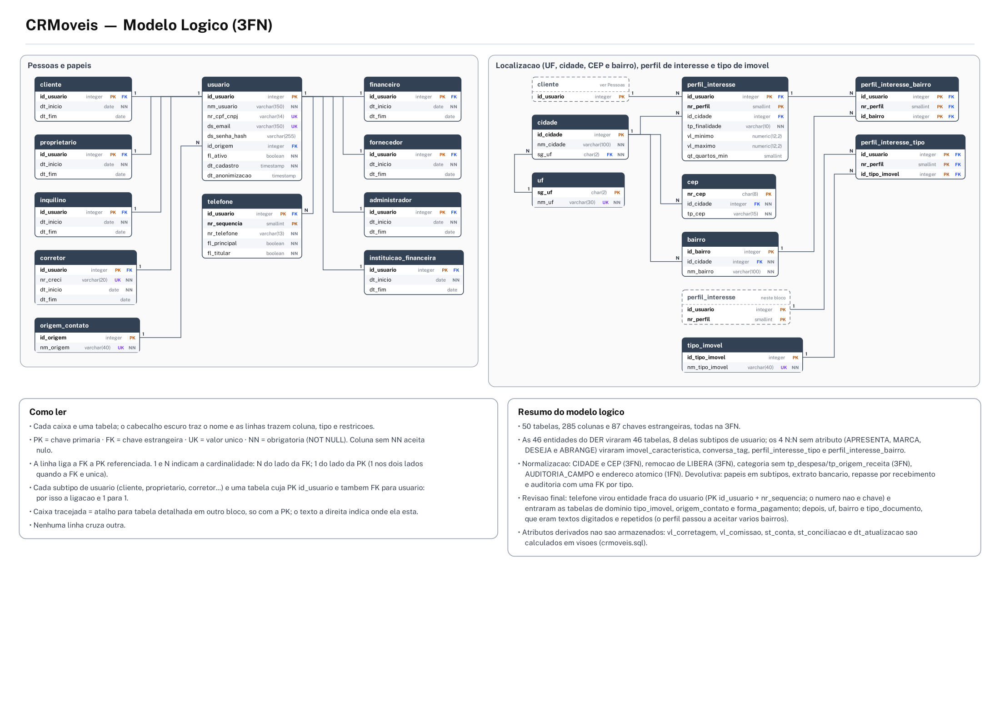

#### Modelo logico — folha 2: Imoveis, integracao N8N e auditoria

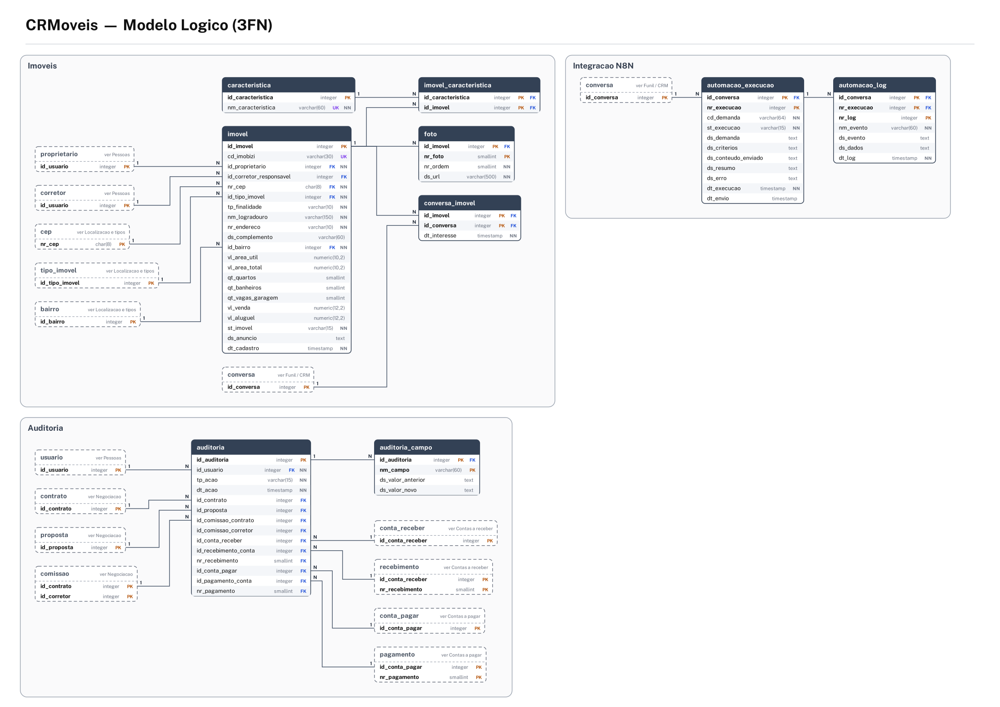

#### Modelo logico — folha 3: Funil / CRM e regras garantidas no banco

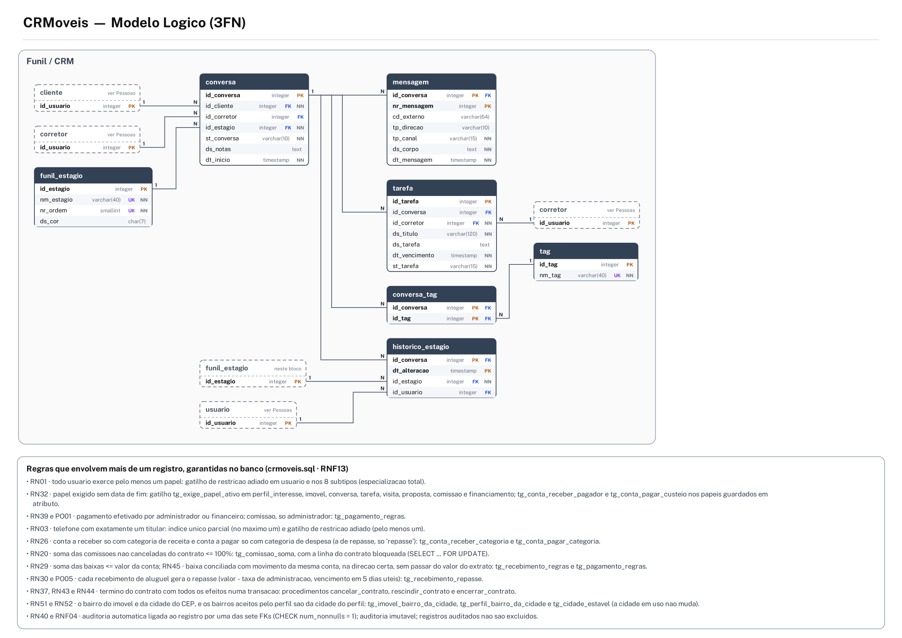

#### Modelo logico — folha 4: Negociacao

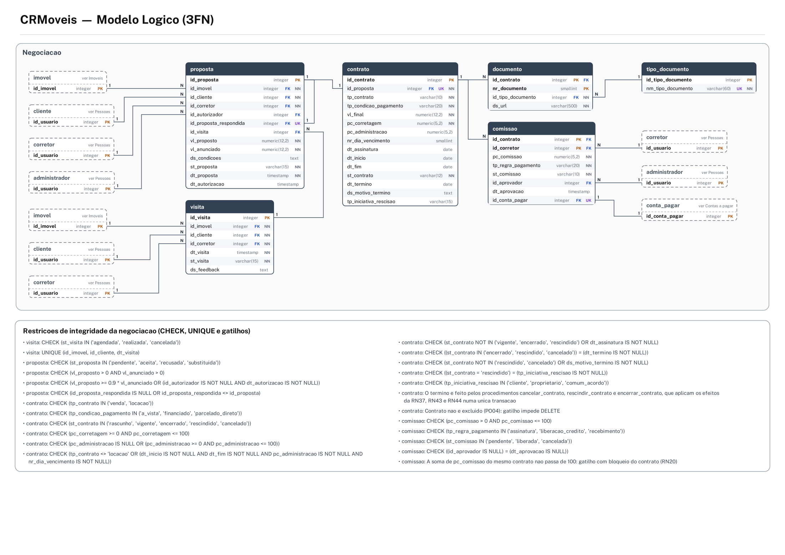

#### Modelo logico — folha 5: Contas a receber, conciliacao, contas a pagar e repasses

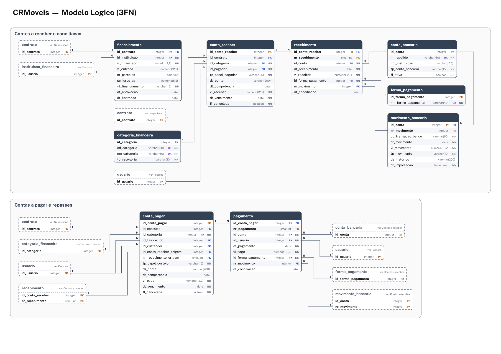

### 18.9 Atualizacao da documentacao

| Item do checklist de entrega | Situacao |
|---|---|
| Modelo logico atualizado | Feito: 18.8, folhas A3 em `../modelo-logico/` e script do PostgreSQL em `../../sql/` |
| Dicionario de dados atualizado | Feito: dicionario conceitual (secao 15) e dicionario logico com tipos, chaves, obrigatoriedade e restricoes ([`dicionario-logico.md`](../dicionario-dados/dicionario-de-dados.md)) |
| PK e FK conferidas | Feito: 43 PKs e 76 FKs conferidas contra as cardinalidades da secao 14 |
| Relacionamentos revisados | Feito: LIBERA removido; PREFERE, LOCALIZA, AGRUPA e DETALHA incluidos; apos a devolutiva, especializacao de USUARIO, POSSUI como N:N, LISTA, CONCILIA, CONFERE, REPASSA e os sete AUDITA (secoes 13 e 14) |
| Correcoes de normalizacao justificadas | Feito: registros da 18.5 e justificativas 17.3, 17.8, 17.25, 17.26 e 17.27 |
| Coerencia entre modelo logico e dicionario de dados verificada | Feito: o dicionario logico e gerado do mesmo modelo que gera os diagramas, o DBML, o Mermaid e o script SQL, e o script foi executado e testado no PostgreSQL (secao 19) |

### 18.10 Reflexao final

**Por que a criacao de tabelas nao garante, isoladamente, um banco de dados corretamente projetado?**

Porque uma tabela pode ser criada e aceitar dados mesmo guardando o mesmo fato em varios lugares. Foi o que vimos no imovel com cidade e UF: a tabela funcionava, mas a cidade dependia do CEP, e nao da chave do imovel. Essa dependencia funcional escondida gerava redundancia, e a redundancia abria espaco para anomalias: a mesma cidade escrita de dois jeitos, um CEP que so existia enquanto houvesse imovel nele, uma correcao que precisava ser repetida em varias linhas. A normalizacao parte das dependencias entre os atributos para decidir onde cada fato deve ficar. Com cada fato guardado uma unica vez, e as tabelas ligadas por chaves primarias e estrangeiras, o proprio banco garante a integridade dos dados, em vez de depender do cuidado de quem digita.

A devolutiva reforcou a licao por outro lado: algumas regras nao cabem numa unica linha, como a soma das comissoes de um contrato ou a baixa que precisa bater com o extrato. Para essas, a estrutura normalizada e o ponto de partida, e o banco completa a garantia com restricoes e gatilhos.


## 19. Correcoes da devolutiva

A devolutiva do professor sobre a versao anterior deste trabalho (nota 8) apontou oito pontos: quatro para corrigir, dois para aprimorar e dois para validar, alem de riscos no banco de dados, no back-end, nas integracoes, no financeiro e na auditoria. Esta secao mostra o que mudou em cada ponto, onde a mudanca esta no documento e os testes que comprovam que as regras sao garantidas pelo proprio banco de dados.

**Resultado:** os oito pontos foram tratados; o modelo passou a ter 41 entidades e 60 relacionamentos no DER e 43 tabelas no modelo logico; o script do PostgreSQL foi executado num banco vazio e os 41 cenarios de teste terminaram como esperado (41 de 41).

### 19.1 O que foi apontado e o que mudou

| Ponto | Tipo | O que o professor apontou | O que fizemos | Onde esta |
|---|---|---|---|---|
| 1 | Corrigir | A estrutura de multiplos papeis pode comprometer a integridade dos dados. | USUARIO passou a ser o supertipo de uma especializacao total e compartilhada em oito subtipos: CLIENTE, PROPRIETARIO, INQUILINO, CORRETOR, FINANCEIRO, FORNECEDOR, ADMINISTRADOR e INSTITUICAO_FINANCEIRA. Cada relacionamento que exige um papel liga-se ao subtipo; a chave estrangeira so aceita quem exerce o papel, e um gatilho recusa papel com data de fim. | RN01, RN02, RN32 · 17.1, 17.17 · DER folha 2 · testes 1.1 a 1.8 |
| 2 | Corrigir | Telefones compartilhados contradizem a regra “cada telefone pertence a um unico usuario”. | A regra foi revista: o numero e cadastrado uma unica vez e pode ser de varios usuarios (USUARIO_TELEFONE, N:N), com exatamente um titular, que e por quem a automacao identifica o cliente. A cardinalidade passou a USUARIO (0,n) — POSSUI — (1,n) TELEFONE. | RN03 · 17.2 · secoes 13 e 14 · F1 · testes 2.1 a 2.4 |
| 3 | Aprimorar | Comportamento do repasse quando o inquilino paga parcialmente. | Cada recebimento do aluguel, mesmo parcial, gera o seu repasse ao proprietario (REPASSA), com o valor recebido menos a taxa de administracao e prazo de 5 dias uteis contado daquele recebimento. | RN30, RF27, PO05 · 17.28 · F5 · testes 3.1 a 3.4 |
| 4 | Aprimorar | Diferenciar cancelamento, rescisao e encerramento do contrato. | Tres situacoes com efeitos diferentes sobre o imovel, as comissoes, as contas e o papel de inquilino, executadas por tres procedimentos que fazem tudo numa unica transacao. O contrato guarda a data do termino, o motivo e, na rescisao, quem pediu. | RN37, RN43, RN44, PO04, RF33 · 17.21 · F4, F5 · testes 4.1 a 4.6 |
| 5 | Corrigir | Conferir os lancamentos financeiros com os extratos bancarios. | Nova entidade MOVIMENTO_BANCARIO (o extrato importado, sem duplicidade), ligada as baixas por CONCILIA (recebimentos) e CONFERE (pagamentos), e um novo processo de conciliacao. | RN45, RN46, RF36 · 17.29 · P6, F6 · DER folha 6 · testes 5.1 a 5.7 |
| 6 | Validar | Integridade da auditoria com referencia generica (nome da entidade e codigo do registro). | A referencia generica deu lugar a sete relacionamentos AUDITA, um por tipo de registro, cada um com chave estrangeira; uma verificacao garante que exatamente um e usado. A auditoria e imutavel e os registros auditados nao sao excluidos. | RN40, RNF04 · 17.22 · DER folha 8 · testes 6.1 a 6.7 |
| 7 | Validar | Impedir que a soma dos percentuais de comissao ultrapasse 100%. | Gatilho que soma as comissoes nao canceladas do contrato com a linha do contrato bloqueada, alem da verificacao de cada percentual (maior que 0 e no maximo 100). | RN20 · 17.30 · 19.4 · testes 7.1 a 7.5 |
| 8 | Corrigir | Consolidar os documentos em um unico PDF. | Um unico PDF reune, na ordem do manual, todo o conteudo deste README, o DER em folhas A3, os fluxogramas, o modelo logico, o dicionario logico e os testes. | [`CRMoveis-documentacao-devolutiva.pdf`](CRMoveis-documentacao-devolutiva.pdf) |

### 19.2 Riscos apontados e como foram tratados

| Area | Risco apontado | Como foi tratado |
|---|---|---|
| Banco de dados | Papeis, telefones e vinculos financeiros | Chaves estrangeiras para os subtipos; papel sem data de fim conferido por gatilho; telefone N:N com um titular (indice unico parcial e gatilho); papel de quem paga ou arca com a conta conferido por gatilho; banco so paga conta de contrato que ele financiou. |
| Back-end | Regras transacionais de comissoes, cancelamentos e repasses | As regras que envolvem mais de um registro ficaram no banco (RNF13): a soma das comissoes e conferida com o contrato bloqueado; cancelar, rescindir e encerrar sao procedimentos que aplicam todos os efeitos de uma vez ou nenhum; o repasse e gerado por gatilho a cada recebimento. |
| Integracoes | Dependencia da disponibilidade e das interfaces de sistemas externos | Nao exigiu mudanca no modelo, que ja reduz o impacto: cada execucao da automacao fica registrada com a situacao e o erro (AUTOMACAO_EXECUCAO e AUTOMACAO_LOG), e a mesma demanda e a mesma mensagem nao sao gravadas duas vezes, o que permite reprocessar com seguranca depois de uma falha (RN31, RNF08); o extrato pode ser importado de novo sem duplicar movimentos (RN46). A disponibilidade do WhatsApp e do IMOBIZI continua fora do controle da imobiliaria (RNF07, RNF11). |
| Financeiro | Divergencias com os extratos | O extrato e importado sem duplicidade; cada baixa e ligada ao movimento que a comprova, da mesma conta e na mesma direcao; a soma das baixas nao passa do valor do movimento; o que nao bate fica pendente (F6). |
| Auditoria | Referencia inconsistente | Sete chaves estrangeiras com a verificacao de que exatamente uma e preenchida; auditoria gravada automaticamente, imutavel e sem exclusao dos registros auditados. |

### 19.3 Por que especializacao, e nao uma tabela de papeis

Comparamos tres formas de guardar os papeis antes de decidir (ponto 1):

| Alternativa | Garante que o corretor de uma conversa e corretor? | Problema |
|---|---|---|
| Tabela de papeis (usuario_papel), como na versao anterior | Nao | As chaves estrangeiras apontavam para usuario; o banco aceitava um cliente como corretor ou como proprietario de um imovel. Era o risco apontado. |
| Tabela de papeis com chave estrangeira composta (id_usuario, tp_papel) | Sim | Cada tabela precisaria de uma coluna com valor fixo (por exemplo, tp_papel_corretor = 'corretor' em todas as linhas), um campo que nao depende da chave, contra a 3FN da secao 18. |
| **Especializacao (escolhida)** | **Sim** | Nenhum: cada papel e um subtipo com o mesmo identificador do usuario, e a chave estrangeira aponta para o subtipo. Os papeis guardam inicio e fim, e um papel encerrado nao aceita novos vinculos. |

Os tres relacionamentos que aceitam papeis diferentes ficaram em USUARIO, com o papel num atributo conferido por gatilho: PAGA (cliente, inquilino, proprietario ou banco), CUSTEIA (proprietario ou inquilino) e EFETIVA (administrador ou financeiro; comissao, so administrador).

### 19.4 Regras garantidas pelo banco de dados

O script [`../../sql/ddl/`](../../sql/ddl/) cria as tabelas, as chaves, as verificacoes e os objetos abaixo. Ele roda em PostgreSQL 13 ou superior.

| Regra | Como o banco garante | Objeto no script |
|---|---|---|
| RN01 · todo usuario tem pelo menos um papel | Gatilho de restricao conferido no fim da transacao | ct_usuario_especializacao e um por subtipo |
| RN32 · papel exigido e sem data de fim | Chave estrangeira para o subtipo e gatilho que recusa papel encerrado | tg_exige_papel_ativo, tg_conta_receber_pagador, tg_conta_pagar_custeio |
| RN39, PO01 · quem efetiva o pagamento | Gatilho: administrador ou financeiro; comissao, so administrador | tg_pagamento_regras |
| RN03 · um titular por telefone | Indice unico parcial (no maximo um) e gatilho no fim da transacao (pelo menos um) | ux_usuario_telefone_titular, ct_telefone_titular |
| RN20 · soma das comissoes ate 100% | Gatilho com o contrato bloqueado durante a soma | tg_comissao_soma |
| RN29 · baixas ate o valor da conta | Gatilho com a conta bloqueada durante a soma | tg_recebimento_regras, tg_pagamento_regras |
| RN30, PO05 · repasse a cada recebimento | Gatilho que gera a conta a pagar do repasse, com valor e vencimento calculados | tg_recebimento_repasse, dia_util_apos |
| RN37, RN43, RN44 · termino do contrato | Procedimentos que aplicam todos os efeitos numa transacao | cancelar_contrato, rescindir_contrato, encerrar_contrato |
| RN45, RN46 · conciliacao | Chave estrangeira composta (mesma conta), gatilho de direcao e de soma, restricao unica do codigo da transacao | tg_recebimento_regras, tg_pagamento_regras, uk_movimento_bancario_id_conta_cd_transacao_banco |
| RN40, RNF04 · auditoria | Gatilho que grava a auditoria e os campos alterados; verificacao de exatamente uma referencia; bloqueio de alteracao e exclusao | tg_auditoria, ck_auditoria_arco_exclusivo, tg_auditoria_imutavel, tg_bloqueia_exclusao |
| RN38, RN45 · situacoes calculadas | Visoes, sem armazenar o resultado | vw_conta_receber, vw_conta_pagar, vw_movimento_bancario, vw_comissao, vw_contrato, vw_conversa |

**Soma das comissoes (ponto 7).** Uma verificacao simples (CHECK) olha uma linha por vez; a soma precisa olhar as outras comissoes do contrato. O gatilho bloqueia a linha do contrato, soma as comissoes nao canceladas, sem contar a propria linha quando ela esta sendo alterada, e recusa a gravacao que passaria de 100%. Se duas pessoas gravarem comissoes do mesmo contrato ao mesmo tempo, a segunda espera a primeira terminar e soma de novo.

```sql
CREATE FUNCTION tg_comissao_soma() RETURNS trigger
LANGUAGE plpgsql AS $$
DECLARE v_soma NUMERIC(7,2);
BEGIN
    IF NEW.st_comissao = 'cancelada' THEN RETURN NEW; END IF;
    PERFORM 1 FROM contrato WHERE id_contrato = NEW.id_contrato FOR UPDATE;
    SELECT COALESCE(SUM(pc_comissao), 0) INTO v_soma
      FROM comissao
     WHERE id_contrato = NEW.id_contrato
       AND st_comissao <> 'cancelada'
       AND (id_contrato, id_corretor) IS DISTINCT FROM (OLD.id_contrato, OLD.id_corretor);
    IF v_soma + NEW.pc_comissao > 100 THEN
        RAISE EXCEPTION 'RN20: a soma das comissoes do contrato % ficaria em % %% (limite: 100 %%)',
            NEW.id_contrato, v_soma + NEW.pc_comissao;
    END IF;
    RETURN NEW;
END $$;
CREATE TRIGGER tg_comissao_soma BEFORE INSERT OR UPDATE OF id_contrato, pc_comissao, st_comissao ON comissao
    FOR EACH ROW EXECUTE FUNCTION tg_comissao_soma();
```

**Referencia da auditoria (ponto 6).** Cada tipo de registro tem a sua chave estrangeira; a verificacao `num_nonnulls(...) = 1` garante que cada auditoria aponta para exatamente um registro.

```sql
CREATE TABLE auditoria (
    id_auditoria               INTEGER GENERATED BY DEFAULT AS IDENTITY NOT NULL,
    id_usuario                 INTEGER NOT NULL,
    tp_acao                    VARCHAR(15) NOT NULL,
    dt_acao                    TIMESTAMP NOT NULL DEFAULT CURRENT_TIMESTAMP,
    id_contrato                INTEGER,
    id_proposta                INTEGER,
    id_comissao_contrato       INTEGER,
    id_comissao_corretor       INTEGER,
    id_conta_receber           INTEGER,
    id_recebimento_conta       INTEGER,
    nr_recebimento             SMALLINT,
    id_conta_pagar             INTEGER,
    id_pagamento_conta         INTEGER,
    nr_pagamento               SMALLINT,
    CONSTRAINT pk_auditoria PRIMARY KEY (id_auditoria),
    CONSTRAINT ck_auditoria_tp_acao CHECK (tp_acao IN ('criacao', 'alteracao', 'cancelamento')),
    CONSTRAINT ck_auditoria_arco_exclusivo CHECK (num_nonnulls(id_contrato, id_proposta, id_comissao_contrato, id_conta_receber, id_recebimento_conta, id_conta_pagar, id_pagamento_conta) = 1),
    CONSTRAINT ck_auditoria_id_comissao_contrato_id_comissao_corretor CHECK ((id_comissao_contrato IS NULL) = (id_comissao_corretor IS NULL)),
    CONSTRAINT ck_auditoria_id_recebimento_conta_nr_recebimento CHECK ((id_recebimento_conta IS NULL) = (nr_recebimento IS NULL)),
    CONSTRAINT ck_auditoria_id_pagamento_conta_nr_pagamento CHECK ((id_pagamento_conta IS NULL) = (nr_pagamento IS NULL))
);
```

### 19.5 Testes no PostgreSQL

O script [`../../sql/testes/40_testes_regras.sql`](../../sql/testes/40_testes_regras.sql) roda depois do `crmoveis.sql`, num banco vazio. Ele grava dados de exemplo ficticios (uma locacao, uma venda a vista e uma venda financiada) e executa 41 cenarios; cada cenario e isolado, e o que e recusado e desfeito. Os testes foram executados no PostgreSQL 16. As mensagens proprias do PostgreSQL aparecem traduzidas; as dos gatilhos sao as do script.

**41 de 41 cenarios com o resultado esperado.**

**Ponto 1 · papeis**

| Teste | Cenario | Esperado | Obtido | Confere |
|---|---|---|---|---|
| 1.1 | Cadastrar uma pessoa com dois papeis ao mesmo tempo (cliente e fornecedora) | Aceito | Aceito: usuaria 11 gravada como cliente e fornecedora | Sim |
| 1.2 | Cadastrar um usuario sem nenhum papel | Recusado | Recusado: RN01: o usuario 12 precisa exercer pelo menos um papel | Sim |
| 1.3 | Anunciar um imovel em nome de quem nao e proprietario (Bruno e so cliente) | Recusado | Recusado: RN32: o usuario 6 nao exerce o papel proprietario (ou o papel tem data de fim) em imovel.id_proprietario | Sim |
| 1.4 | Atribuir uma conversa nova a um corretor cujo papel ja terminou (Sergio) | Recusado | Recusado: RN32: o usuario 10 nao exerce o papel corretor (ou o papel tem data de fim) em conversa.id_corretor | Sim |
| 1.5 | Lancar conta a receber com Ana como inquilina (ela e cliente e proprietaria) | Recusado | Recusado: RN32: o pagador 5 nao exerce o papel inquilino | Sim |
| 1.6 | Cobrar do banco uma conta de contrato que ele nao financiou | Recusado | Recusado: RN27: o banco 7 nao financiou o contrato 201 | Sim |
| 1.7 | Pagamento de comissao efetivado pelo financeiro (Fabio) | Recusado | Recusado: PO01: o pagamento de comissao so pode ser efetivado pelo administrador | Sim |
| 1.8 | Pagamento da mesma comissao efetivado pela administradora (Carla) | Aceito | Aceito: conta 300 paga | Sim |

**Ponto 2 · telefones**

| Teste | Cenario | Esperado | Obtido | Confere |
|---|---|---|---|---|
| 2.1 | Numero de WhatsApp compartilhado por Ana (titular) e Bruno | Aceito | Aceito: 2 usuarios no numero, 1 titular | Sim |
| 2.2 | Marcar Bruno como segundo titular do mesmo numero | Recusado | Recusado: valor repetido (restricao unica ux_usuario_telefone_titular) | Sim |
| 2.3 | Cadastrar um numero sem titular | Recusado | Recusado: RN03: o telefone 5 precisa ter exatamente um titular | Sim |
| 2.4 | Cadastrar de novo um numero que ja existe | Recusado | Recusado: valor repetido (restricao unica uk_telefone_nr_telefone) | Sim |

**Ponto 3 · repasse com pagamento parcial**

| Teste | Cenario | Esperado | Obtido | Confere |
|---|---|---|---|---|
| 3.1 | Inquilino paga R$ 1.200,00 do aluguel de R$ 2.000,00 (domingo, 05/04) | Aceito | Aceito: repasse de R$ 1.080,00 a Marta, vencendo em 10/04/2026; aluguel com R$ 1.200,00 recebidos de R$ 2.000,00 | Sim |
| 3.2 | Inquilino paga os R$ 800,00 restantes (segunda, 20/04) | Aceito | Aceito: repasse de R$ 720,00, vencendo em 27/04/2026; aluguel quitado; repasses somam R$ 1.800,00 | Sim |
| 3.3 | Receber mais R$ 10,00 no aluguel ja quitado | Recusado | Recusado: RN29: os recebimentos da conta 400 somariam 2010.00, acima do valor da conta (2000.00) | Sim |
| 3.4 | Alterar o valor de um recebimento que ja gerou repasse | Recusado | Recusado: RN30: o recebimento 400/1 ja gerou repasse e nao pode mudar de valor | Sim |

**Ponto 4 · cancelamento, rescisao e encerramento**

| Teste | Cenario | Esperado | Obtido | Confere |
|---|---|---|---|---|
| 4.1 | Encerrar a locacao antes da data de termino (15/06/2026) | Recusado | Recusado: RN44: a locacao so e encerrada a partir da data de termino (2027-02-28); antes disso e rescisao | Sim |
| 4.2 | Rescindir a locacao em 15/06/2026 a pedido do inquilino, com multa de R$ 4.000,00 | Aceito | Aceito: canceladas as contas de julho e agosto; maio e junho continuam devidas; multa de R$ 4.000,00 lancada; comissao pendente cancelada e liberada mantida; repasses mantidos; imovel disponivel; papel de inquilino ate 15/06/2026 | Sim |
| 4.3 | Cancelar o contrato ja rescindido | Recusado | Recusado: RN37: so contrato em rascunho ou vigente pode ser cancelado (situacao atual: rescindido) | Sim |
| 4.4 | Cancelar a venda 202 porque o banco reprovou o financiamento | Aceito | Aceito: contrato cancelado; corretagem sem baixa cancelada; comissao cancelada; imovel disponivel | Sim |
| 4.5 | Encerrar a venda 201 com a corretagem ainda em aberto | Recusado | Recusado: RN44: a venda so e encerrada com todas as contas do contrato quitadas | Sim |
| 4.6 | Receber a corretagem da venda 201 e encerrar o contrato | Aceito | Aceito: contrato encerrado; nenhum lancamento cancelado; imovel vendido | Sim |

**Ponto 5 · conciliacao bancaria**

| Teste | Cenario | Esperado | Obtido | Confere |
|---|---|---|---|---|
| 5.1 | Importar o extrato de abril (4 movimentos) | Aceito | Aceito: 4 movimentos importados, todos pendentes | Sim |
| 5.2 | Importar de novo a mesma transacao do banco | Recusado | Recusado: valor repetido (restricao unica uk_movimento_bancario_id_conta_cd_transacao_banco) | Sim |
| 5.3 | Conciliar o recebimento de R$ 1.200,00 com o credito de R$ 1.200,00 | Aceito | Aceito: movimento 1 conciliado | Sim |
| 5.4 | Conferir o pagamento do repasse com um movimento de credito | Recusado | Recusado: RN45: pagamento so e conciliado com movimento de debito (o movimento 1 e credito) | Sim |
| 5.5 | Pagar o repasse de R$ 1.080,00 e conferir com o debito do extrato | Aceito | Aceito: repasse pago pelo financeiro; movimento 3 conciliado | Sim |
| 5.6 | Conciliar o recebimento de R$ 800,00 com um credito de R$ 350,00 | Recusado | Recusado: RN45: as baixas ligadas ao movimento 4 somariam 800.00, acima do valor do extrato (350.00) | Sim |
| 5.7 | Conciliar os R$ 800,00 com o credito certo; o credito de R$ 350,00 fica pendente | Aceito | Aceito: mov. 1: conciliado; mov. 2: conciliado; mov. 3: conciliado; mov. 4: pendente | Sim |

**Ponto 6 · auditoria**

| Teste | Cenario | Esperado | Obtido | Confere |
|---|---|---|---|---|
| 6.1 | Conferir a trilha de auditoria gravada pela rescisao do contrato 200 | Aceito | Aceito: 39 registros de auditoria, todos com exatamente uma referencia; st_contrato: vigente → rescindido | Sim |
| 6.2 | Gravar auditoria apontando para dois registros (contrato e proposta) | Recusado | Recusado: verificacao ck_auditoria_arco_exclusivo nao atendida | Sim |
| 6.3 | Gravar auditoria sem apontar para nenhum registro | Recusado | Recusado: verificacao ck_auditoria_arco_exclusivo nao atendida | Sim |
| 6.4 | Gravar auditoria de um contrato que nao existe | Recusado | Recusado: chave estrangeira fk_auditoria_audita_contrato sem registro correspondente | Sim |
| 6.5 | Alterar um registro de auditoria | Recusado | Recusado: RNF04: registros de auditoria nao podem ser alterados nem excluidos | Sim |
| 6.6 | Excluir um contrato auditado | Recusado | Recusado: PO04/RN40: registros de contrato nao sao excluidos; use o cancelamento | Sim |
| 6.7 | Lancar uma conta sem informar o usuario responsavel | Recusado | Recusado: RN40: informe o usuario responsavel (SET LOCAL crmoveis.id_usuario) antes de gravar em conta_receber | Sim |

**Ponto 7 · soma das comissoes**

| Teste | Cenario | Esperado | Obtido | Confere |
|---|---|---|---|---|
| 7.1 | Dividir a comissao da venda 201: Rui 60% e Lia 40% | Aceito | Aceito: soma = 100% | Sim |
| 7.2 | Incluir Paulo com 1% no mesmo contrato | Recusado | Recusado: RN20: a soma das comissoes do contrato 201 ficaria em 101.00 % (limite: 100 %) | Sim |
| 7.3 | Aumentar a parte de Lia de 40% para 45% | Recusado | Recusado: RN20: a soma das comissoes do contrato 201 ficaria em 105.00 % (limite: 100 %) | Sim |
| 7.4 | Gravar comissao com percentual 0 | Recusado | Recusado: verificacao ck_comissao_pc_comissao nao atendida | Sim |
| 7.5 | Cancelar a comissao de Lia e incluir Paulo com 40% | Aceito | Aceito: soma das nao canceladas = 100%; comissao de Paulo = R$ 11.520,00 | Sim |

O exemplo do repasse (testes 3.1 e 3.2) e o da justificativa 17.28: aluguel de R$ 2.000,00, taxa de 10%, pagamento de R$ 1.200,00 num domingo (05/04/2026) e de R$ 800,00 numa segunda-feira (20/04/2026). Os repasses de R$ 1.080,00 e R$ 720,00 vencem em 10/04 e 27/04, cinco dias uteis depois de cada recebimento.

### 19.6 Documento unico

O PDF [`CRMoveis-documentacao-devolutiva.pdf`](CRMoveis-documentacao-devolutiva.pdf) substitui os arquivos separados da versao anterior. Ele segue a ordem do manual: identificacao, caracterizacao, problemas, processos, requisitos, regras e politicas; fluxogramas; entidades, atributos, relacionamentos, cardinalidades e dicionario; DER; justificativas; normalizacao com o modelo logico; correcoes da devolutiva; conclusao; e, no fim, o dicionario de dados logico. As figuras aparecem no tamanho em que foram desenhadas: fluxogramas em A4, DER e modelo logico em A3.


## 20. Conclusao

O modelo conceitual do CRMoveis foi construido na ordem pedida pelo manual: a caracterizacao da imobiliaria levou aos processos, os processos revelaram os problemas, os problemas viraram requisitos e regras, e as regras definiram as entidades, os relacionamentos e as cardinalidades do DER. Cada decisao aponta para o requisito ou a regra que a sustenta.

O modelo, com 41 entidades e 60 relacionamentos, integra atendimento, imoveis, negociacao e financeiro. A normalizacao da [secao 18](#18-normalizacao-1fn-2fn-e-3fn) transformou o modelo conceitual em um modelo logico de 43 tabelas na 3FN, sem grupos repetitivos, sem dependencias parciais e sem campos carona, com as poucas redundancias que restaram justificadas.

A devolutiva ([secao 19](#19-correcoes-da-devolutiva)) levou o modelo um passo adiante: os papeis viraram uma especializacao que o banco consegue exigir, o telefone pode ser compartilhado com um titular, o repasse acompanha cada pagamento do inquilino, o contrato termina de tres formas diferentes, os lancamentos sao conferidos com o extrato e a auditoria aponta para o registro por chave estrangeira. As regras que envolvem mais de um registro foram escritas no script do PostgreSQL e testadas. O modelo logico, o dicionario logico e os scripts estao em [`../modelo-logico/`](../modelo-logico/) e [`../../sql/`](../../sql/), e tudo esta reunido no documento unico.

**Fora do escopo desta entrega:** copropriedade de imoveis (varios proprietarios), fiador e caucao, reajuste anual do aluguel e multa e juros por atraso. Essas situacoes nao tiveram regra levantada nesta etapa e podem ser incorporadas nas proximas.

## Arquivos do repositorio

```
CRMoveis/
├── README.md
└── docs/
    ├── CRMoveis-documentacao-completa.pdf   # documento unico (README + DER + fluxogramas + modelo logico + testes)
    ├── der/
    │   ├── visao-geral.png                  # todas as folhas numa imagem
    │   └── folha-1.png … folha-8.png        # DER em 8 folhas (imagens usadas neste README)
    ├── fluxogramas/
    │   └── fluxo-1.png … fluxo-6.png        # 6 fluxogramas
    ├── requisitos/
    │   └── CRMoveis-requisitos-e-regras.md  # secoes 6 a 9 num arquivo so
    ├── modelo-logico/                       # modelo logico normalizado (3FN)
    │   ├── dicionario-logico.md             # dicionario de dados logico
    │   ├── logico-1.png … logico-5.png      # diagramas logicos usados neste README
    │   ├── crmoveis.dbml                    # colar em dbdiagram.io
    │   └── crmoveis.mmd                     # Mermaid, para Miro ou mermaid.live
    └── banco/
        ├── crmoveis.sql                     # PostgreSQL: tabelas, chaves, gatilhos, procedimentos e visoes
        └── testes-crmoveis.sql              # cenarios de teste das correcoes da devolutiva
```
