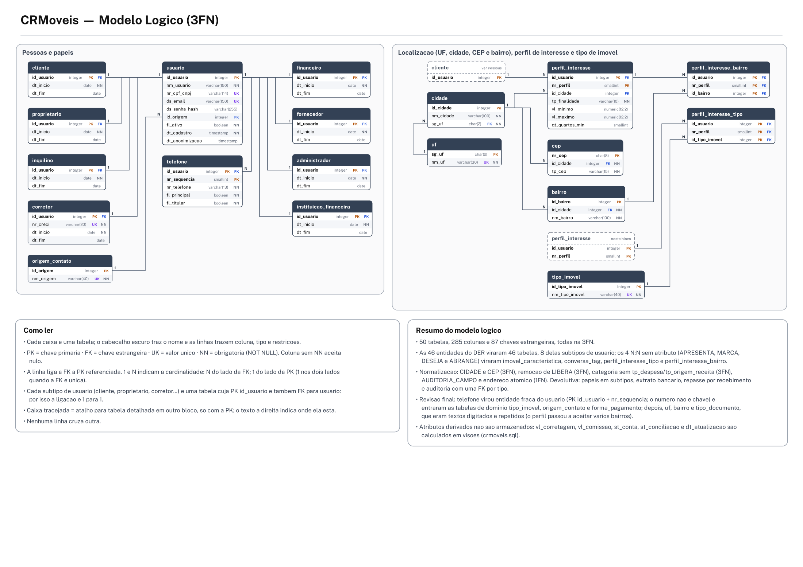
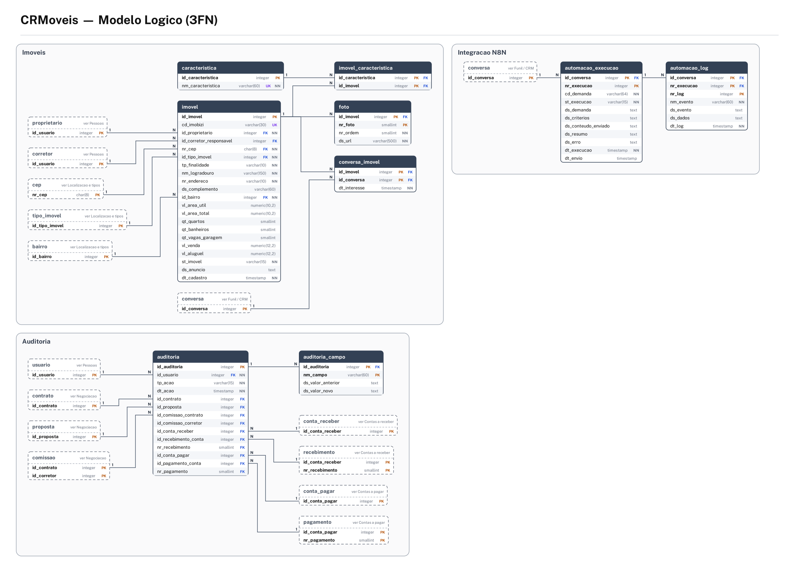
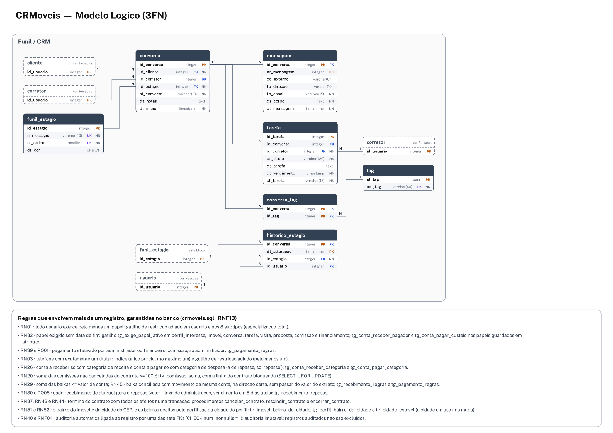
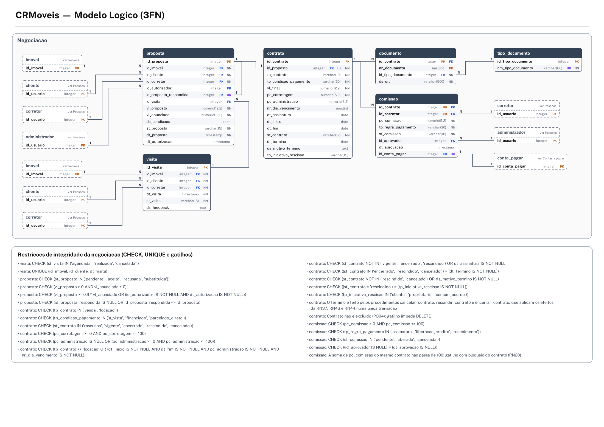
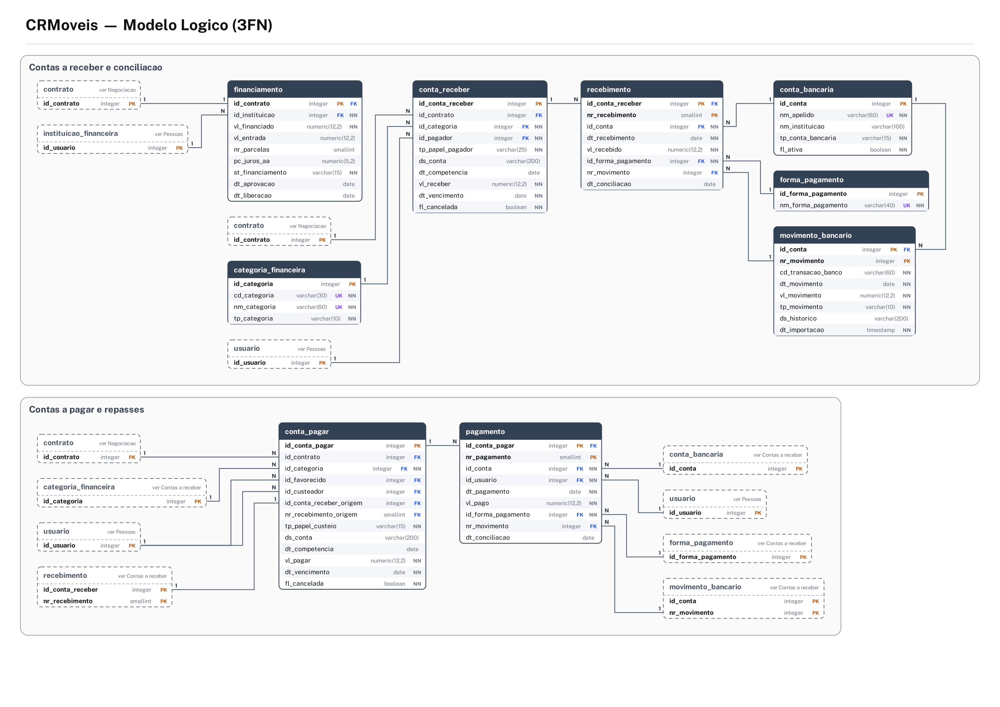

# CRMoveis — Modelo logico relacional (entrega final)

Projeto Integrador — Modelagem de Dados · Prof. Clovis · Grupo 4

Este documento segue o **Manual da Entrega Final**, etapa por etapa: revisao da primeira entrega (Etapas 1 e 2), conversao do DER (3), chaves primarias (4), relacionamentos (5 e 6), entidades fracas (7), restricoes (12) e dicionario de dados (13). A normalizacao (Etapas 8 a 11) esta em [`docs/normalizacao/normalizacao.md`](../normalizacao/normalizacao.md), e o dicionario completo em [`docs/dicionario-dados/dicionario-de-dados.md`](../dicionario-dados/dicionario-de-dados.md).

**Em numeros:** 46 entidades e 70 relacionamentos no DER → 50 tabelas, 285 colunas, 87 chaves estrangeiras, 64 CHECKs, 49 gatilhos e 3 procedimentos, todos na 3FN, instalados e testados no PostgreSQL 16.

**Onde esta cada artefato:**

| Artefato | Arquivo |
|---|---|
| Diagramas do modelo logico (5 folhas A3) | `docs/modelo-logico/logico-1.png` … `logico-5.png` |
| Script para o dbdiagram.io / Mermaid | `docs/modelo-logico/crmoveis.dbml`, `crmoveis.mmd` |
| Script SQL, na ordem de execucao | `sql/00_criar_banco.sql` → `sql/ddl/01` a `06` → `sql/dados/07` e `10` |
| Consultas | `sql/consultas/20` (SELECT, JOIN, UPDATE, DELETE), `21` (gerenciais), `sql/auditoria/30` |
| Testes das regras | `sql/testes/40_testes_regras.sql` (61 cenarios) |
| Prototipo | `prototipo/` (app do SP Imoveis CRM adaptado ao nosso banco) |

**Conferencia automatica** (DER ↔ modelo logico ↔ banco ↔ dicionario ↔ dados):

| Caminho | O que foi conferido | Resultado |
|---|---|---|
| DER → modelo logico | relacionamentos com FK correta, minimo 1 → NOT NULL, 1:1 → UNIQUE, atributos presentes, derivados ausentes | ok |
| Modelo logico → banco instalado | mesmas tabelas, colunas, chaves primarias, FKs, nulos e CHECKs | ok |
| Banco → dicionario | toda coluna tem descricao no catalogo (COMMENT ON) | ok |
| Massa de dados | toda tabela tem linhas | ok |

## 1. Revisao da primeira entrega (Etapas 1 e 2)

Antes de converter o DER, conferimos a primeira entrega item por item, como pede a Etapa 1. O ponto de partida real do projeto e o app **SP Imoveis CRM** (Flask + SQLite), do qual vieram as cinco tabelas originais (`conversations`, `messages`, `stages`, `automation_runs` e `automation_logs`).

| Item revisado | Situacao | O que conferimos |
|---|---|---|
| Requisitos | 37 RF, 13 RNF | Cada requisito aponta para as entidades que o atendem; RF36 (conciliacao) e RNF13 (integridade no banco) entraram com a devolutiva. |
| Regras de negocio | 53 RN, 7 PO | Cada regra aponta para a cardinalidade, o atributo, a restricao ou o gatilho que a garante (secao 7). |
| Entidades | 46 | 21 fortes, 12 fracas, 5 associativas e 8 subtipos; nenhuma sem requisito ou regra. |
| Atributos | 195 no dicionario conceitual | Todos presentes no modelo logico, exceto os derivados (calculados em visoes). |
| Relacionamentos | 70 + a especializacao | Cada um virou FK ou tabela associativa (secao 4). |
| Cardinalidades | Conferidas por script | Minimo 1 → NOT NULL; maximo 1 dos dois lados → UNIQUE; N:N → tabela com chave composta. |
| Entidades associativas | 5 | So onde o relacionamento tem atributos proprios (secao 5). |
| Entidades fracas | 12 | So onde ha dependencia real de existencia ou de identificacao (secao 6). |

### 1.1 Principais alteracoes de modelagem (Etapa 2)

Registramos as mudancas de decisao de modelagem, desde as tabelas do app original ate a entrega final. Ajustes de texto e de diagrama nao entram.

| Fase | O que foi alterado? | Como era? | Como ficou? | Por que alteramos? |
|---|---|---|---|---|
| origem | Papeis da pessoa | conversations.kind (Cliente, Corretor, Proprietario) e colunas “Corretores” e “Proprietarios” no kanban, misturadas com as etapas | USUARIO com 8 subtipos (especializacao total e compartilhada) | Uma pessoa pode ter varios papeis ao mesmo tempo; a coluna do kanban e etapa do funil, nao papel; e o banco passa a exigir o papel em cada relacionamento (devolutiva, ponto 1). |
| origem | Pessoa × atendimento | conversations guardava nome e telefone da pessoa junto com o atendimento | USUARIO (pessoa), TELEFONE e CONVERSA (atendimento) separados | O mesmo cliente tem varias conversas ao longo do tempo (RN11); nome e telefone dependiam da pessoa, e nao da conversa (3FN). |
| origem | Imoveis de interesse da conversa | property_codes: texto com varios codigos de imovel no mesmo campo | CONVERSA_IMOVEL (N:N, com dt_interesse) | Lista dentro de um campo viola a 1FN e impede saber com seguranca quais imoveis a conversa quer. |
| origem | Corretor responsavel | owner: nome digitado em texto livre | FK id_corretor → CORRETOR (ATENDE) | Um nome digitado nao garante que a pessoa exista nem que seja corretor. |
| origem | Imoveis | So na planilha exportada do Imobzi (nenhuma tabela) | IMOVEL, FOTO, CARACTERISTICA, CEP e CIDADE; cd_imobizi guarda o codigo do Imobzi | Sem tabela nao ha integridade entre imovel, visita, proposta e contrato. |
| origem | Etapa do funil | stages.id em texto ('ativo') e conversations.stage sem chave estrangeira | FUNIL_ESTAGIO + HISTORICO_ESTAGIO (MOVE) | Guarda a ordem das etapas e o historico de cada mudanca (RN13, RN14). |
| origem | Mensagens | messages(direction 'note'/'in'/'out') | MENSAGEM fraca de CONVERSA, com canal, direcao e cd_externo unico | A mesma mensagem do WhatsApp nao e gravada duas vezes (RN31). |
| origem | Automacao N8N | automation_runs e automation_logs, log com conversa opcional | AUTOMACAO_EXECUCAO (fraca da conversa) e AUTOMACAO_LOG (fraca da execucao) | Mantida a ideia do app (nao reprocessar a mesma demanda); o log passa a pertencer a uma execucao. |
| 1a entrega | Negociacao e financeiro | Inexistentes no app original | VISITA, PROPOSTA, CONTRATO, COMISSAO, FINANCIAMENTO, contas a receber e a pagar com baixas | Os problemas levantados na empresa (secao 4 do README) exigiam controlar o negocio do primeiro contato ao pagamento. |
| normalizacao | Cidade e UF do imovel | Colunas nm_cidade e sg_uf no imovel e no perfil | CEP → CIDADE (AGRUPA, LOCALIZA, PREFERE) | Cidade e UF dependiam do CEP, e nao da chave do imovel (3FN). |
| normalizacao | Conta a receber × financiamento | Relacionamento LIBERA | Removido: o financiamento e encontrado pelo contrato da conta | A FK repetia o contrato e podia contradize-lo (3FN). |
| normalizacao | Valores alterados na auditoria | ds_valores com todos os campos num texto | AUDITORIA_CAMPO (um registro por campo) | Varios valores num campo (1FN). |
| normalizacao | Endereco do imovel | Atributo composto | Colunas atomicas: logradouro, numero, complemento e bairro | Busca por bairro sem recortar texto (1FN). |
| devolutiva | Telefone | 1 telefone pertence a 1 usuario | USUARIO (0,n) — POSSUI — (1,n) TELEFONE, com um titular por numero | Numeros compartilhados (casal, socios) contradiziam a regra (ponto 2). |
| devolutiva | Repasse do aluguel | Um repasse depois do aluguel quitado | Um repasse para cada recebimento, inclusive parcial (REPASSA) | Pagamento parcial do inquilino (ponto 3). |
| devolutiva | Termino do contrato | dt_cancelamento e ds_motivo_cancelamento | st_contrato com 5 situacoes, dt_termino, ds_motivo_termino, tp_iniciativa_rescisao | Cancelamento, rescisao e encerramento tem efeitos diferentes (ponto 4). |
| devolutiva | Conciliacao bancaria | Inexistente | MOVIMENTO_BANCARIO (fraca da conta), CONCILIA e CONFERE | Conferir os lancamentos com o extrato (ponto 5). |
| devolutiva | Referencia da auditoria | nm_entidade + cd_registro (texto) | Sete FKs (AUDITA …) com CHECK de exatamente uma | Integridade da referencia (ponto 6). |
| devolutiva | Soma das comissoes | Sem controle | Gatilho que soma as comissoes com o contrato bloqueado | Impedir mais de 100% (ponto 7). |
| entrega final | Exclusao de registro referenciado | Comportamento padrao do banco, sem decisao registrada | Politica explicita em cada FK: RESTRICT, CASCADE ou SET NULL | Integridade referencial pedida no manual: cada FK diz o que acontece quando o registro referenciado e excluido (secao 7). |
| entrega final | Indices das chaves estrangeiras | Nenhum (o PostgreSQL nao cria sozinho) | 54 indices | Desempenho das juncoes das consultas gerenciais e da conferencia das FKs. |
| entrega final | Dicionario de dados | Documento separado do banco | COMMENT ON TABLE/COLUMN e dicionario gerado do catalogo do banco | O dicionario passa a representar o banco implementado (Etapa 13). |
| entrega final | Criacao do banco | O script comecava pelas tabelas | 00_criar_banco.sql + scripts numerados por etapa | Executar do banco vazio ate as consultas (Etapas 14 e 15). |
| revisao final | Telefone | Entidade TELEFONE com chave propria (id_telefone), numero UNIQUE e ligacao N:N USUARIO_TELEFONE | TELEFONE entidade fraca de USUARIO: chave (id_usuario, nr_sequencia); o mesmo numero pode estar em mais de uma pessoa, com um titular | O numero de telefone nao identifica nada no negocio: muda de dono, e cada pessoa tem os seus. O telefone passou a ser dado da pessoa, e o compartilhamento continua garantido pelo titular unico por numero (RN03). |
| revisao final | Tipo de imovel | tp_imovel com CHECK de 5 valores fixos, repetido em IMOVEL e em PERFIL_INTERESSE | Tabela TIPO_IMOVEL (relacionamento TIPIFICA), com 10 tipos | A lista e mantida pela imobiliaria e cresce (cobertura, kitnet, galpao...): com tabela, um tipo novo e so um cadastro, e imovel e perfil usam o mesmo vocabulario (RN48). |
| revisao final | Tipos aceitos pelo perfil | Um unico tp_imovel por perfil | N:N DESEJA: tabela perfil_interesse_tipo | O cliente que aceita apartamento ou cobertura precisaria de dois perfis iguais; guardar varios tipos num campo violaria a 1FN (RN47). |
| revisao final | Origem do contato | tp_origem com CHECK em USUARIO | Tabela ORIGEM_CONTATO (relacionamento CAPTA) | Os canais de captacao mudam (redes sociais, portais, placa no imovel): a tabela permite cadastrar um canal novo sem alterar a estrutura e e a base do relatorio de captacao (G02, RN49). |
| revisao final | Forma de pagamento | tp_forma_pagamento com o mesmo CHECK repetido em RECEBIMENTO e PAGAMENTO | Tabela FORMA_PAGAMENTO (RECEBIDO VIA e PAGO VIA) | Uma lista so para as duas baixas, que cresce sem alterar a estrutura (RN50). |
| revisao final | Natureza do lancamento | A conta guardava a categoria e tambem tp_origem_receita ou tp_despesa, que dependiam da categoria | So a categoria; CATEGORIA_FINANCEIRA ganhou o codigo (cd_categoria) usado pelas regras | id_categoria → tipo e uma dependencia transitiva (3FN) e permitia contradicao, como categoria Imposto com tipo repasse. A RN26 (categoria compativel com a conta), que nao estava garantida, passou a ser conferida por gatilho. |
| revisao final | Condicao de pagamento do contrato | contrato.tp_forma_pagamento | contrato.tp_condicao_pagamento | O mesmo nome servia para dois dominios diferentes (a vista ou financiado × Pix ou boleto); o nome novo evita a confusao com FORMA_PAGAMENTO. |
| revisao final | Bairro | nm_bairro digitado no IMOVEL e no PERFIL_INTERESSE | Tabela BAIRRO, da cidade (DIVIDE); o imovel aponta para o bairro (SITUA) | O mesmo dado repetido em duas tabelas: Tatuape e Tatuape com acento viravam bairros diferentes, e a comparacao do perfil com o imovel falhava. O bairro tem de ser da cidade do CEP (RN51). |
| revisao final | Bairros aceitos pelo perfil | Um unico nm_bairro por perfil | N:N ABRANGE: tabela perfil_interesse_bairro | Como nos tipos: o cliente que aceita Tatuape ou Mooca precisaria de dois perfis iguais; varios bairros num campo violariam a 1FN. Os bairros sao da cidade do perfil (RN52). |
| revisao final | UF | cidade.sg_uf aceitava qualquer sigla | Tabela UF com as 27 unidades federativas (COMPREENDE) | Uma sigla que nao existe (XX) era aceita; com a FK so entra UF valida, e os relatorios podem mostrar o nome do estado (RN41). |
| revisao final | Tipo de documento | nm_documento digitado em cada documento do contrato | Tabela TIPO_DOCUMENTO (QUALIFICA) | Os mesmos nomes se repetiam (contrato assinado, matricula, laudo de vistoria) e a lista cresce: como tabela, os nomes nao variam e um tipo novo e so um cadastro (RN53). |
| revisao final | Acentuacao | Dados, comentarios, mensagens e documentos com acento | Todo o projeto sem acento | Evita erro de codificacao (UTF-8 × WIN1252) ao rodar os scripts no Windows e deixa os dados padronizados para busca e comparacao. |

## 2. Conversao do DER para o modelo logico (Etapa 3)

Regra basica: **ENTIDADE → TABELA**, e depois **TABELA → ATRIBUTOS → PK → FK → RESTRICOES**. Os atributos derivados nao viram coluna (sao calculados nas visoes), o atributo composto vira uma coluna por parte e os quatro relacionamentos N:N sem atributos viram tabelas de ligacao.

| Entidade no DER | Tipo | Tabela | Como foi convertida | Chave primaria | Linhas na massa de dados |
|---|---|---|---|---|---|
| USUARIO | forte | usuario | Tabela propria; o identificador vira a chave primaria. | id_usuario | 55 |
| ORIGEM_CONTATO | forte | origem_contato | Tabela propria; o identificador vira a chave primaria. | id_origem | 7 |
| CLIENTE | subtipo | cliente | Tabela com a chave do supertipo, que e PK e FK ao mesmo tempo. | id_usuario | 34 |
| PROPRIETARIO | subtipo | proprietario | Tabela com a chave do supertipo, que e PK e FK ao mesmo tempo. | id_usuario | 10 |
| INQUILINO | subtipo | inquilino | Tabela com a chave do supertipo, que e PK e FK ao mesmo tempo. | id_usuario | 5 |
| CORRETOR | subtipo | corretor | Tabela com a chave do supertipo, que e PK e FK ao mesmo tempo. | id_usuario | 5 |
| FINANCEIRO | subtipo | financeiro | Tabela com a chave do supertipo, que e PK e FK ao mesmo tempo. | id_usuario | 2 |
| FORNECEDOR | subtipo | fornecedor | Tabela com a chave do supertipo, que e PK e FK ao mesmo tempo. | id_usuario | 3 |
| ADMINISTRADOR | subtipo | administrador | Tabela com a chave do supertipo, que e PK e FK ao mesmo tempo. | id_usuario | 1 |
| INSTITUICAO_FINANCEIRA | subtipo | instituicao_financeira | Tabela com a chave do supertipo, que e PK e FK ao mesmo tempo. | id_usuario | 2 |
| TELEFONE | fraca | telefone | Tabela com chave composta: chave da entidade dona + identificador parcial. | id_usuario, nr_sequencia | 62 |
| PERFIL_INTERESSE | fraca | perfil_interesse | Tabela com chave composta: chave da entidade dona + identificador parcial. | id_usuario, nr_perfil | 30 |
| TIPO_IMOVEL | forte | tipo_imovel | Tabela propria; o identificador vira a chave primaria. | id_tipo_imovel | 10 |
| IMOVEL | forte | imovel | Tabela propria; o identificador vira a chave primaria. | id_imovel | 30 |
| FOTO | fraca | foto | Tabela com chave composta: chave da entidade dona + identificador parcial. | id_imovel, nr_foto | 168 |
| CARACTERISTICA | forte | caracteristica | Tabela propria; o identificador vira a chave primaria. | id_caracteristica | 15 |
| CONVERSA_IMOVEL | associativa | conversa_imovel | Tabela com as FKs dos dois lados e os atributos do relacionamento. | id_imovel, id_conversa | 86 |
| CIDADE | forte | cidade | Tabela propria; o identificador vira a chave primaria. | id_cidade | 3 |
| UF | forte | uf | Tabela propria; o identificador vira a chave primaria. | sg_uf | 27 |
| CEP | forte | cep | Tabela propria; o identificador vira a chave primaria. | nr_cep | 15 |
| BAIRRO | forte | bairro | Tabela propria; o identificador vira a chave primaria. | id_bairro | 15 |
| CONVERSA | forte | conversa | Tabela propria; o identificador vira a chave primaria. | id_conversa | 45 |
| MENSAGEM | fraca | mensagem | Tabela com chave composta: chave da entidade dona + identificador parcial. | id_conversa, nr_mensagem | 353 |
| FUNIL_ESTAGIO | forte | funil_estagio | Tabela propria; o identificador vira a chave primaria. | id_estagio | 7 |
| HISTORICO_ESTAGIO | associativa | historico_estagio | Tabela com as FKs dos dois lados e os atributos do relacionamento. | id_conversa, dt_alteracao | 139 |
| TAREFA | forte | tarefa | Tabela propria; o identificador vira a chave primaria. | id_tarefa | 104 |
| TAG | forte | tag | Tabela propria; o identificador vira a chave primaria. | id_tag | 8 |
| VISITA | associativa | visita | Tabela com as FKs dos dois lados e os atributos do relacionamento. | id_visita | 31 |
| PROPOSTA | associativa | proposta | Tabela com as FKs dos dois lados e os atributos do relacionamento. | id_proposta | 16 |
| CONTRATO | forte | contrato | Tabela propria; o identificador vira a chave primaria. | id_contrato | 9 |
| DOCUMENTO | fraca | documento | Tabela com chave composta: chave da entidade dona + identificador parcial. | id_contrato, nr_documento | 24 |
| TIPO_DOCUMENTO | forte | tipo_documento | Tabela propria; o identificador vira a chave primaria. | id_tipo_documento | 6 |
| COMISSAO | associativa | comissao | Tabela com as FKs dos dois lados e os atributos do relacionamento. | id_contrato, id_corretor | 10 |
| FINANCIAMENTO | fraca | financiamento | Fraca 1:1: a chave e a propria chave do contrato. | id_contrato | 2 |
| CONTA_RECEBER | forte | conta_receber | Tabela propria; o identificador vira a chave primaria. | id_conta_receber | 45 |
| RECEBIMENTO | fraca | recebimento | Tabela com chave composta: chave da entidade dona + identificador parcial. | id_conta_receber, nr_recebimento | 42 |
| CATEGORIA_FINANCEIRA | forte | categoria_financeira | Tabela propria; o identificador vira a chave primaria. | id_categoria | 10 |
| CONTA_BANCARIA | forte | conta_bancaria | Tabela propria; o identificador vira a chave primaria. | id_conta | 3 |
| MOVIMENTO_BANCARIO | fraca | movimento_bancario | Tabela com chave composta: chave da entidade dona + identificador parcial. | id_conta, nr_movimento | 84 |
| CONTA_PAGAR | forte | conta_pagar | Tabela propria; o identificador vira a chave primaria. | id_conta_pagar | 49 |
| PAGAMENTO | fraca | pagamento | Tabela com chave composta: chave da entidade dona + identificador parcial. | id_conta_pagar, nr_pagamento | 45 |
| FORMA_PAGAMENTO | forte | forma_pagamento | Tabela propria; o identificador vira a chave primaria. | id_forma_pagamento | 5 |
| AUTOMACAO_EXECUCAO | fraca | automacao_execucao | Tabela com chave composta: chave da entidade dona + identificador parcial. | id_conversa, nr_execucao | 34 |
| AUTOMACAO_LOG | fraca | automacao_log | Tabela com chave composta: chave da entidade dona + identificador parcial. | id_conversa, nr_execucao, nr_log | 128 |
| AUDITORIA | forte | auditoria | Tabela propria; o identificador vira a chave primaria. | id_auditoria | 312 |
| AUDITORIA_CAMPO | fraca | auditoria_campo | Tabela com chave composta: chave da entidade dona + identificador parcial. | id_auditoria, nm_campo | 208 |
| APRESENTA (N:N) | relacionamento | imovel_caracteristica | Tabela de ligacao com chave composta. | id_caracteristica, id_imovel | 121 |
| MARCA (N:N) | relacionamento | conversa_tag | Tabela de ligacao com chave composta. | id_conversa, id_tag | 46 |
| DESEJA (N:N) | relacionamento | perfil_interesse_tipo | Tabela de ligacao com chave composta (o perfil tem chave composta, entao a FK tambem e). | id_usuario, nr_perfil, id_tipo_imovel | 42 |
| ABRANGE (N:N) | relacionamento | perfil_interesse_bairro | Tabela de ligacao com chave composta (perfil + bairro). | id_usuario, nr_perfil, id_bairro | 40 |

**Resultado:** 46 entidades + 4 relacionamentos N:N sem atributos = **50 tabelas**, com 285 colunas.

## 3. Chaves primarias (Etapa 4)

Para cada tabela respondemos: *“Como identificaremos cada registro de maneira unica?”* e *“Por que esta e uma boa chave para esta tabela?”*. Usamos quatro tipos de chave:

| Tipo | Quando usamos | Tabelas |
|---|---|---|
| Substituta (IDENTITY) | Entidade forte sem atributo natural estavel, curto e obrigatorio. O atributo natural, quando existe, vira UNIQUE (chave candidata). | 21 |
| Natural | Identificador oficial, estavel e de tamanho fixo. | 2 |
| Composta | Entidade fraca (dona + identificador parcial) e entidade associativa ou ligacao N:N (as duas FKs). | 18 |
| Herdada | Subtipo da especializacao e entidade fraca 1:1: a chave e a da entidade da qual depende. | 9 |

| Tabela | Chave primaria | Tipo | Geracao | Por que e uma boa chave |
|---|---|---|---|---|
| usuario | id_usuario | substituta | IDENTITY | O CPF/CNPJ nao serve de chave: e opcional para quem so conversou, some na anonimizacao (PO07) e pode ser digitado errado. Ele continua unico (UNIQUE) como chave candidata. |
| origem_contato | id_origem | substituta | IDENTITY | Lista de dominio: o nome e unico (UNIQUE) e pode ser corrigido sem afetar os usuarios ligados. |
| cliente | id_usuario | herdada (subtipo) | — | O subtipo e o proprio usuario naquele papel: a chave e o id_usuario, que tambem e FK para usuario. Assim a pessoa tem o papel no maximo uma vez. |
| proprietario | id_usuario | herdada (subtipo) | — | O subtipo e o proprio usuario naquele papel: a chave e o id_usuario, que tambem e FK para usuario. Assim a pessoa tem o papel no maximo uma vez. |
| inquilino | id_usuario | herdada (subtipo) | — | O subtipo e o proprio usuario naquele papel: a chave e o id_usuario, que tambem e FK para usuario. Assim a pessoa tem o papel no maximo uma vez. |
| corretor | id_usuario | herdada (subtipo) | — | O subtipo e o proprio usuario naquele papel: a chave e o id_usuario, que tambem e FK para usuario. Assim a pessoa tem o papel no maximo uma vez. |
| financeiro | id_usuario | herdada (subtipo) | — | O subtipo e o proprio usuario naquele papel: a chave e o id_usuario, que tambem e FK para usuario. Assim a pessoa tem o papel no maximo uma vez. |
| fornecedor | id_usuario | herdada (subtipo) | — | O subtipo e o proprio usuario naquele papel: a chave e o id_usuario, que tambem e FK para usuario. Assim a pessoa tem o papel no maximo uma vez. |
| administrador | id_usuario | herdada (subtipo) | — | O subtipo e o proprio usuario naquele papel: a chave e o id_usuario, que tambem e FK para usuario. Assim a pessoa tem o papel no maximo uma vez. |
| instituicao_financeira | id_usuario | herdada (subtipo) | — | O subtipo e o proprio usuario naquele papel: a chave e o id_usuario, que tambem e FK para usuario. Assim a pessoa tem o papel no maximo uma vez. |
| telefone | id_usuario, nr_sequencia | composta (fraca) | — | O telefone so existe no cadastro da pessoa: pessoa + sequencia (1, 2, 3...). O numero nao e chave: muda de dono e pode estar em mais de uma pessoa (casal); a mesma pessoa nao o repete (UNIQUE id_usuario + nr_telefone). |
| uf | sg_uf | natural | — | A sigla da UF (SP, RJ...) e oficial, curta e nao muda: serve de chave sem precisar de numero, e cidade.sg_uf ja mostra a sigla sem JOIN. |
| cidade | id_cidade | substituta | IDENTITY | Nome + UF e a chave candidata (UNIQUE), mas e longa e seria repetida em todo CEP, bairro e perfil. |
| cep | nr_cep | natural | — | O CEP e o identificador oficial dos Correios, estavel e com tamanho fixo de 8 digitos. |
| bairro | id_bairro | substituta | IDENTITY | Cidade + nome e a chave candidata (UNIQUE): o mesmo nome (Centro) existe em cidades diferentes. A chave substituta e curta e deixa corrigir o nome sem mexer nos imoveis e perfis. |
| perfil_interesse | id_usuario, nr_perfil | composta (fraca) | — | O perfil so existe para o cliente: chave do cliente + numero do perfil. |
| perfil_interesse_tipo | id_usuario, nr_perfil, id_tipo_imovel | composta | — | N:N sem atributos: o perfil aceita cada tipo uma vez; a chave e o perfil (cliente + numero) + o tipo. |
| perfil_interesse_bairro | id_usuario, nr_perfil, id_bairro | composta | — | N:N sem atributos: o perfil aceita cada bairro uma vez; a chave e o perfil (cliente + numero) + o bairro. |
| tipo_imovel | id_tipo_imovel | substituta | IDENTITY | Lista de dominio mantida pela imobiliaria; o nome e unico (UNIQUE) e pode ser corrigido sem afetar imoveis e perfis. |
| imovel | id_imovel | substituta | IDENTITY | O codigo do Imobzi (cd_imobizi) e externo e opcional (imovel cadastrado direto no CRM); fica como UNIQUE. |
| foto | id_imovel, nr_foto | composta (fraca) | — | A foto so existe dentro do imovel: imovel + numero da foto. |
| caracteristica | id_caracteristica | substituta | IDENTITY | Catalogo pequeno; o nome e unico (UNIQUE) e pode ser corrigido sem afetar as ligacoes. |
| imovel_caracteristica | id_caracteristica, id_imovel | composta | — | N:N sem atributos: o par imovel + caracteristica nao se repete. |
| funil_estagio | id_estagio | substituta | IDENTITY | O nome e a ordem do estagio podem mudar (renomear a coluna do kanban); ambos sao unicos. |
| conversa | id_conversa | substituta | IDENTITY | Nao ha atributo natural que identifique um atendimento: o mesmo cliente pode ter varias conversas (RN11). |
| conversa_imovel | id_imovel, id_conversa | composta | — | Associativa: a conversa se interessa por cada imovel uma vez; dt_interesse e atributo do par. |
| mensagem | id_conversa, nr_mensagem | composta (fraca) | — | A mensagem so existe dentro da conversa: conversa + numero da mensagem. |
| historico_estagio | id_conversa, dt_alteracao | composta | — | Cada mudanca de estagio e identificada pela conversa e pelo instante em que aconteceu. |
| tarefa | id_tarefa | substituta | IDENTITY | A tarefa pode existir sem conversa (GERA TAREFA e opcional), entao nao pode depender dela. |
| tag | id_tag | substituta | IDENTITY | Catalogo de etiquetas; o nome e unico. |
| conversa_tag | id_conversa, id_tag | composta | — | N:N sem atributos: a etiqueta e marcada uma vez em cada conversa. |
| visita | id_visita | substituta | IDENTITY | O mesmo cliente pode visitar o mesmo imovel mais de uma vez (RN16), e a data muda quando a visita e remarcada; a combinacao imovel + cliente + data fica como UNIQUE. |
| proposta | id_proposta | substituta | IDENTITY | Ha varias propostas do mesmo cliente para o mesmo imovel (contrapropostas, RN35), e a proposta e referenciada por FECHA, RESPONDE e pela auditoria. |
| contrato | id_contrato | substituta | IDENTITY | O contrato nasce de uma proposta (id_proposta e UNIQUE), mas recebe chave propria porque e referenciado por contas, comissoes, financiamento e auditoria. |
| documento | id_contrato, nr_documento | composta (fraca) | — | O documento so existe anexado ao contrato: contrato + numero. |
| tipo_documento | id_tipo_documento | substituta | IDENTITY | Lista de dominio dos documentos do contrato; o nome e unico (UNIQUE) e pode ser corrigido sem afetar os documentos. |
| comissao | id_contrato, id_corretor | composta | — | Associativa: cada corretor tem no maximo uma comissao por contrato; percentual e situacao valem para o par. |
| financiamento | id_contrato | herdada (fraca 1:1) | — | Um contrato tem no maximo um financiamento (RN22): a chave e o proprio contrato. |
| categoria_financeira | id_categoria | substituta | IDENTITY | Plano de contas: o codigo (usado pelas regras) e o nome sao chaves candidatas (UNIQUE); a chave substituta deixa renomear sem mexer nas contas. |
| conta_bancaria | id_conta | substituta | IDENTITY | O apelido e unico, mas pode mudar; agencia e conta nao sao guardadas (dado sensivel). |
| movimento_bancario | id_conta, nr_movimento | composta (fraca) | — | O lancamento pertence ao extrato da conta: conta + numero do movimento. O codigo da transacao do banco, dentro da conta, e chave candidata (UNIQUE, RN46). |
| conta_receber | id_conta_receber | substituta | IDENTITY | Nao ha combinacao natural estavel (o mesmo contrato gera varios alugueis do mesmo valor). |
| recebimento | id_conta_receber, nr_recebimento | composta (fraca) | — | A baixa so existe dentro da conta: conta + numero do recebimento (pagamento parcial, RN29). |
| conta_pagar | id_conta_pagar | substituta | IDENTITY | Comissoes, repasses, despesas e impostos nao tem combinacao natural comum. |
| pagamento | id_conta_pagar, nr_pagamento | composta (fraca) | — | A baixa so existe dentro da conta a pagar: conta + numero do pagamento. |
| forma_pagamento | id_forma_pagamento | substituta | IDENTITY | Lista de dominio usada por recebimento e pagamento; o nome e unico (UNIQUE). |
| automacao_execucao | id_conversa, nr_execucao | composta (fraca) | — | A execucao pertence a conversa; o codigo da demanda e unico na conversa (RN31). |
| automacao_log | id_conversa, nr_execucao, nr_log | composta (fraca) | — | O registro do log pertence a execucao: conversa + execucao + numero. |
| auditoria | id_auditoria | substituta | IDENTITY | Registro de evento, so de inclusao; nenhum atributo natural e unico. |
| auditoria_campo | id_auditoria, nm_campo | composta (fraca) | — | Cada campo alterado aparece uma vez no registro de auditoria: auditoria + nome do campo. |

**Chaves candidatas (UNIQUE):** atributos que tambem identificam o registro, mas nao foram escolhidos como chave primaria.

| Tabela | Colunas | Restricao |
|---|---|---|
| automacao_execucao | id_conversa, cd_demanda | uk_automacao_execucao_id_conversa_cd_demanda |
| bairro | id_cidade, nm_bairro | uk_bairro_id_cidade_nm_bairro |
| caracteristica | nm_caracteristica | uk_caracteristica_nm_caracteristica |
| categoria_financeira | cd_categoria | uk_categoria_financeira_cd_categoria |
| categoria_financeira | nm_categoria | uk_categoria_financeira_nm_categoria |
| cidade | nm_cidade, sg_uf | uk_cidade_nm_cidade_sg_uf |
| comissao | id_conta_pagar | uk_comissao_id_conta_pagar |
| conta_bancaria | nm_apelido | uk_conta_bancaria_nm_apelido |
| conta_pagar | id_conta_receber_origem, nr_recebimento_origem | uk_conta_pagar_id_conta_receber_origem_nr_recebimento_origem |
| contrato | id_proposta | uk_contrato_id_proposta |
| corretor | nr_creci | uk_corretor_nr_creci |
| forma_pagamento | nm_forma_pagamento | uk_forma_pagamento_nm_forma_pagamento |
| funil_estagio | nm_estagio | uk_funil_estagio_nm_estagio |
| funil_estagio | nr_ordem | uk_funil_estagio_nr_ordem |
| imovel | cd_imobizi | uk_imovel_cd_imobizi |
| mensagem | id_conversa, cd_externo | uk_mensagem_id_conversa_cd_externo |
| movimento_bancario | id_conta, cd_transacao_banco | uk_movimento_bancario_id_conta_cd_transacao_banco |
| origem_contato | nm_origem | uk_origem_contato_nm_origem |
| proposta | id_proposta_respondida | uk_proposta_id_proposta_respondida |
| tag | nm_tag | uk_tag_nm_tag |
| telefone | id_usuario, nr_telefone | uk_telefone_id_usuario_nr_telefone |
| tipo_documento | nm_tipo_documento | uk_tipo_documento_nm_tipo_documento |
| tipo_imovel | nm_tipo_imovel | uk_tipo_imovel_nm_tipo_imovel |
| uf | nm_uf | uk_uf_nm_uf |
| usuario | ds_email | uk_usuario_ds_email |
| usuario | nr_cpf_cnpj | uk_usuario_nr_cpf_cnpj |
| visita | id_imovel, id_cliente, dt_visita | uk_visita_id_imovel_id_cliente_dt_visita |

## 4. Relacionamentos convertidos (Etapa 5)

*“Como este relacionamento aparecera nas tabelas?”* A regra que usamos:

| Relacionamento no DER | No modelo logico |
|---|---|
| 1:N | FK no lado N. NOT NULL quando a participacao minima do lado N e 1; nula quando e 0. |
| 1:1 | FK com UNIQUE no lado que pode ficar sem o outro. |
| N:N | Tabela associativa (ou de ligacao) com as duas FKs na chave primaria (secao 5). |
| Especializacao | Uma tabela por subtipo, com PK = FK para o supertipo. |
| Autorrelacionamento | FK para a propria tabela (RESPONDE: a contraproposta aponta para a proposta que responde). |

Cada linha abaixo saiu do DER (secao 14 do README) e foi conferida por script contra o banco instalado.

| Relacionamento | Cardinalidade (DER) | Tipo | Implementacao | Regra |
|---|---|---|---|---|
| POSSUI | USUARIO (0,n) — TELEFONE (1,1) | 1:N | telefone.id_usuario → usuario (NOT NULL; ao excluir: CASCADE) | RN03 |
| CAPTA | ORIGEM_CONTATO (0,n) — USUARIO (0,1) | 1:N | usuario.id_origem → origem_contato (aceita nulo; ao excluir: RESTRICT) | RN49 |
| BUSCA | CLIENTE (0,n) — PERFIL_INTERESSE (1,1) | 1:N | perfil_interesse.id_usuario → cliente (NOT NULL; ao excluir: CASCADE) | RN05 |
| PREFERE | CIDADE (0,n) — PERFIL_INTERESSE (0,1) | 1:N | perfil_interesse.id_cidade → cidade (aceita nulo; ao excluir: RESTRICT) | RN42 |
| DESEJA | PERFIL_INTERESSE (0,n) — TIPO_IMOVEL (0,n) | N:N | tabela perfil_interesse_tipo: perfil_interesse_tipo.(id_usuario, nr_perfil) → perfil_interesse (NOT NULL; ao excluir: CASCADE); perfil_interesse_tipo.id_tipo_imovel → tipo_imovel (NOT NULL; ao excluir: RESTRICT) | RN47 |
| ABRANGE | PERFIL_INTERESSE (0,n) — BAIRRO (0,n) | N:N | tabela perfil_interesse_bairro: perfil_interesse_bairro.(id_usuario, nr_perfil) → perfil_interesse (NOT NULL; ao excluir: CASCADE); perfil_interesse_bairro.id_bairro → bairro (NOT NULL; ao excluir: RESTRICT) | RN52 |
| ANUNCIA | PROPRIETARIO (0,n) — IMOVEL (1,1) | 1:N | imovel.id_proprietario → proprietario (NOT NULL; ao excluir: RESTRICT) | RN06 |
| TIPIFICA | TIPO_IMOVEL (0,n) — IMOVEL (1,1) | 1:N | imovel.id_tipo_imovel → tipo_imovel (NOT NULL; ao excluir: RESTRICT) | RN48 |
| RESPONSAVEL | CORRETOR (0,n) — IMOVEL (0,1) | 1:N | imovel.id_corretor_responsavel → corretor (aceita nulo; ao excluir: RESTRICT) | RN07 |
| TEM | IMOVEL (0,n) — FOTO (1,1) | 1:N | foto.id_imovel → imovel (NOT NULL; ao excluir: CASCADE) | RN09 |
| APRESENTA | IMOVEL (0,n) — CARACTERISTICA (0,n) | N:N | tabela imovel_caracteristica: imovel_caracteristica.id_caracteristica → caracteristica (NOT NULL; ao excluir: RESTRICT); imovel_caracteristica.id_imovel → imovel (NOT NULL; ao excluir: CASCADE) | RN08 |
| INTERESSA | IMOVEL (0,n) — CONVERSA (0,n) | N:N | tabela conversa_imovel: conversa_imovel.id_imovel → imovel (NOT NULL; ao excluir: RESTRICT); conversa_imovel.id_conversa → conversa (NOT NULL; ao excluir: CASCADE) | RF17 |
| LOCALIZA | CEP (0,n) — IMOVEL (1,1) | 1:N | imovel.nr_cep → cep (NOT NULL; ao excluir: RESTRICT) | RN41 |
| AGRUPA | CIDADE (0,n) — CEP (1,1) | 1:N | cep.id_cidade → cidade (NOT NULL; ao excluir: RESTRICT) | RN41 |
| COMPREENDE | UF (0,n) — CIDADE (1,1) | 1:N | cidade.sg_uf → uf (NOT NULL; ao excluir: RESTRICT) | RN41 |
| DIVIDE | CIDADE (0,n) — BAIRRO (1,1) | 1:N | bairro.id_cidade → cidade (NOT NULL; ao excluir: RESTRICT) | RN51 |
| SITUA | BAIRRO (0,n) — IMOVEL (1,1) | 1:N | imovel.id_bairro → bairro (NOT NULL; ao excluir: RESTRICT) | RN51 |
| INICIA | CLIENTE (0,n) — CONVERSA (1,1) | 1:N | conversa.id_cliente → cliente (NOT NULL; ao excluir: RESTRICT) | RN11 |
| ATENDE | CORRETOR (0,n) — CONVERSA (0,1) | 1:N | conversa.id_corretor → corretor (aceita nulo; ao excluir: RESTRICT) | RN12 |
| CONTEM | CONVERSA (0,n) — MENSAGEM (1,1) | 1:N | mensagem.id_conversa → conversa (NOT NULL; ao excluir: CASCADE) | RF05 |
| MARCA | CONVERSA (0,n) — TAG (0,n) | N:N | tabela conversa_tag: conversa_tag.id_conversa → conversa (NOT NULL; ao excluir: CASCADE); conversa_tag.id_tag → tag (NOT NULL; ao excluir: CASCADE) | RF09 |
| GERA TAREFA | CONVERSA (0,n) — TAREFA (0,1) | 1:N | tarefa.id_conversa → conversa (aceita nulo; ao excluir: SET NULL) | RN15 |
| EXECUTA | CORRETOR (0,n) — TAREFA (1,1) | 1:N | tarefa.id_corretor → corretor (NOT NULL; ao excluir: RESTRICT) | RN15 |
| PERTENCE A | CONVERSA (1,1) — FUNIL_ESTAGIO (0,n) | 1:N | conversa.id_estagio → funil_estagio (NOT NULL; ao excluir: RESTRICT) | RN13 |
| REGISTRA | HISTORICO_ESTAGIO (0,1) — USUARIO (0,n) | 1:N | historico_estagio.id_usuario → usuario (aceita nulo; ao excluir: SET NULL) | RF08 |
| MOVE | CONVERSA (0,n) — FUNIL_ESTAGIO (0,n) | N:N | tabela historico_estagio: historico_estagio.id_conversa → conversa (NOT NULL; ao excluir: CASCADE); historico_estagio.id_estagio → funil_estagio (NOT NULL; ao excluir: RESTRICT) | RN14 |
| ACOMPANHA | VISITA (1,1) — CORRETOR (0,n) | 1:N | visita.id_corretor → corretor (NOT NULL; ao excluir: RESTRICT) | RN16 |
| ORIGINA | VISITA (0,n) — PROPOSTA (0,1) | 1:N | proposta.id_visita → visita (aceita nulo; ao excluir: RESTRICT) | RN17 |
| RESPONDE | PROPOSTA (0,1) — PROPOSTA (0,1) | 1:1 recursivo | proposta.id_proposta_respondida → proposta (aceita nulo, UNIQUE; ao excluir: RESTRICT) | RN35 |
| NEGOCIA | PROPOSTA (1,1) — CORRETOR (0,n) | 1:N | proposta.id_corretor → corretor (NOT NULL; ao excluir: RESTRICT) | RF19 |
| FECHA | PROPOSTA (0,1) — CONTRATO (1,1) | 1:1 | contrato.id_proposta → proposta (NOT NULL, UNIQUE; ao excluir: RESTRICT) | RN18 |
| ANEXA | CONTRATO (0,n) — DOCUMENTO (1,1) | 1:N | documento.id_contrato → contrato (NOT NULL; ao excluir: RESTRICT) | RF21 |
| QUALIFICA | TIPO_DOCUMENTO (0,n) — DOCUMENTO (1,1) | 1:N | documento.id_tipo_documento → tipo_documento (NOT NULL; ao excluir: RESTRICT) | RN53 |
| AUTORIZA | PROPOSTA (0,1) — ADMINISTRADOR (0,n) | 1:N | proposta.id_autorizador → administrador (aceita nulo; ao excluir: RESTRICT) | PO03 |
| APROVA | COMISSAO (0,1) — ADMINISTRADOR (0,n) | 1:N | comissao.id_aprovador → administrador (aceita nulo; ao excluir: RESTRICT) | PO01 |
| VISITA | CLIENTE (0,n) — IMOVEL (0,n) | N:N | tabela visita: visita.id_imovel → imovel (NOT NULL; ao excluir: RESTRICT); visita.id_cliente → cliente (NOT NULL; ao excluir: RESTRICT) | RN16 |
| PROPOE | CLIENTE (0,n) — IMOVEL (0,n) | N:N | tabela proposta: proposta.id_imovel → imovel (NOT NULL; ao excluir: RESTRICT); proposta.id_cliente → cliente (NOT NULL; ao excluir: RESTRICT) | RF19 |
| RECEBE | CONTRATO (0,n) — CORRETOR (0,n) | N:N | tabela comissao: comissao.id_contrato → contrato (NOT NULL; ao excluir: RESTRICT); comissao.id_corretor → corretor (NOT NULL; ao excluir: RESTRICT) | RN20 |
| FINANCIA | CONTRATO (0,1) — FINANCIAMENTO (1,1) | 1:1 | financiamento.id_contrato → contrato (NOT NULL; ao excluir: RESTRICT) | RN22 |
| CONCEDE | INSTITUICAO_FINANCEIRA (0,n) — FINANCIAMENTO (1,1) | 1:N | financiamento.id_instituicao → instituicao_financeira (NOT NULL; ao excluir: RESTRICT) | RN27, RN33 |
| GERA RECEITA | CONTRATO (0,n) — CONTA_RECEBER (0,1) | 1:N | conta_receber.id_contrato → contrato (aceita nulo; ao excluir: RESTRICT) | RF24 |
| CLASSIFICA | CATEGORIA_FINANCEIRA (0,n) — CONTA_RECEBER (1,1) | 1:N | conta_receber.id_categoria → categoria_financeira (NOT NULL; ao excluir: RESTRICT) | RN26 |
| PAGA | USUARIO (0,n) — CONTA_RECEBER (1,1) | 1:N | conta_receber.id_pagador → usuario (NOT NULL; ao excluir: RESTRICT) | RN27 |
| QUITA | CONTA_RECEBER (0,n) — RECEBIMENTO (1,1) | 1:N | recebimento.id_conta_receber → conta_receber (NOT NULL; ao excluir: RESTRICT) | RN29 |
| RECEBIDO VIA | FORMA_PAGAMENTO (0,n) — RECEBIMENTO (1,1) | 1:N | recebimento.id_forma_pagamento → forma_pagamento (NOT NULL; ao excluir: RESTRICT) | RN50 |
| CREDITA | CONTA_BANCARIA (0,n) — RECEBIMENTO (1,1) | 1:N | recebimento.id_conta → conta_bancaria (NOT NULL; ao excluir: RESTRICT) | RN29 |
| LISTA | CONTA_BANCARIA (0,n) — MOVIMENTO_BANCARIO (1,1) | 1:N | movimento_bancario.id_conta → conta_bancaria (NOT NULL; ao excluir: RESTRICT) | RN46 |
| CONCILIA | MOVIMENTO_BANCARIO (0,n) — RECEBIMENTO (0,1) | 1:N | recebimento.(id_conta, nr_movimento) → movimento_bancario (aceita nulo; ao excluir: RESTRICT) | RN45 |
| GERA DESPESA | CONTRATO (0,n) — CONTA_PAGAR (0,1) | 1:N | conta_pagar.id_contrato → contrato (aceita nulo; ao excluir: RESTRICT) | RF25 |
| CATEGORIZA | CATEGORIA_FINANCEIRA (0,n) — CONTA_PAGAR (1,1) | 1:N | conta_pagar.id_categoria → categoria_financeira (NOT NULL; ao excluir: RESTRICT) | RN26 |
| FAVORECE | USUARIO (0,n) — CONTA_PAGAR (0,1) | 1:N | conta_pagar.id_favorecido → usuario (aceita nulo; ao excluir: RESTRICT) | RF25 |
| CUSTEIA | USUARIO (0,n) — CONTA_PAGAR (0,1) | 1:N | conta_pagar.id_custeador → usuario (aceita nulo; ao excluir: RESTRICT) | RN28 |
| LANCA | COMISSAO (0,1) — CONTA_PAGAR (0,1) | 1:1 | comissao.id_conta_pagar → conta_pagar (aceita nulo, UNIQUE; ao excluir: RESTRICT) | RN25 |
| REPASSA | RECEBIMENTO (0,1) — CONTA_PAGAR (0,1) | 1:1 | conta_pagar.(id_conta_receber_origem, nr_recebimento_origem) → recebimento (aceita nulo, UNIQUE; ao excluir: RESTRICT) | RN30 |
| LIQUIDA | CONTA_PAGAR (0,n) — PAGAMENTO (1,1) | 1:N | pagamento.id_conta_pagar → conta_pagar (NOT NULL; ao excluir: RESTRICT) | RN29 |
| PAGO VIA | FORMA_PAGAMENTO (0,n) — PAGAMENTO (1,1) | 1:N | pagamento.id_forma_pagamento → forma_pagamento (NOT NULL; ao excluir: RESTRICT) | RN50 |
| DEBITA | CONTA_BANCARIA (0,n) — PAGAMENTO (1,1) | 1:N | pagamento.id_conta → conta_bancaria (NOT NULL; ao excluir: RESTRICT) | RN29 |
| CONFERE | MOVIMENTO_BANCARIO (0,n) — PAGAMENTO (0,1) | 1:N | pagamento.(id_conta, nr_movimento) → movimento_bancario (aceita nulo; ao excluir: RESTRICT) | RN45 |
| EFETIVA | USUARIO (0,n) — PAGAMENTO (1,1) | 1:N | pagamento.id_usuario → usuario (NOT NULL; ao excluir: RESTRICT) | RN39, PO01 |
| DISPARA | CONVERSA (0,n) — AUTOMACAO_EXECUCAO (1,1) | 1:N | automacao_execucao.id_conversa → conversa (NOT NULL; ao excluir: CASCADE) | RN31 |
| GRAVA | AUTOMACAO_EXECUCAO (0,n) — AUTOMACAO_LOG (1,1) | 1:N | automacao_log.(id_conversa, nr_execucao) → automacao_execucao (NOT NULL; ao excluir: CASCADE) | RF12 |
| PRATICA | USUARIO (0,n) — AUDITORIA (1,1) | 1:N | auditoria.id_usuario → usuario (NOT NULL; ao excluir: RESTRICT) | RN40 |
| DETALHA | AUDITORIA (0,n) — AUDITORIA_CAMPO (1,1) | 1:N | auditoria_campo.id_auditoria → auditoria (NOT NULL; ao excluir: RESTRICT) | RN40 |
| AUDITA CONTRATO | CONTRATO (0,n) — AUDITORIA (0,1) | 1:N | auditoria.id_contrato → contrato (aceita nulo; ao excluir: RESTRICT) | RN40 |
| AUDITA PROPOSTA | PROPOSTA (0,n) — AUDITORIA (0,1) | 1:N | auditoria.id_proposta → proposta (aceita nulo; ao excluir: RESTRICT) | RN40 |
| AUDITA COMISSAO | COMISSAO (0,n) — AUDITORIA (0,1) | 1:N | auditoria.(id_comissao_contrato, id_comissao_corretor) → comissao (aceita nulo; ao excluir: RESTRICT) | RN40 |
| AUDITA CONTA_RECEBER | CONTA_RECEBER (0,n) — AUDITORIA (0,1) | 1:N | auditoria.id_conta_receber → conta_receber (aceita nulo; ao excluir: RESTRICT) | RN40 |
| AUDITA RECEBIMENTO | RECEBIMENTO (0,n) — AUDITORIA (0,1) | 1:N | auditoria.(id_recebimento_conta, nr_recebimento) → recebimento (aceita nulo; ao excluir: RESTRICT) | RN40 |
| AUDITA CONTA_PAGAR | CONTA_PAGAR (0,n) — AUDITORIA (0,1) | 1:N | auditoria.id_conta_pagar → conta_pagar (aceita nulo; ao excluir: RESTRICT) | RN40 |
| AUDITA PAGAMENTO | PAGAMENTO (0,n) — AUDITORIA (0,1) | 1:N | auditoria.(id_pagamento_conta, nr_pagamento) → pagamento (aceita nulo; ao excluir: RESTRICT) | RN40 |

**Especializacao de USUARIO** (total e compartilhada): cliente.id_usuario → usuario (PK e FK; ao excluir: CASCADE); proprietario.id_usuario → usuario (PK e FK; ao excluir: CASCADE); inquilino.id_usuario → usuario (PK e FK; ao excluir: CASCADE); corretor.id_usuario → usuario (PK e FK; ao excluir: CASCADE); financeiro.id_usuario → usuario (PK e FK; ao excluir: CASCADE); fornecedor.id_usuario → usuario (PK e FK; ao excluir: CASCADE); administrador.id_usuario → usuario (PK e FK; ao excluir: CASCADE); instituicao_financeira.id_usuario → usuario (PK e FK; ao excluir: CASCADE). A especializacao total (todo usuario tem pelo menos um papel, RN01) e garantida por gatilho conferido no fim da transacao, porque uma FK nao consegue exigir que exista uma linha em outra tabela.

**Total:** 70 relacionamentos → 79 chaves estrangeiras (cada N:N gera duas) + 8 da especializacao = **87 chaves estrangeiras**.

## 5. Relacionamentos N:N (Etapa 6)

Nenhum N:N ficou direto no modelo fisico. Para cada um perguntamos: *“O relacionamento possui informacoes proprias?”*

| Relacionamento | Entre | Tabela | Chave primaria | Informacoes proprias | No DER |
|---|---|---|---|---|---|
| APRESENTA | IMOVEL × CARACTERISTICA | imovel_caracteristica | id_caracteristica, id_imovel | nenhum (tabela de ligacao) | relacionamento N:N |
| MARCA | CONVERSA × TAG | conversa_tag | id_conversa, id_tag | nenhum (tabela de ligacao) | relacionamento N:N |
| DESEJA | PERFIL_INTERESSE × TIPO_IMOVEL | perfil_interesse_tipo | id_usuario, nr_perfil, id_tipo_imovel | nenhum (tabela de ligacao) | relacionamento N:N |
| ABRANGE | PERFIL_INTERESSE × BAIRRO | perfil_interesse_bairro | id_usuario, nr_perfil, id_bairro | nenhum (tabela de ligacao) | relacionamento N:N |
| INTERESSA | IMOVEL × CONVERSA | conversa_imovel | id_imovel, id_conversa | dt_interesse | entidade associativa |
| MOVE | CONVERSA × FUNIL_ESTAGIO | historico_estagio | id_conversa, dt_alteracao | dt_alteracao | entidade associativa |
| VISITA | CLIENTE × IMOVEL | visita | id_visita | dt_visita, st_visita, ds_feedback, id_visita | entidade associativa |
| PROPOE | CLIENTE × IMOVEL | proposta | id_proposta | vl_proposto, vl_anunciado, ds_condicoes, st_proposta, dt_proposta, dt_autorizacao, id_proposta | entidade associativa |
| RECEBE | CONTRATO × CORRETOR | comissao | id_contrato, id_corretor | pc_comissao, tp_regra_pagamento, st_comissao, dt_aprovacao | entidade associativa |

VISITA e PROPOSTA sao associativas entre CLIENTE e IMOVEL, mas tem chave substituta: o mesmo cliente visita o mesmo imovel mais de uma vez e faz varias propostas (contrapropostas). Por isso o par nao identifica o registro, e a combinacao imovel + cliente + data da visita fica como UNIQUE.

## 6. Entidades fracas e associativas (Etapa 7)

**Entidade fraca** depende de outra para existir ou para ser identificada. **Entidade associativa** representa uma associacao, normalmente N:N, com informacoes proprias. So marcamos como fraca o que a regra de negocio exige.

| Entidade fraca | Chave (dona + parcial) | Dependencia de existencia ou identificacao |
|---|---|---|
| TELEFONE | id_usuario, nr_sequencia | O telefone e dado da pessoa: so existe no cadastro dela e e numerado dentro dele (POSSUI, RN03). O numero nao e chave, porque pode estar em mais de uma pessoa. |
| PERFIL_INTERESSE | id_usuario, nr_perfil | O perfil descreve o que um cliente procura; sem o cliente nao tem sentido (BUSCA, RN05). |
| FOTO | id_imovel, nr_foto | A foto so existe como parte do anuncio do imovel (RN09). |
| MENSAGEM | id_conversa, nr_mensagem | A mensagem so existe dentro de uma conversa. |
| DOCUMENTO | id_contrato, nr_documento | O documento e anexo de um contrato (ANEXA). |
| FINANCIAMENTO | id_contrato | Um contrato tem no maximo um financiamento, identificado pelo proprio contrato (RN22). |
| RECEBIMENTO | id_conta_receber, nr_recebimento | A baixa e parte da conta a receber; numerada dentro dela (RN29). |
| MOVIMENTO_BANCARIO | id_conta, nr_movimento | O lancamento pertence ao extrato de uma conta bancaria (LISTA, RN46). |
| PAGAMENTO | id_conta_pagar, nr_pagamento | A baixa e parte da conta a pagar; numerada dentro dela (RN29). |
| AUTOMACAO_EXECUCAO | id_conversa, nr_execucao | A execucao da automacao e disparada por uma conversa (DISPARA, RN31). |
| AUTOMACAO_LOG | id_conversa, nr_execucao, nr_log | O registro do log pertence a uma execucao (GRAVA). |
| AUDITORIA_CAMPO | id_auditoria, nm_campo | Cada campo alterado pertence a um registro de auditoria (DETALHA). |

Entidades **associativas**: CONVERSA_IMOVEL, HISTORICO_ESTAGIO, VISITA, PROPOSTA, COMISSAO. Elas surgem de relacionamentos N:N com atributos proprios (secao 5), e nao de dependencia de existencia: VISITA, PROPOSTA e COMISSAO, por exemplo, sao referenciadas por outros relacionamentos e tem ciclo de vida proprio.

## 7. Restricoes e integridade referencial (Etapa 12)

*“Quais regras podem ser protegidas pelo proprio banco de dados?”* Cada restricao abaixo tem a regra que protege. Restricoes de uma linha usam PRIMARY KEY, FOREIGN KEY, NOT NULL, UNIQUE, CHECK e DEFAULT; regras que envolvem mais de uma linha usam gatilhos e procedimentos (RNF13).

| Restricao | Quantidade | Para que |
|---|---|---|
| PRIMARY KEY | 50 | Identifica cada registro (secao 3). |
| FOREIGN KEY | 87 | Integridade referencial: so aponta para registro que existe (secao 7.2). |
| NOT NULL | 191 | Atributo obrigatorio no dicionario (Obrig. = Sim) ou participacao minima 1 no relacionamento. |
| UNIQUE | 29 | Chaves candidatas e cardinalidade 1:1; 2 indices unicos parciais (um titular por numero e um telefone principal por pessoa, RN03). |
| CHECK | 64 | Dominios fechados e regras de uma linha (secao 7.1). |
| DEFAULT | 34 | Valor inicial do ciclo de vida ou registrado pelo sistema (secao 7.3). |
| Gatilhos | 49 | Regras que envolvem mais de uma linha (secao 7.4). |

### 7.1 CHECK: cada verificacao e a regra que protege

| Tabela | Restricao | Regra protegida |
|---|---|---|
| cliente | ck_cliente_dt_inicio_dt_fim | O papel nao pode terminar antes de comecar (RN02). |
| proprietario | ck_proprietario_dt_inicio_dt_fim | O papel nao pode terminar antes de comecar (RN02). |
| inquilino | ck_inquilino_dt_inicio_dt_fim | O papel nao pode terminar antes de comecar (RN02). |
| corretor | ck_corretor_dt_inicio_dt_fim | O papel nao pode terminar antes de comecar (RN02). |
| financeiro | ck_financeiro_dt_inicio_dt_fim | O papel nao pode terminar antes de comecar (RN02). |
| fornecedor | ck_fornecedor_dt_inicio_dt_fim | O papel nao pode terminar antes de comecar (RN02). |
| administrador | ck_administrador_dt_inicio_dt_fim | O papel nao pode terminar antes de comecar (RN02). |
| instituicao_financeira | ck_instituicao_financeira_dt_inicio_dt_fim | O papel nao pode terminar antes de comecar (RN02). |
| telefone | ck_telefone_nr_telefone | O numero tem so digitos, de 10 a 13 (DDD + numero, com ou sem o codigo do pais). Sem mascara, a comparacao entre cadastros e exata (um valor atomico, 1FN). |
| uf | ck_uf_sg_uf | A sigla da UF tem exatamente duas letras maiusculas (SP, RJ...). |
| cep | ck_cep_tp_cep | Dominio fechado de tp_cep: aceita so geral, logradouro. Geral (a cidade inteira) ou de logradouro; como um CEP geral nao indica rua, a rua continua no imovel |
| perfil_interesse | ck_perfil_interesse_tp_finalidade | Dominio fechado de tp_finalidade: aceita so venda, locacao. Mesmo vocabulario de IMOVEL |
| perfil_interesse | ck_perfil_interesse_vl_minimo_vl_maximo | A faixa de valor do perfil precisa ser coerente: minimo ate o maximo. |
| imovel | ck_imovel_st_imovel | Dominio fechado de st_imovel: aceita so disponivel, reservado, vendido, alugado, inativo. Disponivel, reservado, vendido, alugado ou inativo; vendido, alugado ou inativo nao recebe visita nem proposta (RN10) |
| imovel | ck_imovel_tp_finalidade | Dominio fechado de tp_finalidade: aceita so venda, locacao, ambas. Define quais valores sao obrigatorios (17.24) |
| imovel | ck_imovel_tp_finalidade_vl_aluguel | Imovel para locacao (ou venda e locacao) precisa ter valor de aluguel. |
| imovel | ck_imovel_tp_finalidade_vl_venda | Imovel a venda (ou venda e locacao) precisa ter valor de venda. |
| conversa | ck_conversa_st_conversa | Dominio fechado de st_conversa: aceita so aberta, encerrada. Aberta ou encerrada (RN34) |
| mensagem | ck_mensagem_tp_canal | Dominio fechado de tp_canal: aceita so whatsapp, email, nota_interna. WhatsApp, e-mail ou nota interna |
| mensagem | ck_mensagem_tp_direcao | Dominio fechado de tp_direcao: aceita so entrada, saida. Em branco quando for nota interna |
| tarefa | ck_tarefa_st_tarefa | Dominio fechado de st_tarefa: aceita so pendente, concluida, cancelada. Pendente, concluida ou cancelada |
| visita | ck_visita_st_visita | Dominio fechado de st_visita: aceita so agendada, realizada, cancelada. Agendada, realizada ou cancelada |
| proposta | ck_proposta_id_autorizador_vl_proposto | Desconto acima de 10% do valor anunciado so com autorizacao do administrador registrada (PO03). |
| proposta | ck_proposta_id_proposta_id_proposta_respondida | Uma proposta nao responde a si mesma (RN35). |
| proposta | ck_proposta_st_proposta | Dominio fechado de st_proposta: aceita so pendente, aceita, recusada, substituida. Pendente, aceita, recusada ou substituida (respondida por contraproposta, RN35) |
| proposta | ck_proposta_vl_proposto_vl_anunciado | Valores de proposta e de anuncio positivos. |
| contrato | ck_contrato_dt_assinatura_st_contrato | Contrato vigente, encerrado ou rescindido foi assinado: tem data de assinatura (RN36). |
| contrato | ck_contrato_pc_administracao | Taxa de administracao entre 0 e 100. |
| contrato | ck_contrato_pc_corretagem | Percentual de corretagem entre 0 e 100. |
| contrato | ck_contrato_st_contrato | Dominio fechado de st_contrato: aceita so rascunho, vigente, encerrado, rescindido, cancelado. Rascunho, vigente, encerrado, rescindido ou cancelado; contrato assinado nao e excluido (PO04) |
| contrato | ck_contrato_st_contrato_ds_motivo_termino | Cancelamento e rescisao exigem o motivo (RN37, RN43). |
| contrato | ck_contrato_st_contrato_dt_termino | Encerrado, rescindido ou cancelado sempre tem a data do termino, e so eles tem (RN37, RN43, RN44). |
| contrato | ck_contrato_st_contrato_tp_iniciativa_rescisao | So a rescisao registra quem pediu (RN43). |
| contrato | ck_contrato_tp_condicao_pagamento | Dominio fechado de tp_condicao_pagamento: aceita so a_vista, financiado, parcelado_direto. A vista, financiado ou parcelado direto; "financiado" se, e somente se, houver financiamento (RN22). Nao confundir com a forma de cada baixa (FORMA_PAGAMENTO) |
| contrato | ck_contrato_tp_contrato | Dominio fechado de tp_contrato: aceita so venda, locacao. RN19 |
| contrato | ck_contrato_tp_contrato_pc_administracao | Contrato de locacao precisa de inicio, termino, taxa de administracao e dia de vencimento (RN19). |
| contrato | ck_contrato_tp_iniciativa_rescisao | Dominio fechado de tp_iniciativa_rescisao: aceita so cliente, proprietario, comum_acordo. Cliente, proprietario ou comum acordo; obrigatorio na rescisao (RN43) |
| comissao | ck_comissao_id_aprovador_dt_aprovacao | A aprovacao registra quem aprovou e quando, sempre juntos (PO01). |
| comissao | ck_comissao_pc_comissao | Cada percentual de comissao e maior que 0 e no maximo 100 (a soma por contrato e conferida por gatilho, RN20). |
| comissao | ck_comissao_st_comissao | Dominio fechado de st_comissao: aceita so pendente, liberada, cancelada. Pendente, liberada ou cancelada; “paga” nao e armazenada, pois deriva da conta a pagar ligada por LANCA (17.20) |
| comissao | ck_comissao_tp_regra_pagamento | Dominio fechado de tp_regra_pagamento: aceita so assinatura, liberacao_credito, recebimento. Na assinatura, na liberacao do credito ou no recebimento (RN24) |
| financiamento | ck_financiamento_st_financiamento | Dominio fechado de st_financiamento: aceita so em_analise, aprovado, reprovado, liberado, cancelado. Em analise, aprovado, reprovado, liberado ou cancelado |
| financiamento | ck_financiamento_st_financiamento_dt_liberacao | Financiamento liberado tem a data da liberacao (RN23). |
| categoria_financeira | ck_categoria_financeira_cd_categoria | O codigo da categoria e minusculo, sem espaco e sem acento, porque e usado pelas regras do banco (RN26). |
| categoria_financeira | ck_categoria_financeira_tp_categoria | Dominio fechado de tp_categoria: aceita so receita, despesa. Receita para conta a receber, despesa para conta a pagar (RN26); nao muda enquanto houver conta na categoria |
| conta_bancaria | ck_conta_bancaria_tp_conta_bancaria | Dominio fechado de tp_conta_bancaria: aceita so corrente, poupanca, caixa. Corrente, poupanca ou caixa |
| movimento_bancario | ck_movimento_bancario_tp_movimento | Dominio fechado de tp_movimento: aceita so credito, debito. Credito comprova recebimentos; debito comprova pagamentos (RN45) |
| movimento_bancario | ck_movimento_bancario_vl_movimento | Valor do lancamento do extrato positivo; a direcao fica em tp_movimento. |
| conta_receber | ck_conta_receber_tp_papel_pagador | Dominio fechado de tp_papel_pagador: aceita so cliente, inquilino, proprietario, instituicao_financeira. Cliente, inquilino, proprietario ou instituicao financeira; o pagador precisa exercer esse papel (RN27, RN32) |
| conta_receber | ck_conta_receber_vl_receber | Conta com valor positivo. |
| recebimento | ck_recebimento_nr_movimento_dt_conciliacao | Baixa conciliada tem o movimento e a data da conciliacao, sempre juntos (RN45). |
| recebimento | ck_recebimento_vl_recebido | Baixa com valor positivo. |
| conta_pagar | ck_conta_pagar_id_conta_receber_origem_nr_recebimento_origem | A referencia ao recebimento de origem e composta: as duas colunas vem juntas. |
| conta_pagar | ck_conta_pagar_id_custeador_tp_papel_custeio | Quando quem arca com o custo nao e a imobiliaria, a pessoa precisa ser informada; quando e a imobiliaria, nao ha pessoa (RN28). |
| conta_pagar | ck_conta_pagar_tp_papel_custeio | Dominio fechado de tp_papel_custeio: aceita so imobiliaria, proprietario, inquilino. Imobiliaria, proprietario ou inquilino; quem arca precisa exercer esse papel (RN28, RN32) |
| conta_pagar | ck_conta_pagar_vl_pagar | Conta com valor positivo. |
| pagamento | ck_pagamento_nr_movimento_dt_conciliacao | Baixa conciliada tem o movimento e a data da conciliacao, sempre juntos (RN45). |
| pagamento | ck_pagamento_vl_pago | Baixa com valor positivo. |
| automacao_execucao | ck_automacao_execucao_st_execucao | Dominio fechado de st_execucao: aceita so recebida, processada, enviada, erro. |
| auditoria | ck_auditoria_arco_exclusivo | Cada auditoria aponta para exatamente um registro (arco exclusivo dos sete AUDITA, RN40). |
| auditoria | ck_auditoria_id_comissao_contrato_id_comissao_corretor | A referencia a comissao e composta: as duas colunas vem juntas. |
| auditoria | ck_auditoria_id_pagamento_conta_nr_pagamento | A referencia ao pagamento e composta: as duas colunas vem juntas. |
| auditoria | ck_auditoria_id_recebimento_conta_nr_recebimento | A referencia ao recebimento e composta: as duas colunas vem juntas. |
| auditoria | ck_auditoria_tp_acao | Dominio fechado de tp_acao: aceita so criacao, alteracao, cancelamento. Criacao, alteracao ou cancelamento (RN40) |

### 7.2 Integridade referencial: o que acontece ao excluir o registro referenciado

| Politica | Quando usamos | Chaves estrangeiras |
|---|---|---|
| RESTRICT | preserva o historico: nao se exclui o que ainda e referenciado (contratos e lancamentos nunca sao excluidos) | 64 |
| CASCADE | o registro dependente nao existe sem o referenciado (subtipo, entidade fraca ou ligacao N:N) | 21 |
| SET NULL | a participacao e opcional (minimo 0): o registro continua valido sem a referencia | 2 |

Na atualizacao, as chaves substitutas nunca mudam; so o CEP (chave natural) propaga a correcao para os imoveis (ON UPDATE CASCADE).

Chaves estrangeiras que nao usam RESTRICT:

| Restricao | Coluna → tabela | Ao excluir | Por que |
|---|---|---|---|
| fk_cliente_usuario | cliente.id_usuario → usuario | CASCADE | ligacao ou dependente sem sentido sem o referenciado |
| fk_proprietario_usuario | proprietario.id_usuario → usuario | CASCADE | ligacao ou dependente sem sentido sem o referenciado |
| fk_inquilino_usuario | inquilino.id_usuario → usuario | CASCADE | ligacao ou dependente sem sentido sem o referenciado |
| fk_corretor_usuario | corretor.id_usuario → usuario | CASCADE | ligacao ou dependente sem sentido sem o referenciado |
| fk_financeiro_usuario | financeiro.id_usuario → usuario | CASCADE | ligacao ou dependente sem sentido sem o referenciado |
| fk_fornecedor_usuario | fornecedor.id_usuario → usuario | CASCADE | ligacao ou dependente sem sentido sem o referenciado |
| fk_administrador_usuario | administrador.id_usuario → usuario | CASCADE | ligacao ou dependente sem sentido sem o referenciado |
| fk_instituicao_financeira_usuario | instituicao_financeira.id_usuario → usuario | CASCADE | ligacao ou dependente sem sentido sem o referenciado |
| fk_telefone_possui | telefone.id_usuario → usuario | CASCADE | ligacao ou dependente sem sentido sem o referenciado |
| fk_perfil_interesse_busca | perfil_interesse.id_usuario → cliente | CASCADE | ligacao ou dependente sem sentido sem o referenciado |
| fk_perfil_interesse_tipo_perfil_interesse | perfil_interesse_tipo.id_usuario, nr_perfil → perfil_interesse | CASCADE | ligacao ou dependente sem sentido sem o referenciado |
| fk_perfil_interesse_bairro_perfil_interesse | perfil_interesse_bairro.id_usuario, nr_perfil → perfil_interesse | CASCADE | ligacao ou dependente sem sentido sem o referenciado |
| fk_foto_tem | foto.id_imovel → imovel | CASCADE | ligacao ou dependente sem sentido sem o referenciado |
| fk_imovel_caracteristica_imovel | imovel_caracteristica.id_imovel → imovel | CASCADE | ligacao ou dependente sem sentido sem o referenciado |
| fk_conversa_imovel_conversa | conversa_imovel.id_conversa → conversa | CASCADE | ligacao ou dependente sem sentido sem o referenciado |
| fk_mensagem_contem | mensagem.id_conversa → conversa | CASCADE | ligacao ou dependente sem sentido sem o referenciado |
| fk_historico_estagio_conversa | historico_estagio.id_conversa → conversa | CASCADE | ligacao ou dependente sem sentido sem o referenciado |
| fk_historico_estagio_registra | historico_estagio.id_usuario → usuario | SET NULL | participacao opcional |
| fk_tarefa_gera_tarefa | tarefa.id_conversa → conversa | SET NULL | participacao opcional |
| fk_conversa_tag_conversa | conversa_tag.id_conversa → conversa | CASCADE | ligacao ou dependente sem sentido sem o referenciado |
| fk_conversa_tag_tag | conversa_tag.id_tag → tag | CASCADE | ligacao ou dependente sem sentido sem o referenciado |
| fk_automacao_execucao_dispara | automacao_execucao.id_conversa → conversa | CASCADE | ligacao ou dependente sem sentido sem o referenciado |
| fk_automacao_log_grava | automacao_log.id_conversa, nr_execucao → automacao_execucao | CASCADE | ligacao ou dependente sem sentido sem o referenciado |

### 7.3 DEFAULT

| Tabela | Coluna | Valor padrao | Por que |
|---|---|---|---|
| usuario | fl_ativo | verdadeiro | todo cadastro novo comeca ativo |
| usuario | dt_cadastro | data e hora atual | registra o momento da gravacao, sem depender de digitacao |
| cliente | dt_inicio | data atual | o papel comeca no dia do cadastro, se outra data nao for informada |
| proprietario | dt_inicio | data atual | o papel comeca no dia do cadastro, se outra data nao for informada |
| inquilino | dt_inicio | data atual | o papel comeca no dia do cadastro, se outra data nao for informada |
| corretor | dt_inicio | data atual | o papel comeca no dia do cadastro, se outra data nao for informada |
| financeiro | dt_inicio | data atual | o papel comeca no dia do cadastro, se outra data nao for informada |
| fornecedor | dt_inicio | data atual | o papel comeca no dia do cadastro, se outra data nao for informada |
| administrador | dt_inicio | data atual | o papel comeca no dia do cadastro, se outra data nao for informada |
| instituicao_financeira | dt_inicio | data atual | o papel comeca no dia do cadastro, se outra data nao for informada |
| telefone | fl_principal | falso | o estado especial (cancelada, principal, titular) so existe se for marcado |
| telefone | fl_titular | falso | o estado especial (cancelada, principal, titular) so existe se for marcado |
| imovel | st_imovel | 'disponivel' | o imovel captado entra disponivel |
| imovel | dt_cadastro | data e hora atual | registra o momento da gravacao, sem depender de digitacao |
| conversa | st_conversa | 'aberta' | a conversa nasce aberta (RN34) |
| conversa | dt_inicio | data e hora atual | registra o momento da gravacao, sem depender de digitacao |
| conversa_imovel | dt_interesse | data e hora atual | registra o momento da gravacao, sem depender de digitacao |
| mensagem | dt_mensagem | data e hora atual | registra o momento da gravacao, sem depender de digitacao |
| historico_estagio | dt_alteracao | data e hora atual | registra o momento da gravacao, sem depender de digitacao |
| tarefa | st_tarefa | 'pendente' | a tarefa nasce pendente |
| visita | st_visita | 'agendada' | a visita nasce agendada |
| proposta | st_proposta | 'pendente' | a proposta nasce pendente de resposta |
| proposta | dt_proposta | data e hora atual | registra o momento da gravacao, sem depender de digitacao |
| contrato | st_contrato | 'rascunho' | o contrato nasce como rascunho (RN36) |
| comissao | st_comissao | 'pendente' | a comissao nasce pendente ate a condicao de pagamento (RN24) |
| financiamento | st_financiamento | 'em_analise' | o financiamento nasce em analise |
| conta_bancaria | fl_ativa | verdadeiro | todo cadastro novo comeca ativo |
| movimento_bancario | dt_importacao | data e hora atual | registra o momento da gravacao, sem depender de digitacao |
| conta_receber | fl_cancelada | falso | o estado especial (cancelada, principal, titular) so existe se for marcado |
| conta_pagar | fl_cancelada | falso | o estado especial (cancelada, principal, titular) so existe se for marcado |
| automacao_execucao | st_execucao | 'recebida' | a demanda da automacao nasce recebida |
| automacao_execucao | dt_execucao | data e hora atual | registra o momento da gravacao, sem depender de digitacao |
| automacao_log | dt_log | data e hora atual | registra o momento da gravacao, sem depender de digitacao |
| auditoria | dt_acao | data e hora atual | registra o momento da gravacao, sem depender de digitacao |

### 7.4 Regras que envolvem mais de uma linha (gatilhos e procedimentos)

Uma CHECK enxerga uma linha de cada vez. As regras abaixo precisam olhar outras linhas e, por isso, sao gatilhos (testados nos 61 cenarios de `sql/testes/`):

| Regra | O que garante | Objeto no banco |
|---|---|---|
| RN01 | Todo usuario tem pelo menos um papel | ct_usuario_especializacao + um por subtipo (conferido no fim da transacao) |
| RN32 | Papel exigido e sem data de fim em cada novo registro | tg_exige_papel_ativo, tg_conta_receber_pagador, tg_conta_pagar_custeio |
| RN03 | Um titular por numero | ux_telefone_titular (no maximo um) + ct_telefone_titular (pelo menos um, conferido no fim da transacao) |
| RN26 | Categoria de receita na conta a receber e de despesa na conta a pagar; o codigo da categoria nao muda | tg_conta_receber_categoria, tg_conta_pagar_categoria, tg_categoria_financeira_estavel |
| RN20 | Soma das comissoes do contrato ate 100% | tg_comissao_soma, com o contrato bloqueado durante a soma |
| RN29 | Soma das baixas ate o valor da conta | tg_recebimento_regras, tg_pagamento_regras |
| RN30, PO05 | Repasse gerado a cada recebimento do aluguel | tg_recebimento_repasse |
| RN39, PO01 | Quem efetiva o pagamento; comissao so pelo administrador | tg_pagamento_regras |
| RN45 | Conciliacao na mesma conta, na direcao certa e ate o valor do extrato | FK composta + tg_recebimento_regras, tg_pagamento_regras |
| RN33 | A locacao assinada torna o cliente inquilino | tg_contrato_inquilino |
| RN37, RN43, RN44 | Cancelar, rescindir e encerrar com todos os efeitos numa transacao | procedimentos cancelar_contrato, rescindir_contrato, encerrar_contrato |
| RN40, RNF04 | Auditoria automatica, imutavel, e registros auditados sem exclusao | tg_auditoria, tg_auditoria_imutavel, tg_bloqueia_exclusao |
| RN51 | O bairro do imovel e da cidade do CEP; a cidade do bairro e do CEP em uso nao muda | tg_imovel_bairro_da_cidade, tg_cidade_estavel |
| RN52 | Os bairros aceitos pelo perfil sao da cidade do perfil | tg_perfil_bairro_da_cidade, tg_cidade_estavel |

## 8. Listas de dominio: CHECK ou tabela? (revisao final)

Na revisao final o professor pediu o tipo de imovel como tabela, e revisamos os temas principais do CRM procurando outras listas que deveriam ser tabelas. Usamos tres perguntas:

1. **A lista e mantida pela imobiliaria e cresce?** (um tipo, um canal ou uma forma de pagamento novos aparecem sem mudar o sistema)
2. **A lista e usada por mais de uma tabela, ou tem atributos proprios?** (ordem, cor, tipo receita/despesa, relacionamento N:N)
3. **Alguma regra do banco depende de um valor especifico?** (gatilho, procedimento ou CHECK que testa 'cancelada', 'locacao'...)

Se as respostas 1 ou 2 sao sim e a 3 e nao, a lista vira **tabela**. Se a regra depende de cada valor (situacoes do ciclo de vida, papeis, direcoes), ela fica como **CHECK**: com tabela, alguem poderia cadastrar uma situacao nova que nenhuma regra conhece.

As perguntas seguem a literatura de projeto de banco de dados:

- **Lista que muda com o tempo, com mais de 15 a 20 valores ou usada em varios lugares** pede tabela propria com FK; lista pequena e fixa pode ficar em CHECK (Red Gate, *Five simple database design errors you should avoid*). Uma tabela para cada lista, e nunca uma tabela unica de codigos para tudo (o anti-padrao *one true lookup table*, criticado no mesmo texto).
- **O mesmo dado repetido em lugares diferentes** obriga a manter as copias iguais a mao; e um erro classico de projeto (University of Washington, *Common DB Design Errors*).
- **Atributo multivalorado** vira uma relacao propria com a chave da dona (Elmasri e Navathe, mapeamento ER → relacional, passo 6): foi o caso dos tipos e dos bairros aceitos pelo perfil.
- **CHECK so enxerga a linha que esta sendo gravada**; regra que olha outra tabela (o bairro e da cidade do CEP?) e gatilho, e a validacao por lista de valores mais facil de manter e a FK para uma tabela de dominio (Command Prompt, *FK, CHECK, ENUM or DOMAIN*).

Na revisao de 31/10, aplicamos as perguntas a **todos os atributos de texto** do banco, e nao so as listas com CHECK (ultima tabela desta secao).

### Listas que sao tabelas

| Tema do CRM | Tabela | O que guarda | Desde | Por que e tabela |
|---|---|---|---|---|
| Localizacao | uf | As 27 unidades federativas | revisao final | Lista fixa, mas com 27 valores (acima do limite pratico de 15 a 20 para um CHECK) e com atributo proprio (nome do estado); antes aceitava qualquer sigla. |
| Localizacao | bairro | Bairros de cada cidade, usados pelo imovel e pelo perfil | revisao final | O mesmo dado estava repetido em duas tabelas, a lista cresce e tem centenas de valores possiveis; como tabela, permite o N:N com o perfil (ABRANGE) e a regra do bairro na cidade do CEP (RN51). |
| Pessoas e contatos | origem_contato | Canal pelo qual o contato chegou (site, indicacao, portal, Instagram, WhatsApp...) | revisao final | A lista muda com o marketing (rede social nova, portal novo, placa no imovel) e e a base do relatorio de captacao (G02) e da pontuacao de leads proposta. |
| Imoveis | tipo_imovel | Tipo do imovel e tipos aceitos pelo perfil | revisao final | Pedido do professor. A lista cresce (cobertura, kitnet, galpao) e e usada por duas tabelas (imovel e perfil); como tabela, permite o N:N com o perfil (DESEJA). |
| Imoveis | caracteristica | Piscina, elevador, aceita pet... | 1a entrega | Lista aberta e opcional, com N:N para o imovel (APRESENTA). |
| Negociacao | tipo_documento | Contrato assinado, documento do cliente, matricula, laudo de vistoria... | revisao final | Os nomes se repetiam em cada documento e a lista cresce (comprovante de renda, certidoes). |
| Funil / CRM | funil_estagio | Etapas do kanban | 1a entrega | Tem atributos proprios (ordem e cor) e e renomeada pela imobiliaria. |
| Funil / CRM | tag | Etiquetas das conversas | 1a entrega | Lista criada pelos corretores, com N:N para a conversa (MARCA). |
| Financeiro | categoria_financeira | Plano de contas | 1a entrega (codigo na revisao final) | Tem atributos proprios (tipo receita ou despesa) e cresce; as regras encontram as categorias de sistema pelo codigo. |
| Financeiro | forma_pagamento | Pix, TED, boleto, dinheiro, cartao... | revisao final | Usada por recebimento e pagamento: uma lista so, que cresce sem alterar a estrutura (antes era o mesmo CHECK repetido nas duas tabelas). |
| Financeiro | conta_bancaria | Contas da imobiliaria | 1a entrega | Tem atributos proprios e e referenciada pelas baixas e pelo extrato. |

### Listas que continuam como CHECK

| Coluna | Valores | Por que fica como CHECK |
|---|---|---|
| cep.tp_cep | geral, logradouro | Geral ou de logradouro: definido pelos Correios. |
| perfil_interesse.tp_finalidade | venda, locacao | Venda ou locacao: o seletor compara com a finalidade do imovel, em que 'ambas' aceita as duas. |
| imovel.st_imovel | disponivel, reservado, vendido, alugado, inativo | Os procedimentos mudam a situacao do imovel (vendido, alugado, disponivel) e a RN10 depende dela. |
| imovel.tp_finalidade | venda, locacao, ambas | Venda, locacao ou ambas: os CHECKs dos valores (venda exige vl_venda) dependem de cada valor. |
| conversa.st_conversa | aberta, encerrada | Aberta ou encerrada (RN34). |
| mensagem.tp_canal | whatsapp, email, nota_interna | Definido pela integracao (WhatsApp, e-mail, nota interna). |
| mensagem.tp_direcao | entrada, saida | Entrada ou saida: so dois valores possiveis. |
| tarefa.st_tarefa | pendente, concluida, cancelada | Situacoes fixas da tarefa. |
| visita.st_visita | agendada, realizada, cancelada | Situacoes fixas da agenda. |
| proposta.st_proposta | pendente, aceita, recusada, substituida | Situacoes fixas da negociacao (RN35). |
| contrato.st_contrato | rascunho, vigente, encerrado, rescindido, cancelado | Ciclo de vida do contrato; os procedimentos cancelar, rescindir e encerrar dependem de cada situacao (RN37, RN43, RN44). |
| contrato.tp_condicao_pagamento | a_vista, financiado, parcelado_direto | 'financiado' exige financiamento (RN22). |
| contrato.tp_contrato | venda, locacao | Venda ou locacao: a locacao exige inicio, fim, taxa e dia de vencimento (CHECK) e gera repasse (RN30). |
| contrato.tp_iniciativa_rescisao | cliente, proprietario, comum_acordo | Define quem paga a multa no procedimento de rescisao (RN43). |
| comissao.st_comissao | pendente, liberada, cancelada | Os gatilhos da soma (RN20) e o cancelamento usam 'cancelada' e 'liberada'. |
| comissao.tp_regra_pagamento | assinatura, liberacao_credito, recebimento | Cada regra libera a comissao num momento diferente (RN24). |
| financiamento.st_financiamento | em_analise, aprovado, reprovado, liberado, cancelado | A RN23 depende de 'liberado'. |
| categoria_financeira.tp_categoria | receita, despesa | Receita ou despesa: a RN26 depende de cada valor. |
| conta_bancaria.tp_conta_bancaria | corrente, poupanca, caixa | Corrente, poupanca ou caixa: lista fixa, sem atributos. |
| movimento_bancario.tp_movimento | credito, debito | Credito ou debito: o gatilho de conciliacao depende da direcao (RN45). |
| conta_receber.tp_papel_pagador | cliente, inquilino, proprietario, instituicao_financeira | Os valores sao os nomes dos subtipos; o gatilho confere se a pessoa exerce aquele papel (RN32). |
| conta_pagar.tp_papel_custeio | imobiliaria, proprietario, inquilino | Idem: 'imobiliaria' dispensa a pessoa (CHECK) e os outros sao subtipos (RN28, RN32). |
| automacao_execucao.st_execucao | recebida, processada, enviada, erro | Estados do processamento da automacao (RN31). |
| auditoria.tp_acao | criacao, alteracao, cancelamento | Criacao, alteracao ou cancelamento: gravado pelo gatilho de auditoria (RN40). |

### Caracteristica do imovel: por que existem CARACTERISTICA e IMOVEL_CARACTERISTICA, e por que quartos, banheiros, vagas e areas ficam no imovel

| Informacao | Onde fica | Por que |
|---|---|---|
| Quartos, banheiros, vagas de garagem, area util e area total | Colunas de imovel | Todo imovel tem esses numeros, um valor so cada, e as buscas comparam por faixa (o perfil pede quartos minimos). Sao atributos simples do imovel (1FN). |
| Piscina, elevador, portaria 24h, aceita pet, mobiliado... | Catalogo caracteristica + ligacao imovel_caracteristica | Sao opcionais e cada imovel tem nenhuma, uma ou varias; a lista cresce. O catalogo guarda cada caracteristica uma vez (o nome e unico) e a ligacao N:N (APRESENTA) diz quais o imovel tem. |
| Por que nao colunas fl_piscina, fl_elevador...? | — | Seria um grupo repetitivo, como telefone1, telefone2: cada caracteristica nova exigiria alterar a tabela, e a maioria das colunas ficaria vazia. |

Ou seja, as duas tabelas nao repetem o imovel: caracteristica e a lista de caracteristicas possiveis, e imovel_caracteristica e a ligacao de cada imovel com as que ele tem.

### Revisao de todos os atributos de texto (31/10)

Cada coluna de texto do banco passou pelas mesmas perguntas. Tres viraram tabela, e as outras ficam como estao, pelos motivos abaixo.

| Atributo | Decisao | Por que |
|---|---|---|
| imovel.nm_bairro e perfil_interesse.nm_bairro | Viraram a tabela **bairro** (+ N:N ABRANGE no perfil) | O mesmo dado em duas tabelas, digitado; lista que cresce e com centenas de valores. O perfil passou a aceitar varios bairros, como os tipos (RN51, RN52). |
| cidade.sg_uf | Virou FK para a tabela **uf** | Aceitava qualquer sigla; sao 27 valores, com nome proprio. |
| documento.nm_documento | Virou a tabela **tipo_documento** | Os mesmos nomes se repetiam em todos os contratos, e a lista cresce (RN53). |
| imovel.nm_logradouro | Fica no imovel | Um CEP geral cobre a cidade inteira e nao indica a rua: a dependencia CEP → rua nao vale para todos os CEPs, entao nao ha violacao de 3FN (secao 3.2 da normalizacao). |
| conta_bancaria.nm_instituicao | Fica como atributo | Sao poucas contas da propria imobiliaria (tres na massa), sem outra tabela usando o nome do banco; uma tabela de bancos nao traria integridade nem consulta nova. |
| automacao_log.nm_evento | Fica como texto | E o registro fiel do evento que o fluxo do N8N enviou; uma lista fechada recusaria o log quando o fluxo ganhasse um evento novo, e o log existe justamente para guardar o que aconteceu. |
| auditoria_campo.nm_campo | Fica como texto | E o nome da coluna alterada (metadado do proprio banco), gravado pelo gatilho de auditoria. |
| usuario.nr_cpf_cnpj, usuario.ds_email, corretor.nr_creci, imovel.cd_imobizi | Ficam como atributos UNIQUE | Identificam um unico registro (chaves candidatas); nao sao listas de valores. |
| Descricoes e textos livres (ds_anuncio, ds_corpo, ds_notas, ds_feedback, ds_condicoes...) | Ficam como texto | Sao textos escritos para cada registro, sem valores que se repitam. |

## 9. Diagramas do modelo logico

Estilo dbdiagram.io, sem nenhuma linha cruzando outra. Caixa tracejada e atalho para uma tabela detalhada em outro bloco.

### Folha 1 — Pessoas, papeis, localizacao, perfil de interesse e tipos de imovel

### Folha 2 — Imoveis, integracao N8N e auditoria

### Folha 3 — Funil / CRM e regras garantidas no banco

### Folha 4 — Negociacao

### Folha 5 — Contas a receber, conciliacao, contas a pagar e repasses

